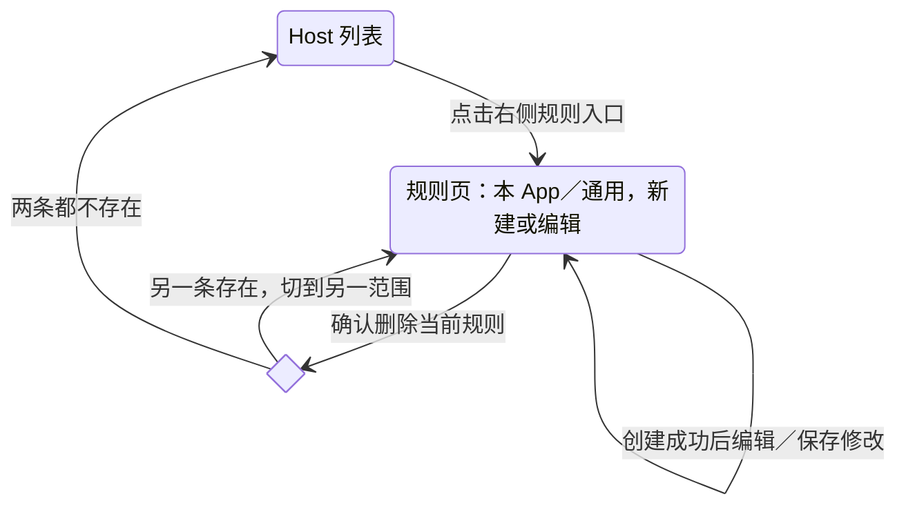

# NA-T01-07 Host 规则 Plan

用户已批准本方案；输入基线 e6bb845。先同步本 Plan、总 Plan、Tasks 和需求覆盖，再实现、验证及安装到现有 AVD。
本任务仅覆盖 07；按最新授权先完成本项验收提交，之后由独立 08 Plan 接续，不推进 09 或暂停的安全 Loop。已实现事实完成后写入 Design，实际证据写入 Result。

## 目标与模式

交付观察某 App 的 Host 后就地创建、修改、删除覆盖规则的闭环。规则主体复用现有 Rules 库，
增加必要的应用范围与逐订阅目标绑定元数据；不在 ApplicationRoutingLibraries 中再保存一份 Host 规则。
规则编辑表单和目标选择复用现有 overwrite UI，原 Proxies 页面及 Dashboard outbound mode 保持现状。

Rule 优先级：启用的本 App＋Host → App 整体默认策略 → 通用 Host 覆盖 → 原有规则及订阅。
Direct 仅采用启用的本 App＋Host 和 App 整体策略，未命中则 DIRECT；Global 忽略这些覆盖。
应用总开关控制其默认策略及 Host 例外；允许只配置 Host 例外而没有 App 默认动作。
通用 Host 不受某个 App 的开关控制。未知应用仍可使用通用规则，不借用其它 App 的身份。
共享 UID 的候选必须取得一致决策；修改前确认完整影响范围。

复用已有 06 接入，在 App 默认返回前检查 Host。域名／IP 匹配复用 mihomo 规则解析器和 Match；
通用 Host 沿本地受信任 override 采用边界参与 Rule，保留受管配置的原规则图。
不将整份旧 override 提前，不自动改变已有复杂规则的顺序，也不修改订阅文件或接受待审来源。
首版按精确域名、IPv4／IPv6 地址设置，不扩大成后缀；普通复杂规则仍由原编辑器与匹配链处理。

## UI 与状态

入口为 App 目标列表的 Host item 右侧，替换箭头；主体仍打开连接列表。
右侧仅显示当前已采用配置中新连接会使用的策略及必要的范围／暂停／异常状态，不同时列两个目标。
无 Host 规则时按 App 整体或模式路径显示；现有连接摘要继续保留实际历史。
用户后续收敛入口：App 和 Host 策略仅从对应 item 右侧进入，移除页面菜单、连接页与规则管理页的重复入口。
Host 入口固定 64 宽，常态使用纯文字；继承时显示“跟随应用／跟随规则”，Host 例外显示目标。
只在配置异常时显示警告图标；完整目标与状态保留 Tooltip。
Host 项只保留目标、活动统计与完整分组链，删除重复规则类型及包名；包名／UID 保留在搜索框下方。
旗帜和分组链使用同一最新活动连接，无活动时取最新历史；多路径标记其它路径数，原始连接事实不变。

全屏规则页顶部显示 Host、App 和当前采用状态，其下为“本 App／通用”范围切换。
同页新建与编辑共用表单：未创建时预填 Host 并提示创建；已有时编辑对应记录。
Host／应用条件由入口固定，用户选择 DIRECT、REJECT 或组／节点，目标支持搜索。
切换范围只切换记录，各自保留草稿，不复制或转换规则。保存只提交当前范围，成功后留在编辑态。
删除只影响当前范围：另一条存在则切换过去，两条均不存在则返回 Host 列表。
删除确认说明作用范围，因退出丢弃草稿时明确提示。返回按未保存修改提示处理。

失败留在原表单并保留输入，不为失败增加另一套页面状态。数据库保存与 Core 采用分别反馈：
已落盘但采用失败仍是已存在规则，允许重试，不重复创建；删除采用前不能假称旧规则已经停止。
App 开关关闭、VPN 断开或 Global 时允许预设，保存不隐式 Start、切模式或开启应用规则。
分组失效沿 06 提示及 fail-closed；自建组按稳定 ID，订阅目标不按同名猜测迁移。

## 实施与验证

1. Rules 元数据、迁移、备份与统一事务；Host 写入同步现有应用 override 修订版本。
2. 配置快照编译、原生精确 Host 索引与优先级；复用 UID、来源追踪和代次检查。
3. 提取可复用规则表单、Host 双范围编辑页、列表生效策略与管理入口，补齐四种语言。
4. 专项 Flutter／Go、竞态及持久化检查；必要的 Android 构建与受控系统验证；签名／安装绑定。
5. 更新 Design／Result／Tasks，审查并提交合入 security/android，按已有授权普通推送根仓库。

覆盖两条 Host 规则的四种存在组合、App 整体优先于通用、创建／编辑／删除与草稿切换；
两个 App 同一 Host 不同出口，Rule／Direct／Global、应用开关、纯 Host 设置、共享 UID 与未知身份；
离线保存、迟到采用、切订阅、目标失效、删除回退与进程重启。既有连接不重写、不强制重连。
规则在采用时编译，新连接只查内存；测匹配耗时与身份查询次数，空闲不新增唤醒或请求。
已有模拟器性能结果不作为真机电池结论；真机耗电属于 09 的整体验收边界。
设备 UI／VPN 验证遵守当前用户授权；保留订阅及原设置，使用现有 AVD，不导出 Downloads。

## VPN 配置采用提示收敛

移除仅由配置差异触发的通用 Restart 提示及其独立监听、缓存和文案。
保存 VPN 设置继续使用既有 Request／Setup／ServiceState 事务；同时比较生效的 VpnOptions，
让协议栈、系统代理端口／认证、绕过地址和路由范围等依赖变化进入完整应用流程。
Core 明确要求完整重新应用时跳过来源热采用；关闭状态只保存，不隐式 Start。
失败仍由既有配置状态和错误反馈表达，不把设置落盘等同于运行时已经采用。
同步当前 Design、Manager Stack 文档和 Result，验证自动采用、离线保存、失败和 Stop 抢占，
最后保留数据安装现有 AVD；不操作页面或主动启停 VPN。

## 验收与提交接续

按用户最新授权在现有 emulator-5554 验证：备份开发版私有数据，临时开启仅访问本机服务的 VPN，
运行两个受控客户端覆盖 Host／App／通用优先级、Rule／Direct／Global、删除回退及 TCP／UDP。
结束恢复原数据及 AppOps、删除本次客户端并核对恢复摘要，VPN 断开；页面检查与真实路由证据分别记录。
复用有效源码／包绑定和已有自动检查，对实际变更重验；结构自查后提交并集成 security/android，
核对 Core carrier 后按已有授权普通推送根仓库。07 冻结文档独立清理后再开始 08 生产实现。
