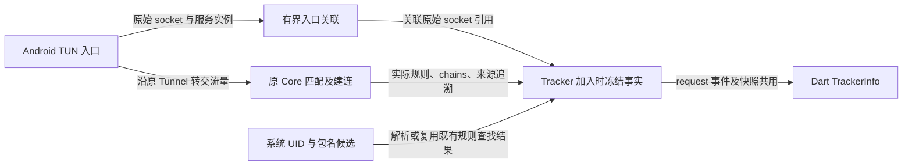

# 应用网络 Design

本文记录已实现的 Android 连接观测基础。应用／Host 汇总、三层页面及就地分流尚未实现，
需求和交付顺序分别见 [Overview](network_activity_overview.md)与 [Plan](network_activity_plan.md)。

## 职责与数据路径

`VpnService` 提供系统 socket UID 查询及当前用户内的包名候选解析；Core 保留实际匹配规则、
出口链和来源追溯，在既有 request 事件与 getConnections 快照上附加版本化 observation。
Dart 的 `TrackerInfo.observation` 使用不可变模型消费这些事实，不新增数据库或事件文件。

入口包装器转发原 Core 的 Tunnel、provider、proxy dialer 和 AppTunnel 能力，不成为第二套路由或服务所有者。
TCP 使用原 metadata 实例关联；UDP 的 metadata 会在 Core 中克隆，关联同时核对克隆保留的原始
UDP 地址对象引用，不能仅凭地址／端口相同就借用另一条 socket 的身份。

## 应用身份

Android 29 及以上使用 `ConnectivityManager.getConnectionOwnerUid`；低版本沿既有 procfs 路径，
对多个 UID、读取失败和不确定结果保守返回未知。后者的表解析有自动化测试，尚无旧版 Android 系统验收。

JNI 保留 resolve_uid、resolve_package 两步。后一个回调返回含 status、userScope、packages 的 JSON，
`UidPackageResolver` 去重、排序并限制最多 64 个候选，不再长期缓存 UID→首个包名。
JSON 使用显式字段构造，避免发行版混淆改变反射字段名。
Go 使用实际查询得到的 UID，不能从回调 JSON 或默认值推断 UID；旧纯包名字符串不作为降级成功。
Native 模块与 Go 库须一起构建交付。

| application 字段／状态 | 含义 |
| --- | --- |
| uid | 系统取得的完整 Android UID；缺失与数值 0 有别，不把 0 默认当成已识别应用 |
| userScope | current、other 或 unknown；不同用户的 UID 不套用当前用户的包名目录 |
| known | 当前用户内存在唯一包名；仅此状态可提供确定的 packageName |
| ambiguous | 同一个 UID 有多个包名候选；保留候选，不选第一个，也不声称能区分共享 UID 内的应用 |
| notFound／otherUser／lookupFailed | UID 已取得，但包名不存在、不属于当前用户或查找失败 |
| unknown／unsupported | 系统未给出 UID，或没有适用的 socket 信息／协议 |
| serviceUnavailable／serviceChanged | 查询所属的 VPN 回调已释放或服务代次改变 |
| notObserved | 没有保留下可关联的入口事实；也用于观测保留上限以外的快照 |
| method | 成功 UID 的查询来源为 androidUid 或 procfs；没有可用结果时可为 unavailable |

没有 App 规则、find-process-mode 为 off 时，TUN 连接加入统计器仍会尝试识别应用。
若既有进程规则查找已解析同一 socket，观测复用其结果。查询持有原 TunHandler 的读锁并核对服务代次，
关闭回调须取得写锁，避免查询释放后的 JNI 对象。

观测只在对外 metadata 副本中补充 uid／process，不改变已经用于匹配的 Core metadata。
因此显示出应用归属不代表 App 规则已执行；后续 App 默认分流任务仍须通过正常配置接受流程落实规则所需的进程查找。
原 Requests、连接详情及桌面协议保留；旧数据没有 observation 时，不据 legacy uid=0 或 process 字段
构造新的确定身份。

包名候选每次新连接查询，不沿用卸载／重装前的 UID 缓存。已冻结的旧连接保留当时观察，
不因应用更新、UID 变化或当前目录改变而重标。系统代发、已结束且无法查询的 socket 等仍可能未知。

## 连接事实与版本

observation.version 当前为 1；runtimeEpoch 标识 Native Core 进程实例。它与前端 Request 的
processEpoch 是不同字段，不随单次切换订阅或 VPN 重建而充当新进程标识。

| 数据位置 | 事实与限制 |
| --- | --- |
| TrackerInfo.id／start／metadata | 原连接 ID、开始时间、Host／IP、协议和端口；不猜测 Host，不采集 HTTPS 路径或正文 |
| TrackerInfo.rule／rulePayload／chains | 原匹配器和实际建连返回的规则、payload、逻辑出口链；不是当前分组选择或外部出口 IP 测量 |
| observation.application | 本次 socket 查询结果及其识别状态 |
| observation.capture | vpn 表示有进入 TUN 的证据，并保留 serviceId／generation；unknown 不等于未接管 |
| observation.configuration | 已证明的 ConfigInput inputId、模式及可选路由版本；status=known 证明 inputId，不能据此假定每个可选字段都存在 |
| TrackerInfo.provenance | 原来源追溯；版本已知与规则来源已知是不同结论 |

配置和路由戳在入口与 Tracker 加入时核对。读取配置使用非阻塞锁：遇到 Core 占用配置边界或
前后不一致时不阻塞业务连接，缺失版本保留 unknown。实际 matcher 的来源追溯可以证明匹配时的
inputId；非空的实际规则还能证明 Rule 模式。Global／Direct 绕过规则匹配，不伪造一条命中规则。
路由版本是已有观察器的版本戳；实际出口仍以该连接自己的 chains 为准。

request 在 Tracker 加入时冻结 observation 和 metadata；快照只读取冻结记录，不重新查询 UID、
当前配置或当前分组。切换后不能把旧 unknown 回填成当前版本，也不能重写旧连接出口。

## 容量、生命周期与覆盖

入口关联最多 2048 条，过期窗口一分钟；满额清理最多每秒执行一次。
冻结记录按加入顺序最多 4096 条，超过上限淘汰；之后的快照明确缺少 observation，不能重建历史。
这些是 01 的事实关联缓存，不是 02 的 App／Host 汇总。全部在内存中，不落盘，不跨进程恢复。

观测在 Native Tracker 回调中运行，不依附某个页面。事件仍受既有监听器状态与 bulk 队列约束，
监听器断开期间不会补发已结束的连接，有限缓冲也不代表完整历史。
现有 Tracker 通常在成功创建出站后加入；此前被拒绝或建连失败的尝试不因此成为完整连接记录。
UDP 记录遵循 Core 的 association 口径，不能把它等同于逐包归属审计或 HTTP 请求次数。
未进入 TUN 的流量无法据此完整观察；没有记录不证明应用没有联网。

实际矩阵、性能与未覆盖边界见 [01 Result](na_t01_01_result.md)，复现工具见
[Android 验证说明](../../../android/tests/device/network_activity/README.md)。
