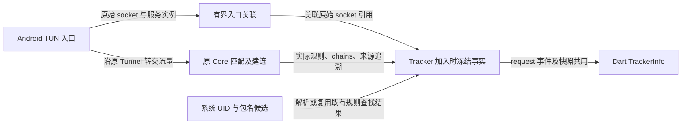

# 应用网络 Design

本文记录已实现的 Android 连接观测、运行期汇总、应用活动和某 App 的目标列表只读页。已交付逐连接目标详情，就地分流尚未实现，
需求和交付顺序分别见 [Overview](network_activity_overview.md)与 [Plan](network_activity_plan.md)。

## 职责与数据路径

`VpnService` 提供系统 socket UID 查询及当前用户内的包名候选解析；TUN 与同机 HTTP／HTTPS 代理连接共用识别，
Core 保留实际匹配规则、
出口链和来源追溯，在既有 request 事件与 getConnections 快照上附加版本化 observation。
Dart 的 `TrackerInfo.observation` 使用不可变模型消费这些事实，不新增数据库或事件文件。

入口包装器转发原 Core 的 Tunnel、provider、proxy dialer 和 AppTunnel 能力，不成为第二套路由或服务所有者。
TCP 使用原 metadata 实例关联；UDP 的 metadata 会在 Core 中克隆，关联同时核对克隆保留的原始
UDP 地址对象引用，不能仅凭地址／端口相同就借用另一条 socket 的身份。

## 应用身份

Android 29 及以上使用 `ConnectivityManager.getConnectionOwnerUid`；低版本沿既有 procfs 路径，
对多个 UID、读取失败和不确定结果保守返回未知。后者的表解析有自动化测试，尚无旧版 Android 系统验收。

JNI 保留 resolve_uid、resolve_package 两步。后一个回调返回含 status、userScope、packages 的 JSON，
`UidPackageResolver` 去重、排序并限制最多 64 个候选，不再长期缓存 UID→首个包名。
JSON 使用显式字段构造，避免发行版混淆改变反射字段名。
Go 使用实际查询得到的 UID，不能从回调 JSON 或默认值推断 UID；旧纯包名字符串不作为降级成功。
Native 模块与 Go 库须一起构建交付。

| application 字段／状态 | 含义 |
| --- | --- |
| uid | 系统取得的完整 Android UID；缺失与数值 0 有别，不把 0 默认当成已识别应用 |
| userScope | current、other 或 unknown；不同用户的 UID 不套用当前用户的包名目录 |
| known | 当前用户内存在唯一包名；仅此状态可提供确定的 packageName |
| ambiguous | 同一个 UID 有多个包名候选；保留候选，不选第一个，也不声称能区分共享 UID 内的应用 |
| notFound／otherUser／lookupFailed | UID 已取得，但包名不存在、不属于当前用户或查找失败 |
| unknown／unsupported | 系统未给出 UID，或没有适用的 socket 信息／协议 |
| serviceUnavailable／serviceChanged | 查询所属的 VPN 回调已释放或服务代次改变 |
| notObserved | 没有保留下可关联的入口事实；也用于观测保留上限以外的快照 |
| method | 成功 UID 的查询来源为 androidUid 或 procfs；没有可用结果时可为 unavailable |

VPN HTTP proxy 使部分应用直接连接本机代理，绕过 TUN 入口。这类 HTTP／HTTPS TCP 连接在入站请求交给
业务 Tunnel 时、DNS／出口建连之前，使用客户端与本机监听器的原始 socket 地址查询归属并保留结果。
不能等到 Tracker 加入才首次查询：出口建立期间客户端可能已关闭，系统届时可能只返回未知或 UID 0。
两端必须均为回环地址，不能把 LAN 远端客户端归到本机 App。
查询仍核对原 VPN 服务及保护代次，只做一次，不在快照读取时回填。接管证据记为 localProxy，不伪装成 TUN 捕获。
业务 Tunnel 的 TrackInbound 和 scope 失效处理沿原 owner 转发；观测不取得新的业务执行权限。
这条路径没有 TUN 入口时的配置戳；配置归属只采用原匹配器能够证明的事实，不套用当前配置。

没有 App 规则、find-process-mode 为 off 时，TUN 连接加入统计器仍会尝试识别应用。
若既有进程规则查找已解析同一 socket，观测复用其结果。查询持有原 TunHandler 的读锁并核对服务代次，
关闭回调须取得写锁，避免查询释放后的 JNI 对象。

观测只在对外 metadata 副本中补充 uid／process，不改变已经用于匹配的 Core metadata。
因此显示出应用归属不代表 App 规则已执行；后续 App 默认分流任务仍须通过正常配置接受流程落实规则所需的进程查找。
原 Requests、连接详情及桌面协议保留；旧数据没有 observation 时，不据 legacy uid=0 或 process 字段
构造新的确定身份。

包名候选每次新连接查询，不沿用卸载／重装前的 UID 缓存。已冻结的旧连接保留当时观察，
不因应用更新、UID 变化或当前目录改变而重标。系统代发、已结束且无法查询的 socket 等仍可能未知。

## 连接事实与版本

observation.version 当前为 1；runtimeEpoch 标识 Native Core 进程实例。它与前端 Request 的
processEpoch 是不同字段，不随单次切换订阅或 VPN 重建而充当新进程标识。

| 数据位置 | 事实与限制 |
| --- | --- |
| TrackerInfo.id／start／metadata | 原连接 ID、开始时间、Host／IP、协议和端口；不猜测 Host，不采集 HTTPS 路径或正文 |
| TrackerInfo.rule／rulePayload／chains | 原匹配器和实际建连返回的规则、payload、逻辑出口链；不是当前分组选择或外部出口 IP 测量 |
| observation.application | 本次 socket 查询结果及其识别状态 |
| observation.capture | vpn 表示进入 TUN；localProxy 表示同机代理 socket；均保留 serviceId／generation，unknown 不等于未接管 |
| observation.configuration | 已证明的 ConfigInput inputId、模式及可选路由版本；status=known 证明 inputId，不能据此假定每个可选字段都存在 |
| TrackerInfo.provenance | 原来源追溯；版本已知与规则来源已知是不同结论 |

配置和路由戳在入口与 Tracker 加入时核对。读取配置使用非阻塞锁：遇到 Core 占用配置边界或
前后不一致时不阻塞业务连接，缺失版本保留 unknown。实际 matcher 的来源追溯可以证明匹配时的
inputId；非空的实际规则还能证明 Rule 模式。Global／Direct 绕过规则匹配，不伪造一条命中规则。
路由版本是已有观察器的版本戳；实际出口仍以该连接自己的 chains 为准。

request 在 Tracker 加入时冻结 observation 和 metadata；快照只读取冻结记录，不重新查询 UID、
当前配置或当前分组。切换后不能把旧 unknown 回填成当前版本，也不能重写旧连接出口。

## 容量、生命周期与覆盖

入口关联最多 2048 条，过期窗口一分钟；满额清理最多每秒执行一次。
冻结记录按加入顺序最多 4096 条，超过上限淘汰；之后的快照明确缺少 observation，不能重建历史。
这些是 01 的事实关联缓存，不是 02 的 App／Host 汇总。全部在内存中，不落盘，不跨进程恢复。

观测在 Native Tracker 回调中运行，不依附某个页面。事件仍受既有监听器状态与 bulk 队列约束，
监听器断开期间不会补发已结束的连接，有限缓冲也不代表完整历史。
现有 Tracker 通常在成功创建出站后加入；此前被拒绝或建连失败的尝试不因此成为完整连接记录。
UDP 记录遵循 Core 的 association 口径，不能把它等同于逐包归属审计或 HTTP 请求次数。
未进入 TUN 的流量无法据此完整观察；没有记录不证明应用没有联网。

采集矩阵、性能与未覆盖边界见 [01 Result](na_t01_01_result.md)，复现工具见
[Android 验证说明](../../../android/tests/device/network_activity/README.md)。

## 运行期汇总与观察生命周期

`ApplicationActivityStore` 是纯内存的事实集合，`ApplicationActivityState` 提供 App、App＋Host、
Host 跨 App 的三个查询范围。它们共用最多 4096 条连接，按首次保留顺序淘汰最早记录，
超限显式标记 truncated；“近期次数”是当前保留的连接数，不是运行以来的累计总数或 HTTP 请求次数。
没有额外的事件文件、数据库或跨进程恢复。Host 统一大小写及尾点，无 Host 时保留原 IP，不猜域名。

确定身份按当前用户内的 package name 汇总；共享 UID、识别失败和未知身份按其原始身份事实分别汇总，
不把一条共享连接重复加给每个候选应用，也不从 legacy process／uid 推导确定身份。
连接 ID 在已确认的 Native runtimeEpoch 内去重。首份身份、metadata、规则、chains、来源及配置保持不变，
后续成功快照只更新已观察的流量计数和存活状态；计数增长时更新最近活动时间。

`applicationActivityProvider` 在原 Core request 通道接收事件，事件最多每 200 ms 合并一次发布。
Android 的 CoreManager 在应用根部持续订阅它，使观察不依附页面，也避免无消费者时 provider 的依赖监听暂停。
观察器先等待 initProvider 确认 bootstrap 完成，再订阅 Native／配置状态和原 request 分发器，
避免根部订阅提前读取启动依赖。开始观察时补读现有 Requests 的最多 2000 条内存记录，
仍按实例及连接 ID 校验、去重，不保证补齐更早的启动事件。
前台约每两秒串行读取完整连接快照，单次五秒超时；没有单独的 Core 事件订阅、服务控制或路由所有者。
Core getConnections 的缺失列表、非列表或任一不完整条目均为读取失败，不能转成空快照。

事件证明连接曾加入，不证明此刻仍活跃。完整成功快照确认在场连接为活跃，并将不在场的旧记录标为结束；
请求开始后才收到的新事件不被该快照判为结束，须等待之后校对。读取失败保留历史并将活跃状态标为待确认。
查询的已确认活跃数与是否存在待确认记录分别计算，不把未知显示为零。

运行上下文沿用 configStateProvider 的 Native 实例及现有 Android 服务状态，只有 VPN 的业务／保护状态可用才主动观察。
实例、服务或保护代次、运行状态、可见性改变会使旧异步快照失效；事件不能自行切换当前实例。
其它实例的迟到事件拒绝，缺少实例信息的事件不猜测归属；完整且上下文有效的快照允许保留身份未知的连接。
停止或暂停观察保留已有记录，活跃状态待确认；已确认的新 Native 实例清空旧集合，Flutter 进程退出同样丢弃内存。
内部 clear 同时记录清空时刻，清空前开始且仍存活的连接不作为新活动重新累计；它不修改任何规则。

后台暂停主动轮询，原通道实际送达的事件仍可加入；返回前台立即校对，并标记可能的观察缺口。
服务切换造成的观察间隔、无实例信息及超限也会限制覆盖。短连接不依赖页面轮询捕获，
但这不增加 01 未提供的后台补发、丢包检测或完整历史保证。

## 应用活动只读页

Android 的 Tools 顶部提供“应用网络”入口。ApplicationActivityView 只读取汇总，
默认显示近期活动，已确认有活跃连接的应用优先，其余保持最近活动排序；断开时仍能查看保留结果。
标题下常驻搜索框，按应用名／包名及已有 UID 信息过滤，清空恢复列表；自动更新和菜单切换不丢失输入。
右上菜单提供带勾选状态的“显示全部应用”，补充没有活动记录的已安装应用，追加在近期应用之后。
页面不启动代理、下载订阅或接受来源；条目保持摘要样式，点击进入该身份的目标列表，包括没有活动的安装应用。

每个 App 显示名称／图标、连接数与最近活动的合并摘要、出口概况；收紧内边距，图标为 48 逻辑像素。
连接摘要使用“活跃数／近期总数 · 最近时间”，只有大于零的已确认活跃数字使用强调色及稍粗字重；
零与无法确认的 — 使用次要文字样式，不增设状态标签。读屏保留完整连接数及最后活动时间说明。
普通字号下合并为一行，窄屏／大字号可自然换行；占位图标仍为单个应用窗口轮廓。
身份及规则／出口汇总可在应用目标页查看，接管设置与更详细的连接排查仍由后续任务提供；
观察缺口保留在内部事实中，不再显示常驻告警。
多规则／多出口独立保留，规则模式外有证据时标为未使用规则，缺失事实保持未知。
列表按应用身份定位子项，更新后计数与摘要不能串到其它应用。
摘要显示首种出口及其它出口数量；完整目标排查由后续页面提供。
不展示常驻运行状态、容量说明、说明按钮、筛选 chips 或手动刷新按钮；继续使用既有自动更新。
实际快照读取失败或应用目录不可用时，在页面内提供对应的重试入口；未知活跃状态不显示为零。

全部应用复用 packagesProvider、SystemAction 与原安装应用 API；目录只在页面需要时加载，
加载／权限不足／失败不遮住已取得的网络活动，可以单独重试。空目录的更新不重复触发自身读取。
包目录更新仍沿 AndroidManager 的原通知链，不建立第二份安装应用缓存或自动请求权限。
接管设置与历史连接证据仍保持独立，后续详情页不能把当前设置显示为历史连接已采用的状态。
页面没有接管开关、分流编辑、清空或假保存按钮；这些操作仍按 Tasks 的功能边界推进。

## 某 App 的目标列表只读页

`ApplicationTargetsView` 通过稳定的 `appKey` 调用现有 `hostsForApp`，持续消费同一份运行期汇总。
导航同时带入身份事实和显示信息，不复制连接集合，也不建立另一份观察器、轮询或订阅下载任务。
使用原 `BaseNavigator` 路由及其键盘 inset 处理；返回保留第一层搜索、全部应用选项和滚动位置。

标题显示应用名称和图标，普通应用补充包名及已取得的 UID。包名和 UID 可分别点击复制，UID 只复制数值。
共享身份单列 UID 和候选应用，默认展开；候选条目可点击复制原包名，UID 可单独复制，
候选包名来自原连接身份，当前安装目录只补充名称；未知身份不从目录猜测归属。目录缺失时仍显示原包名及目标。
候选共享同一份活动，不把一次连接分别加到每个候选名下，也不提供单个候选的分流编辑。

标题下常驻域名／IP 搜索。目标以已确认活跃优先，其余保持最近活动顺序；右上菜单可仅显示活跃目标。
新事件尚未校对、停止观察或快照失败时，活跃值不能解释为零；启用中的活跃筛选暂时回退到保留列表并说明原因。
快照真实失败保留内容及原观察器的重试入口；页面不显示常驻覆盖告警、容量说明或刷新按钮。

每个 Host 项显示目标、合并的连接数／最近时间及规则／出口概况；没有域名时显示原 IPv4／IPv6，
目标也缺失时单列未知。点击统一进入 ApplicationConnectionsView，不再展开目标汇总。
左侧复用逐连接列表的出口图标，优先取当前 App／Host 中开始时间最新的已确认活动连接；
没有已确认活动连接时取最新保留记录，但不自动检测。同时间按连接 ID 升序，不以插入或流量更新时间替代。
图标只表示这个节点的出口检测，规则／出口摘要仍覆盖该 Host 保留的全部连接；检测语义见下文。
规则与出口路径均唯一时展示实际内容，否则展示各自去重数量；长路径自然换行，因此物理行数可以不同。
只有冻结配置明确为已知 Global／Direct 且规则为空时说明规则未参与匹配；其它缺失事实显示未知，
不读取当前模式回填旧结果。两层连接摘要共用 ActivityConnectionSummary。

## 目标的逐连接详情

ApplicationConnectionsView 默认通过 appKey＋hostKey 过滤同一份保留记录。不同连接 ID 不合并，
同一 ID 后续快照更新流量和存活；按连接开始时间倒序，稳定键包含 Native 实例及连接 ID。
页面无搜索、汇总统计卡片或手动刷新。标题显示目标，下面显示 App 范围及已观察的目标 IP／端口，
附原记录具备的 TCP／UDP、地区／ASN。地址去重、可复制，超过三项可展开，不发起 DNS 或 IP 查询来补目标资料。

连接条目直接显示本地连接开始时间、最后观测上传／下载、实际 chains 的入口到出口顺序和原命中规则。
首行参考 Recent requests 的 RecordHeader／RecordTimestamp 布局，不重复 Host、应用与源地址等已有上下文。
时间与流量共用 activityActiveStyle：已确认活跃使用强调色和稍粗字重，结束和待确认用次要样式；
tooltip 和读屏保留准确状态，不另设常驻状态标签。停止／快照失败不被解释为已结束或零活动。
点击连接复用 Recent requests 的 TrackerInfoDetailView 及相同导航方式，不再内联展开或维护第二套连接详情。
传入原连接事实及最后观测的流量计数；不从当前配置重新推断旧连接身份、命中规则或出口。
不把连接结束当成 HTTP 成功，不提供 URL、响应码、请求耗时、精确结束时间或未取得的最终流量。
跨 App 菜单扩大查看范围时仍按连接分别展示并标出原应用身份，不修改规则；返回保留前层搜索和滚动位置。

### 代理出口检测与国家／地区旗帜

旗帜表示指定节点的一次实际出口检测结果，不再用代理入口 GeoIP、本机公网检测缓存或节点名称标记代替。保留 HK、MO、TW 等地区码的独立旗帜。图标提示给出测得的公网 IP、国家／地区和检测时间；目标网站、IP 版本或服务商调度可能产生不同出口，不能据此断言某条历史连接的网站所见来源。

二级目标列表与三级连接列表共用 ConnectionExitIcon。目标行选择最新的已确认活动连接；没有活动连接时保留原有最近记录供查看，但不自动检测。直连、内建出口、配置不匹配等无法检测的条目显示明确的不可用图标。没有活动连接或状态未确认时使用同类图标说明无需自动检测；节点仍有效且代理就绪时，可以点击手动检测。成功后显示本次结果。点击旗帜强制重新检测，短时间连续点击合并并提示等待。

仅当前页面实际可见的图标触发自动检测，不扫描全部应用、全部 Host 或列表预加载行。使用 [visibility_detector](https://pub.dev/packages/visibility_detector) 读取视口可见性，配合路由当前状态、前后台状态和 350 ms 稳定时间，防止快速滚动或被其它页面覆盖时发起请求。应用列表保留原应用图标，不为未展示出口的条目预热检测。

ConnectionExits 是跨应用、跨这两个页面的内存缓存与队列所有者。缓存键含具体节点身份、已观察入口地址及已接受配置标识；同一入口 IP 下的不同节点不能混用出口。有效结果缓存 10 分钟，失败退避 1 分钟；最多保留 256 个结果，按插入顺序淘汰无观察者的旧记录。全局串行执行，两次开始至少间隔 1 秒；同一节点重复检测至少间隔 5 秒。无可见观察者、进入后台、配置／网络／Core 变化时取消相应排队或在途工作。有效旧缓存不会因为刷新被取消而丢失，迟到响应不能覆盖新环境结果。

检测复用 withIpSession、lookupOutboundIp 和 Core 现有固定 Cloudflare trace 接收方，通过连接所属的具体叶子节点发起，保留请求凭据和路由验证，不走“自动选择”等父组，不修改节点选择，不启动代理或接受来源。响应必须包含匹配的实际节点链及 Core／网络戳。连接不属于当前已接受配置或节点已不可用时不探测。后台仪表盘的路由检测保持原策略，连接出口缓存不替代其路由状态所有权。

common/connection_address.dart 只负责从冻结的 remoteDestination 提取合法公开入口 IP，供缓存区分；排除内建出口、目标同址、私网、域名或缺失值。该入口不被当成代理出口。原按页本地 GeoIP 旗帜 provider 已退出这两层 UI；Core 的离线 IP 国家查询接口保留独立能力，未修改 mihomo gitlink。

### 出口检测修订验证（2026-11-13）

- 最终专项 70 项通过，覆盖共享缓存、失效、队列、取消、强制刷新、防抖、前后台、路由覆盖、已结束连接和引用入口。截图辅助调整后，相关页面的 23 项重新通过。
- 完整组件、lint 及相关回归 714 项通过、5 项既有失败：更新说明夹具 3 项、macOS Rust LINKEDIT 加载 1 项、test/bootstrap_test.dart 的既有设计库导入检查 1 项。未将这些失败计为通过。
- 静态检查无错误或警告，保留 42 条既有 info；Go 测试与 vet、生成、格式、空白检查和核心源码 carrier 校验通过。结构检查覆盖缓存与队列所有权、UI 可见性及取消路径、旧 provider 退出和分组入口生命周期，没有需先调整的结构问题。
- Debug ARM64 0.8.99（2026100304）已保留数据覆盖安装到现有 emulator-5554。签名、打包 Core／Dart 内核和安装后 APK 哈希均核对通过；SHA256 为 f990ab90ff29543ea848c665645990aaf850e72507f18e55a96b68116bfba348。
- 用户授权临时启动后，用 Chrome 的少量请求完成真实检测：二级目标与三级连接页显示香港旗帜，提示包含实测出口 IP、HK 及检测时间；仅点击一次重新检测，观察到检测时间更新。已结束连接显示不自动检测图标。没有切换节点、接受来源或修改订阅／规则，结束后恢复断开并移除本轮 ADB 转发。
- 实机验证仍见少量 Unknown app，作为独立的应用身份问题保留，不把本次出口检测结果当作身份修复验收。
