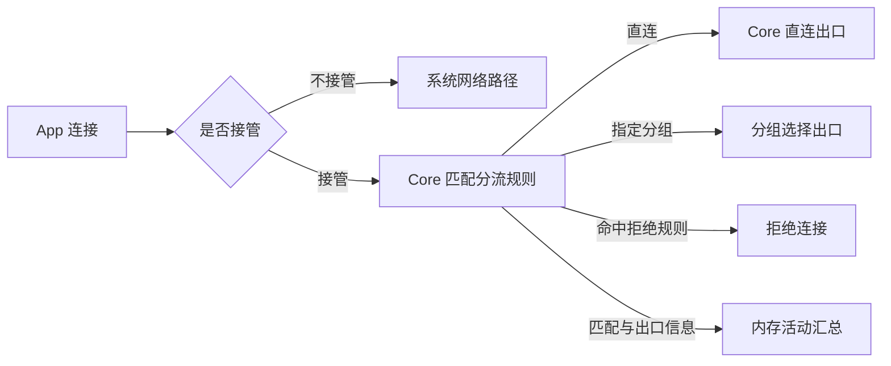

# 应用网络 Overview

本功能面向 Android VPN 使用场景，以“观察 → 定位 → 修改 → 验证”为操作主线，
把应用是否由 FlClash 接管、接管后的分流，以及实际网络活动放进同一套 UI。
用户从活动中的 App 或 Target Host 发现问题，就地调整对应范围的策略，再观察新连接的结果。

本文维护需求、UI 关系和核心功能边界，供具体页面实现时细化。已实现内存汇总与第一层应用活动只读页；
目标列表／详情页与快捷规则操作尚未实现。
现有能力见[实现基础](#实现基础)，功能依赖与顺序见[Plan](network_activity_plan.md)，实现分解见[Tasks](network_activity_tasks.md)。
已实现的连接观测、汇总、第一层页面及覆盖边界见 [Design](network_activity_design.md)，不代表完整三层 UI 已交付。

## 入口与三层 UI

功能与主页面统一命名为“应用网络”：Tools 提供完整入口，Dashboard 的应用活动卡片提供快捷入口。
点击卡片中的 App 可直接进入第二层；现有连接详情也可按 App、Host 跳入对应层级。
入口的具体位置、名称及控件布局在页面实现时确定，不以新增底部 Tab 为前提。
页面按项交付：任务 02 包含 Tools 入口和应用活动只读页；任务 03、04 分别完成某 App 的目标列表、
目标活动详情。接管及分流编辑在后续任务加入，逐页细化不影响三层 UI 的完整需求。

| 页面 | 关注对象与主要信息 | 核心操作 |
| --- | --- | --- |
| 应用活动 | 当前或近期活动过的 App；接管状态、默认策略、活跃连接数、最近活动及出口概况 | 修改接管范围或 App 默认策略；搜索、筛选；进入某个 App |
| 某 App 的 Target Host 列表 | 按 Host 汇总该 App 的连接；活跃状态、连接次数、最近活动、命中规则及实际出口概况 | 修改 App 默认策略；为所选 Host 设置该 App 的例外；进入 Host 详情 |
| 某 Target Host 的活动详情 | 默认限定“当前 App → 当前 Host”；展示当前策略、当时命中的规则、实际出口和近期连接变化 | 修改该 App 对此 Host 的规则；查看规则来源与采用状态；观察修改后的新连接 |

列表以 App、Host 聚合，不以日志式时间流水为主。同一 Host 的多次连接主要表现为一个条目及统计，
具体连接只作为可展开的排查信息。一个 App 或 Host 可以命中多条规则、经过多个出口，不能压成一个“当前规则”。
默认策略与实际连接结果分别展示。

应用活动页提供“全部应用”的筛选或入口，使未活动、尚未接管的已安装 App 也能被配置，
不把已观察到流量当作操作前提。未接管的 App 标明“活动不可观察”，保留的旧汇总标为此前观察结果。
第三层支持切换“查看所有 App 对此 Host 的活动”，明确标出查看范围；跨 App 修改规则是单独的显式操作。

## 是否接管与接管后的分流

接管范围复用现有 Access control，接管后的分流扩展既有规则体系。两个控制独立呈现，
新旧页面对同一控制共享设置，不另建白名单／黑名单或相互冲突的开关。

| 控制 | 用户设置 | 含义 |
| --- | --- | --- |
| 是否接管 | 全部应用、仅选中应用、排除选中应用；支持从 App 就地修改 | 决定哪些应用流量进入 FlClash VPN，沿用现有 Access control |
| 接管后的分流 | 跟随现有分流、直连、使用指定分组 | 决定进入 Core 的连接采用什么出口；指定分组可以是当前有效订阅中的订阅组或自建组 |

“不接管”不是阻止联网，也不等同于 Core 的 DIRECT。前者的活动无法由本功能完整观察；
后者仍经过 Core，可以记录命中规则与出口。系统限制下的实际接管范围沿用
[Android 服务与接管契约](../security/android_service_design.md#接管范围与失败边界)，不承诺排除应用一定能够直连。

同一个 App 在旧 Access control 与新页面中的接管结果保持一致。未接管时可以预设分流策略，
但标为尚不适用；修改分流不暗中开启接管，修改接管也不丢弃已有分流设置。
运行中改变接管范围可能重建 VPN，应说明短暂中断并显示实际采用状态，沿用统一服务流程，
不要求用户先手动 Stop／Start。断开时可编辑设置，不因保存而自动启动代理。

## App 与 Host 的规则范围

应用策略按 Android package name 保存，不以临时进程名或数值 UID 作为持久身份。
Host 规则可组合应用条件：App A 访问同一 Host 使用分组 A，App B 使用分组 B，两者可以同时存在。
从 App 内创建 Host 规则时，默认作用于“仅此 App ＋ 此 Host”；“整个 App”或“所有 App 对此 Host”
必须明确展示作用范围，不能因查看层级变化而扩大修改范围。

规则模式下的概要顺序为“本 App ＋ Host 的例外 → App 默认策略 → 原有分流规则”；
App 选择“跟随现有分流”时继续使用原有规则。该顺序让局部修正可覆盖 App 默认策略，同时保留其它流量的原路径。
用户无需填写 package name、UID 或组合规则语法。

规则设置持久保存，活动汇总按运行期管理。分组被删除、禁用或随订阅切换而不可用时，
应标明目标失效，不静默改成直连或将同名组当作原目标。保存成功与配置采用成功分别反馈；
未采用或失败时保留明确状态和重试入口，不让页面继续声称新策略已生效。
新连接按已采用策略处理，已有连接不伪装成已经改道；是否需要重连及相关操作在页面实现时细化。

## 活动与近期汇总

“历史”指运行期内此前发生、现在可能已经结束的活动汇总，本需求不要求连接事件落盘或跨重启保留。
汇总采用有界内存，页面关闭后不应仅因离开页面就停止观察；进程重启或清空后可以重新累计。
容量、统计窗口及清空范围留到实现时确定，页面需说明当前观察范围，不能把有限缓冲显示为全部历史。
清空统计不删除用户规则。

汇总保留当时命中的规则、来源及实际出口，规则修改后不以当前策略反算旧记录。
连接数、连接次数与 HTTP 请求次数应区分；多条 HTTP 请求可能共用一个连接。
只汇总 FlClash 实际观察到的数据，未接管、尚未取得数据和确认为零分别表示。

Target Host 以可识别的域名为主，无域名时展示 IP，不能猜测补齐域名。
完整 HTTPS URL 路径、查询参数、解密及正文采集不在范围内。
身份无法可靠识别时显示“未知应用”，共享 UID、工作资料或系统代发连接不能强行归到某个 App。

## 实现基础

以下为现有源码能力，不代表本概要的新增体验已经交付。

| 能力 | 当前覆盖及新增需求 |
| --- | --- |
| 应用接管范围 | [Access control](../../../lib/views/access.dart)已有范围设置；需接入三层 UI，保持同一设置来源 |
| 网络活动数据 | [Live connections](../../../lib/views/connection/connections.dart)读取当前连接；[Requests](../../../lib/providers/app.dart)有近期内存缓冲；另有统一的有界汇总和 [应用活动只读页](../../../lib/views/application_activity.dart)，目标列表／详情尚未交付 |
| 应用与目标匹配 | Core 已有应用识别及组合规则基础；需补应用策略、Host 例外的持久配置、采用反馈与就地编辑 |
| 分组目标 | 沿用[订阅组与自建组](../proxies/local_groups_design.md)的可用范围与失效处理，不引入跨订阅节点池 |

## 实现前及页面阶段细化

- 规则跨订阅的归属与迁移、全局／直连模式对应用规则的影响，以及与既有手工规则的冲突提示。
- 各 Android 版本的应用识别覆盖，工作资料、共享 UID、重装及未知身份的处理。
- 汇总键、内存上限和重置时机，规则版本与出口事实的关联，以及可观察的失败信息。
- 页面布局、排序筛选、批量操作及规则编辑反馈；接管范围变更的 VPN 过渡体验。

后续实现沿用既有服务、配置接受及来源权限边界；本概要不新增后台启动、自动接受来源或历史数据外传能力。
