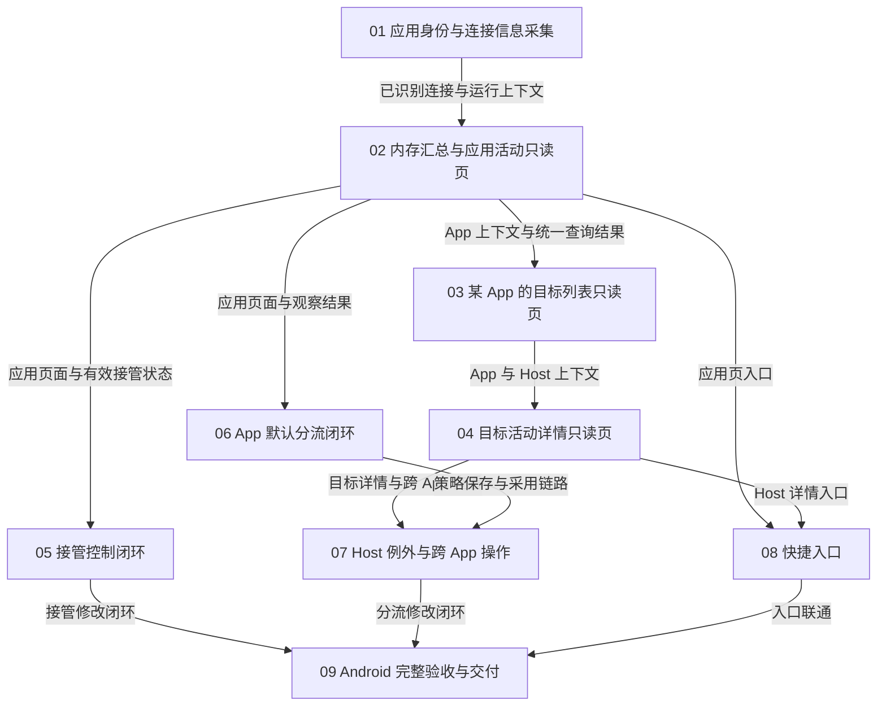

# 应用网络 Plan

需求入口：NA-T01，[Overview](network_activity_overview.md)维护业务范围与三层 UI。
本 Plan 给出功能依赖、建议实现顺序及验证出口，[Tasks](network_activity_tasks.md)管理具体任务和状态。
具体状态及验证入口由 Tasks 维护；02 提供可体验的应用活动入口，后续每个页面独立成项并在开工时细化。
规划输入为 c8a883e，01 的实施基线为 048e99b。

## 目标与实施边界

交付完整的“观察 → 定位 → 修改 → 验证”闭环：用户按 App 查看活动，进入该 App 的 Host 汇总及目标详情，
就地修改接管范围、App 默认策略或 Host 例外，并能确认新连接实际采用的规则和出口。
现有 Access control 是接管范围的唯一配置来源，新增分流沿用现有规则、分组与配置采用机制。

首轮聚焦 Android VPN；连接活动只在有界内存中汇总，规则持久保存。
不加入事件落盘、完整 HTTPS URL、解密或跨订阅节点池，也不重启已暂停／取消的安全 Loops。
Tools → 应用网络入口和第一层应用活动只读页随 02 的内存汇总一起交付；
03、04 分别交付某 App 的目标列表、目标活动详情。Dashboard 卡片和现有连接详情的快捷跳转随后补齐。

## 现有能力与真正的前置

| 现状 | 对实施顺序的影响 |
| --- | --- |
| 已有安装应用列表与 Access control | 复用应用目录和接管设置；未观察到流量的 App 也必须可配置 |
| Android 已有 UID／package 识别桥接，但旧版本可能返回未知；Core 的识别受 find-process-mode 及触发条件影响 | 首先验证实际配置下的 App 识别，不能等用户创建应用规则后才开始识别，也不能把共享 UID 的首个包当作可靠归属 |
| Requests 接收连接加入事件，Live connections 提供当前快照；现有近期缓冲最多 2000 条 | 事件用于捕获短连接，成功快照用于核对存活；不能仅轮询页面，或把现有流水列表当成聚合模型 |
| 已有配置接受、分组、规则匹配与来源追溯 | 在现有链路上增加可编辑策略与历史事实关联；保存设置不等于运行配置已经采用 |

依据包括 [App 识别桥接](../../../android/service/src/main/java/com/follow/clash/service/VpnService.kt)、
[Core 识别触发](../../../core/Clash.Meta/tunnel/tunnel.go)、[配置组合](../../../lib/common/task.dart)、
[请求事件接收](../../../lib/manager/core_manager.dart)及
[接管契约](../security/android_service_design.md)。
现有桥接或字段存在不代替真机识别覆盖与性能验证。

## 依赖与实现顺序

图中为硬依赖，编号对应 Tasks 中 NA-T01-01 至 NA-T01-09。默认按 01 → 02 → 03 → 04 → 05 → 06 → 07 → 08 → 09 执行：

1. 01 取得连接事实，02 同时交付内存汇总与第一层页面，让用户直接看到应用的当前／近期活动。
2. 03、04 每项只交付一个页面，分别细化目标列表和目标详情；三层只读体验逐页完成。
3. 05 接入已有接管控制，06 加入 App 默认分流，07 再复用其持久化与采用链路完成 Host 例外。
4. 08 补快捷入口，09 验证完整流程；各任务自身的测试随实现完成，不把验证全部推到末尾。

05 与 06 仅硬依赖 02，但默认在三层只读体验完成后顺序实施；08 的 Dashboard 子入口可在 02 后先做，
完整快捷跳转仍依赖 04。当前不据此创建并行任务；最终交付须接通 05–07 的操作与状态。

## 功能联系与规划基线

以下为本轮建议基线，涉及策略存储与匹配的业务选择在 06 编码前核定；不是已实现或已验证的能力。

| 关联问题 | 建议落地方式 |
| --- | --- |
| 接管范围与分流归属 | 接管范围继续使用现有全局 VPN 设置；App／Host 分流先随当前 Profile 保存，页面明确所属订阅，切换订阅不借用同名分组 |
| 模式与生效范围 | 首轮精细分流作用于规则模式；全局／直连模式保留原语义并标明应用规则未参与匹配，编辑规则不自动切换模式或启动代理 |
| 规则优先级 | 建议依次为 App＋Host 例外、当前 Profile 内适用于所有 App 的 Host 例外、App 默认策略、原有规则；未改动的原有规则保持相对顺序 |
| 查看范围与修改范围 | 跨 App 查看不自动创建全局规则；修改前明确“此 App＋Host／整个 App／本订阅内所有 App＋Host”，相同作用域的重复规则提供更新或冲突提示 |
| 观测与配置修改 | 保存意图、已采用配置及旧连接事实分别管理；以运行事实确认生效，旧汇总不随当前分组选择重新解释 |
| 分组与来源许可 | 只使用当前已接受配置中的可用目标；失效目标明确处理，不静默直连，不用本地编辑接受远程待审材料 |

全局 Host 例外优先于 App 默认策略，使“本订阅所有 App 访问此 Host”的范围一致；
更具体的 App＋Host 例外允许单个 App 再作调整。这个取舍与其它规划基线一起核定。

01 交付可运行的连接识别与数据输出，02 在此基础上完成内存汇总及应用活动只读入口。
上述优先级及跨订阅、模式选择由 06 的任务 Plan 在编码前明确；若改变这些规划基线，
先同步 Overview 与本 Plan，再开始持久模型和规则组合，不能把业务语义拖到页面联调时才决定。
接管设置与实际 VPN 范围的过渡沿[服务契约](../security/android_service_design.md)；
当前规则匹配的能力边界仍需保留，不能只按生成文本宣称连接已经按新策略处理。

## 验证与完成标准

- 01 验证未配置 App 规则时也能输出正确的应用归属与连接信息，事件和快照保持一致，未知身份不误归属；交付运行代码及覆盖测试。
- 02 用真实桥接样例及可控事件验证汇总去重、短连接、快照失败、重启与容量边界；从 Tools 进入第一层页面可见正确活动，覆盖断开、空、失败、未知身份与数据缺口。
- 03 单独验证 App 的目标列表、聚合和搜索筛选，保留 App 上下文；未知域名不猜测补齐。
- 04 单独验证 Host 详情、规则／出口事实、跨 App 查看及返回上下文；查看范围切换不修改规则。
- 05 验证新旧 Access control 一致、断开编辑及运行中采用；快速连续修改、Stop 或撤销不能被旧结果覆盖。
- 06–07 验证新连接的实际规则与出口：至少包含两个 App 访问同一 Host 使用不同分组，以及 Host 例外覆盖 App 默认策略。
- 08–09 验证所有入口使用同一状态与作用域，完成 Android 闭环、正常使用回归及实际制品核对；未测平台或无法归属的连接保留限制。

完整交付须覆盖 Overview 中的业务范围，不能以只读页面、某段规则文本或部分任务完成代替整体完成。
具体 UI 的细化和交互测试归所属任务，数据与状态含义由前置任务提供，不在本轮固定视觉稿。

## 文档与交付安排

本 Plan 与 network_activity_tasks.md 共同管理交付，Overview 提供需求入口；不创建空的逐任务文档。
开工时按需补对应的任务 Plan，先细化该任务影响的规则、数据边界和 UI，再写实现与测试。
需求变化回到 Overview；任务状态只在 Tasks 更新，避免多份清单分别维护。

对应模块实现交付时，逐步维护 network_activity_design.md，记录已实现的详细结构、流程及限制；
实际职责变化同步 .agents/architecture.md，验证结果绑定实际提交并由 Tasks 链接，不预写通过结论。
01 已按上述职责建立实现 Design 和验证 Result；后续任务继续按实际增量维护。
版本库交付沿用[官方同步约定](../../../CONTRIBUTING.md)。
