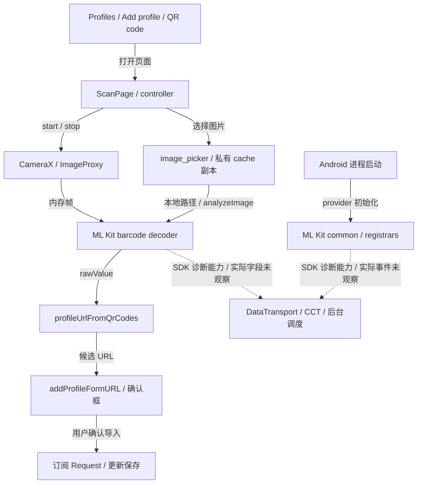

# L1-T09 扫码 SDK 隐私边界 Plan

任务入口：[L1-T09](loop1_tasks.md#l1-t09-审查并修改扫码-sdk-使用)。
design_v3 及 R3 合并规则勘误已获 M1 通过；v3 已通过 M1 实现增量评审，按既定本地交付约定收尾。
方案保留扫码 UI 与 CameraX，Android 改为 ZXing Java core；设备验收未运行，
实际主机消费者与制品证据见 [Result](l1_t09_result.md)。
输入基线为 `security/android@0666e4931cd0f776021c4b9e8758beac6450e50a`。

## 问题、目标与已核实边界

本节的原依赖、SDK 能力和旧 APK 调查均绑定上述输入基线，不是本项替换后的现状。

用户应能离线扫描相机或已在本地的图片，检查识别出的订阅 URL 后决定是否导入。
解码不需要安装标识、诊断上报或远程模型。
本项按[共同安全要求](../security_requirements.md#正常联网与额外暴露的判定)和
[扫码决定](loop1_plan.md#功能决定与待细化事项)保留用途，处理实际扫码依赖及局部秘密保护；
不恢复 L1-T04/L1-T05 全面整改，不修改 Core、mihomo、gitlink 或 carrier。

### 当前消费者与数据流



[入口](../../../../lib/views/profiles/add.dart)、[页面](../../../../lib/pages/scan.dart)、
[相册调用](../../../../lib/common/picker.dart)和
[URL 解析](../../../../lib/common/link.dart)均已只读核查。
相机限定 QR，`autoStart: false`、`noDuplicates`、默认不返回图片；
相册直接调用 platform `analyzeImage`，避免临时 controller 销毁正在使用的相机。
页面已有 `_completed`、`_picking`、route-current 检查及 lifecycle stop/resume。
[订阅动作](../../../../lib/providers/actions/profiles.dart)先弹确认框，确认后才下载；
解码没有调用 Dart `Request`，原生 SDK 的独立 HTTP 也不受其路由票据控制。

| 对象 | 现状与可审查范围 |
| --- | --- |
| mobile_scanner 7.4.2 | pub.dev；BSD-3-Clause；Dart/Kotlin/Swift 源码可读 |
| Android decoder | 默认 `barcode-scanning:17.3.0`；没有启用 useUnbundled |
| 传递依赖 | common 18.11.0、vision-common 17.3.0、barcode-common 17.0.0 |
| 原生基础层 | CameraX 1.6.1、coroutines-android 1.11.0；开放源码、发布工件预编译 |
| 模型与推理 | 三个 TFLite 资产和 `libbarhopper_v3.so` 随 APK；未取得完整对应实现源码 |
| 诊断链 | ML Kit common → DataTransport runtime/CCT；应用不必显式调用它 |

上表版本由当前插件、缓存 POM/AAR 和既有
[release 依赖图](../../../../build/verification/l1-t02/release_dependencies.log)交叉确认。
该图是 T02 的历史解析，含 transport-api 2.2.1、runtime 2.2.6、CCT 2.3.3，
不是本轮重新解析或 T09 最终依赖图。bundled POM 本身也依赖
`play-services-mlkit-barcode-scanning:18.3.1`；该坐标存在不能单独证明用了下载模型。
插件与[官方 bundled 说明][ml-barcode]对应的主模型随包，不要求先从 Play Services 下载；
SDK 的其它连接能力须另判。

本轮对 T08 [既有 APK][old-apk]重算 SHA-256，并只读检查最终 manifest 和 ZIP：
确认 `MlKitInitProvider`、三个 registrar、CCT backend、JobService、Alarm receiver、
模型和 barhopper 确实在包内。缓存 runtime AAR 有 `SQLiteEventStore`、`Uploader`，
CCT AAR 引用 `HttpURLConnection`；这是持久队列和独立 HTTP 能力的证据，
没有证明本项目已经上传了某条记录、图片、二维码或令牌。

当前 `image_picker_android 0.8.13+19` 还通过自己的 Manifest 声明
`com.google.android.gms.metadata.ModuleDependencies` service、
`MODULE_DEPENDENCIES` action 和 `photopicker_activity:0:required` metadata；
既有 APK 最终 Manifest 含同一条目，既有 merge blame 归因于 `:image_picker_android`。
[官方说明][photo-picker]将这段声明用于请求 Play Services 自动安装 backported Photo Picker，
其中 `android:enabled="false"` 不是关闭该安装请求。这里只证明声明存在，未观察实际安装。
root 保留 `image_picker` 时，其 Android 实现仍参与依赖、plugin 注册及 Manifest 合并，
包括 ImagePickerFileProvider；Dart 不再调用它不会自动清除这些原生入口。
实际 plugin 的 `onAttachedToActivity` 会 setup delegate、channel 和 lifecycle observer，
不以 Dart 发起选图为前提；本项不把“二维码改走新路径”写成旧 plugin 未初始化。

[官方初始化 API][ml-init]说明 provider 会在应用启动时初始化，移除它只改变初始化时机。
[隐私说明][ml-privacy]称输入及输出在设备处理，同时明确 SDK 可能联系 Google 并发送指标；
[数据披露][ml-disclosure]列设备/应用信息、安装标识、性能、配置、输入输出大小及事件。
披露面向当时最新 SDK，不能代替上述版本实际上传字段、目标、时间和重试的运行证据。
尚未取得 ML Kit 推理及诊断链完整对应源码，也未观察实际外发；这些限制不能写成安全结论。

## 推荐方案及取舍

| 可行方向 | 判断 |
| --- | --- |
| 保留 ML Kit 并关闭采集 | 未找到受支持、完整且可验证的关闭契约，当前不推荐 |
| CameraX + ZXing Java core 3.5.4 | 推荐；纯 Java、无模型、无新增 JNI/NDK 层 |
| CameraX + ZXing-C++ Android | 可用替代；增加 native 工件、ABI/符号与构建核对成本 |

保留方案已检查插件配置、`MlKit` 与 `BarcodeScannerOptions.Builder` 的公开接口，
未发现完整采集开关。仅移除 provider、排除 CCT 组件、降低日志级别或改成 unbundled，
均不能建立该契约；反射内部 logger 或按混淆类打补丁也不能作为稳定方案。
这是当前证据不足以推荐保留，不声称已穷尽厂商所有内部实现。

ZXing [core 3.5.4 POM][zx-pom]仅声明 test 范围 JUnit；源码和发布 JAR 已取得。
本轮阅读 `QRCodeMultiReader`、`QRCodeReader`、luminance 转换及相关 decoder/detector 入口，
并扫描 239 个 Java 文件的网络/动态库引用；命中的是 URI/URL 字符串解析，未见连接调用。
core JAR 无模型或 native 库；采用的像素 → decoder → 文本路径不需要服务器。
这不是完整漏洞审计，也不把开放源码或一次检索当作整个 APK 无联网的证明。
上游[处于 maintenance mode][zx-project]，维护与复杂二维码识别表现是明确代价。
[ZXing-C++ 的 Android wrapper][zx-cpp]能消费 ImageProxy，若 Java 的必要场景达不到门槛，
再带实际失败夹具复审该替代，不保留 ML Kit 自动兜底。

### 包和 API 的接入

拟在 `plugins/mobile_scanner/` 保留 7.4.2 的必要发布源码、许可证及已有测试入口，
根依赖改为 path；不修改共享 pub cache，不使用构建期覆盖 sourceSets 的隐式补丁。
已核查发布包中 `lib/`、`android/`、`darwin/` 和 pubspec 共 103 个文件、约 439 KB，
与当前 cache 字节一致，因而局部 fork 的维护范围可判断。
保留 Dart widget/controller、method/event channel、texture、CameraX、权限与
ActivityAware 的既有职责，
只替换 Android ML Kit 选项、解码和结果转换；其它平台继续原 backend，不将本项结论外推。

Android 使用 Apache-2.0 的 `com.google.zxing:core:3.5.4`，保留许可声明；
不提高现有应用 minSdk 24（插件声明 23）或 JDK 17 要求，
不增加 JNI、Play Services 或运行时模型依赖。
由 QR decoder 直接返回 `rawValue`、QR format
及必要坐标；不用 `ResultParser` 导航，不解析联系人/Wi-Fi，不自动打开任何 URL。
本 app 两个消费者只需 QR；本地 fork 明确 Android 的支持子集，未支持格式/选项报错，
不能静默假装实现上游全部格式、ML Kit autoZoom 或结构化结果。
camera preview、torch、scanWindow、start/stop/dispose 维持现有消费者契约。

相机在既有分析 executor 上读取 Y plane，核对 crop、row/pixel stride、rotation 和预览坐标。
相册的 provider I/O 和 CPU 解码均不占用这个 executor；两个 decoder 实例不跨线程共享。
采用 `HybridBinarizer` 与 `QRCodeMultiReader`，先按 scanWindow 裁剪，再对可交付结果去重；
不能让窗口外第一次识别抑制后来移入窗口的同码。CameraX 保留
`STRATEGY_KEEP_ONLY_LATEST`；每个 ImageProxy 在全部成功/失败/取消路径恰好 close 一次。
不把帧、Bitmap 或原始图像字节送入 Dart，不存录像、快照或识别历史。

### 相册、资源与生命周期

当前 `image_picker_android 0.8.13+19` 会向私有 cache 复制选中图片，
`Picker` 没有删除该副本，原生 FileUtils 的特定失败日志还可能包含 content URI。
为了让新 QR 路径拥有可控的资源和错误边界，Android 拟在同一局部 scanner plugin 中
增加配对的一次性选图/解码和撤销方法：调用 AndroidX
[`PickVisualMedia(ImageOnly)`][photo-picker]，直接消费授予的 content URI。
复用 Activity binding/result listener；不新建 Activity、全局 provider 或后台任务框架。
使用已在依赖中的 activity 1.12.4；其精确 `createIntent` 顺序为系统
`MediaStore.ACTION_PICK_IMAGES` → 已安装且可解析的 system fallback picker
（`ACTION_SYSTEM_FALLBACK_PICK_IMAGES`）→ `ACTION_OPEN_DOCUMENT`。
fallback 通过 `MATCH_DEFAULT_ONLY | MATCH_SYSTEM_ONLY` 查找并显式指定组件；
该版本的此调用链没有单独的 GMS picker 分支，不从其它常量的存在臆测分支。
无 camera 权限仍可选图片，不申请整库 storage 权限或保存 persistable grant。
系统/用户选择的 cloud provider 可能自行下载图片；离线验收只用已在设备的本地图片，
不能把 OS/provider 的行为称为 app decoder 上传。

`Picker.pickerConfigQRCode` 仅在 Android 走此方法，其余平台保留 image_picker 路径；
不删除其它平台仍需的依赖，也不追清旧版本全部 cache。
`Picker` 复用现有 URL 筛选，不用临时 camera controller。
取消返回 null，无 QR 返回空 capture，读取/解码失败返回固定错误码；
不把路径、二维码、URI 或底层异常字符串交给 `safeRun`/原生日志。

### 排除用途专属的自动安装请求

由 app 的 [AndroidManifest.xml](../../../../android/app/src/main/AndroidManifest.xml)
使用 [node removal][manifest-selector]，仅删除通用 service 下确切名称的安装 metadata：

```xml
<service
    android:name="com.google.android.gms.metadata.ModuleDependencies">
    <meta-data
        android:name="photopicker_activity:0:required"
        tools:node="remove" />
</service>
```

当前唯一来源已核实为 image_picker_android 的 `io.flutter.plugins.imagepicker` Manifest。
原 design_v3 的带 selector 规则拒绝了 library 节点，却在实际 APK 留下 app 自身的空 marker；
M1 已批准上面的最小修订。失败及修复制品证据见 [Result](l1_t09_result.md)。
保留其它 metadata、通用 service/action、ImagePickerFileProvider、plugin 注册及非 Android 路径。
升级后若发现其它来源重新请求同一安装用途，须归因并复审，不能以盲删掩盖新的功能依赖。
不 vendor image_picker，不加构建后重写或无用途全局拦网。

目标是本 app 不再主动声明/调用该模块安装用途，不承诺控制 OS/Play Services 的独立更新、
其它 app 的请求或用户选择的 cloud provider。设备原本已有的系统/system fallback picker
仍可选；均不可用则 document 选择仍可用，不能为恢复界面而自动请求下载模块。

### 外部选图返回的身份

`PickVisualMedia.parseResult` 只返回 URI，不会回传 Dart request id。
当前宿主是 [FlutterActivity](../../../../android/app/src/main/kotlin/com/follow/clash/MainActivity.kt)，
采用 `createIntent` 加现有 `ActivityResultListener`，按
[Activity 返回的原始 requestCode][activity-result] 关联 launch；
不使用可复用的固定 code，也不引入要求 ComponentActivity 的 registry。
plugin 持有至多一个有效相册 operation，记录 native code、engine/Activity binding 代次、
页面发起的 id 与当前 phase；取消或 detach 清除接收资格和 MethodChannel result 引用。
listener 先核对 native code 和全部 owner，再 parse URI；未知/撤销返回直接消费并丢弃，
不解析、缓存、记录或投递给新调用。非本插件 code 交给其它 listener。
只接受本次选择授予的 content URI，不将返回值当 HTTP URL、备用路径或持久授权使用。

native code 从 app 保留的正整数区间 `0x6F000000..0x6FFFFFFF` 单调分配，永不回绕复用。
为跨进程重建维持这一点，在 [`noBackupFilesDir`][no-backup] 的专属小型 AtomicFile
保存 high-water mark：
每次 launch 前在相册 worker 上成功同步保留下一个 code，随后才允许主线程调用外部 intent。
未 launch 的 code 也不回收；写入失败、内容损坏或区间耗尽时拒绝选图，不重置计数。
必须在保留写入/同步成功后 launch，不能把仅创建写入 Future 当作成功。
该文件只含分配进度，不含图片、URI、Dart id、安装标识或历史；不进入 app 导出/备份。
这是明确新增的本地关联成本，避免依靠进程内随机数、猜测 callback 顺序或恢复敏感输入。
固定 code 加 outstanding tombstone 也能避免串单，但回调丢失会一直阻止下一次选择；
本方案以小型计数文件换取旧选择撤销且无实际工作时可安全发起 B。
当前本项目 AppPlugin、已配置选图插件使用的低位 code 与此区间不重叠；
最终实现须核对实际插件集合，后续同步也须保留该 namespace。

| 时序 | 所有者与结果 |
| --- | --- |
| A launch → 页面取消 | A 的 Dart 调用完成 cancelled；native code 永不复用 |
| B 重入，A 尚有实际工作 | 返回 busy，不排第二个选图/I/O 工作 |
| A 无实际工作，B launch → A 迟到 | B 使用新 code；A 不匹配，丢弃；只接收 B |
| Activity detach/重建 | 撤销 A；新 handler 不继承 A 的 URI 或交付资格 |
| 同 engine 换 handler/engine detach | 清理旧 callback 引用；相机释放；code 不回收 |
| 进程重建 | 不恢复 operation；旧 code 未知且不会分给 B，旧返回丢弃 |

保存计数只解决 code 不复用，不恢复识别任务。选择期间不占用线程等待，取消可以释放逻辑 slot，
前提是已没有该次实际 I/O/CPU/清理工作；新 B 仍须在当前前台页面显式发起。
重复调用返回 busy，撤销未知/已结束 id 幂等无操作；未返回的外部 Activity 无需由 app 强行关闭。
launch 同步失败也使用固定错误码并结束该 operation，不把 code 重新分给下一次。

### 调用时限、I/O 与 CPU 资源

相册接口为 `pickQrImage(clientId) → handle?`、`decodeQrImage(handle) → capture`，
以及 `cancelQrImage(clientId)`；clientId 在同一 Dart engine 内不重复，native 另核对 engine 身份。
选图完成仅返回不含 URI 的一次性 handle；当前 resumed 页面显式调用 decode 才返回 capture。
选择/解码只允许各接续一次，重复请求返回 busy，结束/撤销的 handle 不可复用。
选图用户思考时间不计入解码预算；
计数保留/launch 准备另有 5 秒响应预算，超时未 launch 的请求撤销，迟到准备结果不得 launch。
选图返回后的 handle 只在当前页面内存保留，5 秒内未被 resumed 页面接续即失效。
这避免把选图等待、后台等待与 provider 读取混成一个永不完成的 Future。

decode 的 5 秒 deadline 从 Dart 发出该调用前的 monotonic 计时开始，覆盖 channel/worker 排队、
URI 打开和完整读取、EXIF、Bitmap/采样、ZXing 及 Dart 接收/资格检查；各阶段不重置预算。
Dart 到期及时完成为 timeout 并发撤销，接收迟到值时再检查计时、mounted/current/id；
native 同样设置不超过 5 秒的 deadline 并在阶段边界核对。VM/OS 暂停会延迟 timer 执行，
恢复后按 elapsed time 拒绝过期结果，不承诺被冻结的进程准时回复。
timeout/cancelled 是调用结束，不能用它或 `Future.isDone` 证明底层工作已退出。

相册使用独立的单 flight worker，provider 打开/读取和本地 CPU 转换均不在 main/camera executor。
worker 和至多一个异步清理任务受 plugin 内进程范围的资源 slot 限制，跨页面、handler、
engine 重建共用上限；它不管理 app 生命周期、不成为新的全局 manager。
slot 从计数保留到实际工作/清理退出一直占有，不积压重试队列，不按超时新造替代线程。
worker 只使用 application context 和 operation 数据，撤销后移除 Activity/Dart 接收引用。
相机单 worker 也不以更换页面/engine 绕过未退出的旧计算；其资源额度独立于相册，
不能用不断创建 executor 恢复可用性。这里限制线程数和 retained 输入，未承诺 CPU 工作的强停时限。

| 阶段 | 限制与取消能力 |
| --- | --- |
| 打开 content URI | `openAssetFileDescriptor` 带 CancellationSignal；可能阻塞 |
| 读取 | 每轮查取消/剩余时间，累计最多 32 MiB；零进展不自旋 |
| EOF/短读 | 短读继续累计至正常 EOF；声明截断/读取异常不解码 |
| EXIF/Bitmap/ZXing | 仅消费已读内存；header ≤64 MP，采样 ≤4 MP；不得无界重解原图 |
| 取消/超时 | 撤销交付、interrupt，并在专属清理任务尝试 signal/close |
| 实际退出 | finally 丢弃部分输入、释放 buffer/Bitmap、关闭资源后释放 slot |

打开前后均检查撤销；若打开在取消后才返回，资源只进入关闭路径。
读取不查询文件名或为尺寸另做无 deadline 的 provider 调用；未知声明长度仍按流累计，
读到第 32 MiB 之外的字节立即失败。取消/异常/超限时不解码已读前缀。
未知长度的正常 EOF 仅表明 provider 结束该流，不能证明它提供了原文件全部字节；
仍需图像解析和 QR 校验，不把短 read 或 `available()==0` 当 EOF。
输入流/AssetFileDescriptor 由该 flight 独占，用一次性关闭交接避免重复 close/recycle；
读取结束并关闭外部资源后，才把完整字节交给 EXIF/Bitmap/ZXing。

[CancellationSignal][cancel-signal] 及关闭/interrupt 不是对任意 provider 的强制终止保证。
signal/close 也可能阻塞，故不在 main、相机 worker 或持有控制锁时执行；
同一 flight 只安排一个清理任务，slot 须等 worker 和清理任务实际退出才可复用。
取消不等待 join；若读/关闭/同步 CPU 调用不返回，最多留下这一 flight 的受限输入、
一个相册 worker 和一个清理任务，不能声称已及时擦除内存或释放其全部资源。
相机的专用 worker 与该任务分离，可以恢复相机；相册后续明确返回 busy/unavailable，
直至旧工作真正退出或 app 进程结束，不因重开页面/engine 自动重试。
用户仍可用相机、手工 URL 或原有文件导入；本项不强杀 app、不为任意 provider 建隔离服务。
如果产品要求坏 provider 也能立即再次选图，须另评审可终止的隔离进程，不能伪称线程取消已满足。

页面离开、解码中后台、Activity/engine detach 都撤销工作并结束 native 调用状态；
接收端仍有效时及时回复 cancelled，engine 已销毁时不承诺 Dart 收到回复。
idle worker 随 owner detach shutdown，活动 worker 只请求退出，slot 留到实际 finally。
engine 重建不绕过仍占用的进程 slot；正常退出后允许惰性重新创建，进程退出由 OS 回收。
外部 picker 导致的 inactive/resumed 不误取消等待选择；页面关闭仍显式撤销自己的 id。
异步相机 provider/权限结果同样检查原 start 意图，不能在旧页面失效后 bind；
成功/取消/失败后只在页面 current 且 resumed 时恢复相机，旧结果不能 pop 新 route。

短期去重引用随 stop/dispose 清除，候选 URL 只留到确认/取消，确认导入才沿原流程持久保存；
这约束引用生命周期，不承诺 GC 内存被安全擦除。
沿用 `profileUrlFromQrCodes` 与 `addProfileFormURL` 的校验、确认及既有下载出口。
URL 包含 token 时也不增加记录；确认后下载链的通用历史风险仍归 T04/T05。

## 实施顺序和文档职责

本项已通过 design_v3 评审并获实施许可；先完成下列文档基线，再写生产代码与测试；
必要语义变更先修订对应契约，不边编码边将计划伪装成现状。

| 路径 | 本项职责与时机 |
| --- | --- |
| 本 Plan、`loop1_tasks.md` | 本轮增量设计、归属、状态；评审后随事实更新 |
| `../qr_scanning_design.md` | 获准后新增 QR 契约，含身份/时限/安装与 fallback；先标 draft |
| `.agents/architecture.md` | 实施前补插件、进程 slot 和 code 所有权；实现后核对 |
| `.agents/project.md` | 实施前记录 fork 原因/移除条件及 image_picker 合并规则 |
| `plugins/mobile_scanner/README.md` | 随接入先写来源、支持子集、差异和更新/验证入口 |
| `loop1_plan.md` | 方案获准后只更新当前扫码决定并链接长期设计 |
| `l1_t09_result.md` | 实施并取得证据后才创建，记录实测与未覆盖 |

路径按仓库根或本 Plan 所在目录解释；实际文档及验证状态见 [Result](l1_t09_result.md)。
共同需求和 CONTRIBUTING 规则无需重写；不回写 T02/T08 历史、不建额外台账/归档目录。
sync 时先比较上游 7.4.2 到新版本的 camera、channel、权限、旋转和生命周期变化，
将有效修复移入本地 fork，并复核 root lock/path 仍选中局部 backend。
image_picker_android 升级须重查安装 metadata 的来源、确切名称与最终合并结果；
依赖退出时删除对应过期规则，不让文档或 app Manifest 留下无用途占位声明。
只有上游提供满足同一隐私与功能契约的 backend 且通过本项验收，才移除 fork。

实施按可验证依赖推进：文档基线 → 局部插件/解码与权限结果契约 → 页面和相册消费者
→ app 的安装 metadata 排除与必要局部错误处理/针对性回归
→ 锁定依赖及最终 ARM64 release APK 核对 → 实现交评。
清理 ML Kit 依赖、registrars、模型、barhopper 和专属 transport 消费者，
以最终解析图判断共享依赖是否仍有合法消费者，不按 `firebase` 名字一刀切。
不改应用仍需的 INTERNET，也不加无用途全局拦网、备用解码器或模型下载。

## 拟验收场景与证据分层

以下全为目标，不是通过记录。真实入口仍为 Profiles → Add profile → QR code，
相册在扫描页右上角；测试仅用合成 URL/token 和受控图片。

| 用户场景 | 预期与重点反例 | 拟验证层 |
| --- | --- | --- |
| 首次启动，未进扫码 | 不开相机/模型，不初始化 ML Kit 或排诊断任务 | 最终包 + 运行观察 |
| 未进扫码/安装 app | 不声明 Photo Picker 自动安装需求，不冒充 OS 零联网 | 最终 graph/合并归属/包 |
| 三种系统选图可用性 | 系统 → system fallback → document；不请求安装补齐 | 真实 contract + 设备 |
| 离线相机扫普通 URL/安装链接 | 返回确认框；确认前零订阅请求 | 真 decoder + 页面 + 设备 |
| 离线相册，camera 权限拒绝 | 仍可选本地图片并识别，不要求补相机权限 | 真实原生选图/解码 |
| 普通文本、空码、多个 QR | 沿用有效 URL 筛选；无效可重扫；只完成一次 | 真 decoder + Dart |
| 窗口外同码移入窗口 | 外部不完成，进入后可接受；去重顺序正确 | 旋转/裁剪夹具 + 相机 |
| 横竖屏、stride、EXIF/镜像 | 坐标正确，带方向图片可识别，无资源泄漏 | 原生转换 + 设备 |
| 密集 URL、轻度模糊/倾斜、弱光 | 合成常用集可识别；困难集如实记录，不保证等同 ML Kit | 固定图片集 + 实机 |
| 拒权/永久拒权、无相机/无闪光灯 | 无循环弹权限；现有提示/settings/torch 行为正确 | 页面 + 原生/设备 |
| 选图取消、损坏/超限/URI 失权 | 无网络兜底；可返回重扫；错误无秘密 | 真解码失败 + 页面 |
| 相册双击、选图期间来帧 | 不覆盖 result、不抢先 pop；相机暂停 | channel/页面并发 |
| A 取消 → B 重入 → A 迟到 | B 用新 code；A 丢弃；占用时 B busy | native listener + 页面 |
| Activity/进程重建后乱序返回 | 旧 handler 不继承；旧 code 不复用；未知返回丢弃 | 原生身份/保存 + 设备 |
| counter 写失败/超时/耗尽 | 不 launch/不复用，迟到准备不启动 picker | 分配契约 + 原生入口 |
| provider 打开/读迟滞或不返回 | 5 秒结束调用；相册 slot 保留，相机可恢复 | 受控 provider + 设备 |
| 短读/中断/超限后取消再用 | 不解部分输入；旧工作真退出才允许新相册 | 真 I/O/清理 + 页面 |
| engine detach 后工作仍不返回 | 无旧交付；新 engine 不增生线程/绕过 slot | native detach/重附着 |
| 后台/恢复、离开/重进、启动中关闭 | 旧启动不 bind；可中断资源释放，不可中断如实限额 | 原生时序 + 页面/设备 |
| 确认取消/确认导入 | 取消零下载；确认仅进入现有订阅流程 | 真实入口 + 本地受控接收方 |
| 暖启动与反复扫描后后台 | 无 SDK 诊断队列/上传；不把其它应用流量算进来 | 最终包 + UID 运行观察 |

实施验证优先复用 `test/pages/scan_test.dart`、`test/common/link_test.dart`、
`test/common/picker_test.dart` 的邻近入口，增加 native 消费者验证：真实 ZXing 解合成图片，
再经实际转换、channel 与 app 筛选，覆盖无结果、错误、释放和迟到回调。
仅 mock `MobileScannerPlatform` 证明 UI 协作，不足以证明识别成功或没有 SDK。
实施前固定有独立预期的合成夹具：普通 HTTPS、安装协议、UTF-8、2048 字符 URL、
多码混合、常见 EXIF 方向及无效输入；清晰有效集必须全部正确识别，不能漏掉长订阅链接。
相册处理的 5 秒响应及未退出资源限额按上文契约验收；
实机再记录用时和内存，若必要集或预算不满足则复审，不能拿模拟平台通过替代。
密集/模糊/倾斜等困难集记录成功率及失败条件；不靠 writer 与 reader 共用唯一 oracle。
取消时序需实际经 native code 分配、Android result listener 和 provider 消费者，
覆盖 A 撤销后 B、handler/进程重建、结果在 deadline 边缘接收，以及 engine detach。
受控 provider 分别停在 open、read、close，并包含忽略取消/interrupt 的情形，检查相机独立可用、
后续相册 busy 及进程范围 slot/线程上限；可取消假流通过不能证明任意 ContentProvider 可被强停。
最终运行项目要求的依赖解析、analyze、相关 Flutter/native 检查及构建；
设计阶段未运行上述验证；实施后的实际结果与未覆盖项统一见 [Result](l1_t09_result.md)。

最终包须绑定受审源码、lock、实际 release 依赖图、合并/最终 manifest、R8 mapping 和 APK hash，
核对 ML Kit 类原名/来源、初始化/调度组件、资产及 native 库均已退出扫码闭环，
ZXing 所选版本和真实消费者在包内；不能仅全文搜索类名或删除 manifest 节点。
还须在 release graph 中如实保留/归因 image_picker_android，并结合 merge report/blame、
合并及最终 Manifest 确认 `photopicker_activity:0:required` 已从该来源移除且没有其它来源重加。
核对通用 ModuleDependencies 容器如有保留时的全部 metadata、action 和归属，
其它合法模块、provider/消费者没有被误删；新 QR 路径也无显式模块安装调用。
删除规则的合并效果须以 Result 的实际对象与结果为准，不以源 XML 已写规则替代最终包结果。
静态核查能证明依赖与可执行入口的变化，不能证明所有运行时行为。

尚缺真实 CameraX、系统权限/Photo Picker、Activity 重建、识别效果及原生后台行为证据。
后续如获设备运行许可，使用隔离且无真实数据的设备/AVD、合成图片和干净安装；
相机/权限/选图优先断网完成，另以 UID 归因的本地观测检查启动、扫描、后台/暖启动。
若需观察网络尝试，先限制外发为拒绝或本地受控汇点，不使用宿主 TUN/system proxy，
不先让 Google 或订阅服务收到测试流量。AVD/测试夹具不能替代实机光学与低端机性能证据。
已有设备上的旧 SDK 队列可能混淆升级观察，干净安装与升级路径分开，不能为此擅自清真实数据。
短时零外发只作为该窗口的补充证据；不得据此承诺 app/OS 全局零联网。

## 评审决定与调查材料

M1 已通过 design_v3 技术评审，R1/R2/R3 在所述范围与限制内闭合。
已获用户授权实施、本地合成验证和 ARM64 构建；当前实现仍待交评，设计通过不等于设备验收。
当前没有事实足以推荐 ML Kit 的完整关闭方案；不以未确认的关闭能力阻止本轮设计交付。
Java 在困难输入上的质量/性能仍需实施后的独立样本与实机门槛验证；
若关键场景不满足，携失败证据复审 ZXing-C++，不静默恢复 ML Kit。
设备运行及必要观测权限尚未取得，本地实施许可不包含设备运行。

本轮下载的仅为公开依赖；材料在忽略目录
[`build/verification/l1-t09/design_research/`][research]，不入库。
关键校验集中保留于此：

- mobile_scanner 官方发布 archive，与 lock 相同：
  `5a51ea79f0cf8293f616a5d08baae185b59b5e6bb24df01f2a63037ade0bade0`。
- ZXing 3.5.4 sources JAR：
  `a611e3b63b661aeb2a81b8b4f4bde2daace1e2976adbb37917a674a0019c8fac`；
  binary JAR：`71de5d89341b5fcf5dd89da7f44e84d825d0e084cdf3ec77c9abe26b0f0ceb13`。
- 复用 T08 APK：`ce966de05a49de9fae5dc98925252b29e4a320fcf731f2e4994a3d298c65bf5d`。

ML Kit/CCT 对应 sources JAR 和猜测的历史 Git tag 未取得；未将其它版本源码冒充当前实现。
本轮修订另取得 AndroidX activity 1.12.4 发布 sources JAR，核对 URI-only parseResult 和 fallback；
SHA-256 为 `bec49e0d2700ba5c4584cb969c4c74ab885afc445878b809a6b29fe95e576f9b`。
Activity/CancellationSignal 的公开契约及 AOSP 当前源码只用于说明关联/取消能力，
不冒充所有目标 Android 版本或第三方 provider 的实际运行保证。
官方网页于 2026-10-29 查询，版本判断以本地实际工件为准。

[ml-barcode]: https://developers.google.com/ml-kit/vision/barcode-scanning/android
[ml-init]: https://developers.google.com/android/reference/com/google/mlkit/common/MlKit
[ml-privacy]: https://developers.google.com/ml-kit/terms
[ml-disclosure]: https://developers.google.com/ml-kit/android-data-disclosure
[zx-pom]: https://repo.maven.apache.org/maven2/com/google/zxing/core/3.5.4/core-3.5.4.pom
[zx-project]: https://github.com/zxing/zxing
[zx-cpp]: https://github.com/zxing-cpp/zxing-cpp/blob/master/wrappers/android/README.md
[photo-picker]: https://developer.android.com/training/data-storage/shared/photo-picker
[cancel-signal]: https://developer.android.com/reference/android/os/CancellationSignal
[activity-result]: https://developer.android.com/reference/android/app/Activity
[no-backup]: https://developer.android.com/reference/android/content/Context
[manifest-selector]: https://developer.android.com/build/manage-manifests#marker_selector
[old-apk]: ../../../../build/verification/l1-t08/ip_implementation_v2/artifacts/FlClash-0.8.99-android-arm64-v8a.apk
[research]: ../../../../build/verification/l1-t09/design_research/
