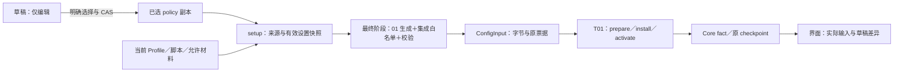

# L2-T02-03：最终合成、受管应用与恢复

本项把 01 的封闭策略和 02 的草稿接到真实 Setup／ConfigInput／T01 链路。用户明确选择策略后，应用统一生成完整候选；页面按 Core 实际接受事实显示已载入、运行、保留旧输入或失败。编辑、保存及预览草稿仍不会自动改变运行资格。

本文保留 M1 已通过的 design_v2 方案及当时的设计基线；实施与实现评审已完成，实际能力、修订、验证和限制见[本项结果](l2_t02_03_result.md)。归属、授权及本地收尾状态由[子任务清单](l2_t02_tasks.md#l2-t02-03-最终合成受管应用与恢复)维护；总体语义沿[总体设计](l2_t02_plan.md)，输入及失败权威沿 [T01](l2_t01_plan.md)。设计起点为父仓库 `8ef984eb1b9c8afb4cd8d42e943da6f30aa34af4`、mihomo `6c6e3e472bb246cc55f2e8577d9eddccc2623afc`。正文的拟实施与未验证表述均为设计时状态，不代替结果记录。

## 1. 用户闭环与范围

| 用户操作／情形 | 本项拟交付结果 |
| --- | --- |
| 编辑、排序、保存、关闭策略页 | 仅更新草稿；当前已选策略及实际输入不变 |
| 明确选择“保存并请求应用策略” | 核对本次草稿，冻结已选策略，沿现有 setup 提交完整候选；确认说明 DIRECT、DNS 及原覆写的作用范围 |
| 正在运行时请求应用 | 沿当前运行意图替换；成功才显示本次策略已运行 |
| 停止时请求应用或确认期间停止 | 可保存选择并载入 inactive，不创建 start 意图、不恢复用户已停止的服务 |
| 候选失败、来源变更、缺策略 | 区分仍适用旧输入与不可用；不可用时沿 T01 关闭本应用入口，不安装默认或暗选其它 Profile |
| 切换节点 | 仅在实际受管配置的固定非空代理组内选择代理成员；DIRECT 由策略编辑和重新应用表达 |
| 离开受管模式 | 明确确认后改用原 Profile；不能借热改 Global／Direct 或旧页面保存绕过 |
| 备份／恢复、进程冷恢复 | 选择内容保真；实际运行仍需现有来源及 T01 资格，缺内容不退回原订阅规则 |

本项按既定安全目标接入 Android；其它平台待定。共享接口中的来源和运行资格按 Android 的原 native 协议描述，便携消费者及 scoped fixture 不冒充设备证据。

首版保持 01 的规则、固定 SOCKS5、静态 select、DNS TCP／UDP／TLS 及地址白名单。04 的订阅／provider／Geo 材料化、协议扩展，05 的整项验收，设备系统接管和其它 Loop 不纳入。旧查询／缓存、远端解析、物理网络等[未解决边界](l2_t02_plan.md#10-残留风险与不再承诺的能力)继续保留。

## 2. 已核实的生产链路

| 位置 | 基线实际行为 | 本项要接入的边界 |
| --- | --- | --- |
| [PolicyDraftAction](../../../../lib/providers/actions/policy_draft.dart)／独立草稿表 | DAO 保存和提取，不触发 setup；预览只调用 01 | 保留草稿隔离，另增加明确选择动作 |
| [setupState](../../../../lib/providers/state/profile.dart) | 按 standard／script／custom 读取 DB 条目，包含全局规则及实际引用材料 | 同时捕获已选策略，区分不存在与存在但不可解释 |
| [SetupAction](../../../../lib/providers/actions/setup.dart) | mutation 中捕获 DB／来源票据，段外读取配置、脚本并合成，提交前重验来源；当前 selectedMap／应用设置有段外读取 | 冻结完整实际输入，不用合成后的当前值给旧材料贴身份 |
| [makeRealProfileTask](../../../../lib/common/task.dart) | 脚本结果之后覆盖应用参数，合并 DNS／NTP／系统 DNS，再组装规则并编码；空 custom 规则沿用源 rules | 最后编码前接入受管闭包，空策略不触发旧分支回退 |
| [ConfigInput](../../../../lib/common/config_input.dart) | YAML 和 manifest 内容寻址，携带依赖 key、选组、测试 URL；本项使用 Android native ticket | 增加受管策略身份；运行资格仍属于原 ticket／T01 |
| [config_apply](../../../../core/config_apply.go) | 登记／prepare／install／activate，替换前拒绝可保留旧输入，替换后失败关闭 | 绑定元数据、原运行意图及已有路由事实，校验受管写入边界 |
| [config_checkpoint](../../../../core/config_checkpoint.go) | 依赖撤销清空恢复引用并令 eligible=false；它与当前业务仍在运行是不同事实 | 不能将不可重放直接画成已停止；补受管失败的条件清理 |
| [热更新](../../../../core/common.go)／[选组](../../../../core/hub.go)／[外控](../../../../core/config_controller.go) | UpdateParams 仍可改 mode 等字段；选组共用 selectMu；外控限制全量上传但允许有限热字段 | 以实际受管 manifest 收敛所有真实写入口 |
| [Profile 删除](../../../../lib/providers/actions/profiles.dart)／[缺失选择恢复](../../../../lib/providers/actions/setup.dart) | 删除当前项可自动选第一项；失踪 ID 也可恢复为第一项 | 受管撤销不能自动选择另一个原始配置 |
| [ConfigState](../../../../lib/providers/config_state.dart)／配置详情 | 接收 Core fact，区分 buildFailed、loaded、active／retained | 补策略身份及与草稿／已选内容的差异，保持单一运行权威 |

现有 Request.invalidate(profile key) 不必立即关闭旧业务；invalidateDataset 则退役业务范围。当前合成失败路径主要刷新 fact 和标记 buildFailed。受管失败不能仅沿这条显示路径而遗漏不可适用旧输入的清理。

## 3. 选择持久化与唯一权威

### 3.1. 采用独立选择记录

推荐 schema 13 新增 `ProfilePolicySelections`：`profileId` 为 Profile 外键／主键，`rawContent` 为可空 TEXT。没有行表示原 Profile 模式；有行表示必须按受管模式构建。raw 为 null、未知版本、缺字段或坏内容均表示“需要配置策略”，不能解释成没有行。

已知 raw envelope 拟为 `selectionVersion: 1`、完整严格 `policy`，以及可空的 `maintenanceProxyTarget`（§5.3）。policy 由 02 当前草稿深复制，不带可编辑标签或历史 migration 材料；准确 envelope UTF-8 字节的 SHA-256 为 `policySha256`，包含明确维护默认目标。哈希只标识所选内容，不授予来源／运行许可，不要求语义等价 JSON 有相同摘要。

| 对象 | 可变性／职责 | 权威 |
| --- | --- | --- |
| ProfilePolicyDraft | 可不完整、可编辑、可只读保真；包含迁移材料 | 02 DAO 和 raw 值 CAS |
| ProfilePolicySelection | 用户明确选择的不可变 policy 副本；可被下一次明确选择替换 | 新选择 DAO；变更复用 Request.mutate 和 profile 来源 key |
| ConfigInput／ConfigFact | 某次实际完整候选及接受／运行／恢复资格 | 现有 T01，不由 DB 布尔值代替 |

不直接让可编辑草稿成为自动运行输入，也不把“预览通过”或迁移快照记成已接受。单用草稿会使下一次普通 setup 消费未经明确选择的新编辑；把已应用标记写回草稿又会混淆保存和运行事实。独立小记录承载用户选择，避免另建通用权限／任务状态平台。

### 3.2. 明确选择与返回原模式

“保存并请求应用”先按 02 值 CAS 保存必要的草稿，再对不可变本次内容作严格模型／编译／迁移阻断检查，展示明确确认。确认后在 Request.mutate／DB 事务中重验 Profile、当前 draft raw 和预期 selection 记录；不改贴新的版本。

selection CAS 比较 `(行存在性, raw)`，可用可空记录表示：预期无行与预期有行/raw=null 是两个不同值。确认期间无行被恢复成 null 占位时，旧确认必须冲突，不能覆盖保护；有行原文改变或 Profile 消失也拒绝。真正相同的存在性和 raw 仍允许同值写入，无需新增世代。02 草稿 DAO 的纯 raw 值 CAS 合同保持不变。

变更选择前 await 既有 `invalidate('profile:<id>')`，再写选择记录；同一 mutation 完成后才请求 setup。撤销回复失败不越过写入。发生撤销后 DB 失败时不回补旧 ticket／checkpoint，提示保存失败并按 §6 核对实际旧输入；不凭 DB 回滚声称恢复了运行资格。

选择不同 Profile 走统一 Profile 选择入口和现有 CoreManager 的 setup 触发；同一 Profile 则显式请求 applyProfile。避免重复派发两次 setup；动作只说明“已保存选择／请求应用”，最终成功由 fact 判断。全部 apply 保持已有 running／paused 意图，不调用 setRunning(true)。

“改用原 Profile”须明确确认，复用同一失效／事务路径删除选择行；它是用户选择退出受管模式。普通删除草稿、修改标签或继续编辑草稿不删除选择，不撤销已选内容。已选内容与草稿不同则提示未应用编辑。

## 4. 同次输入、来源与合成

### 4.1. 冻结与过期检查

在现有 setup 队列和 mutation 读边界捕获 Profile／选择 raw、实际 DB 条目及所用来源票据，并冻结本次有效 Patch／Network 设置、selectedMap、testUrl、Profile 名称和 safe mode。全部作为一个不可变 setup 输入传入后续步骤，不能在 YAML 完成后重读当前值作为本次 metadata。

源依赖继续用既有 key：自身 profile、实际使用的 global-rules、script 及引用 Profile／provider。选择行属于自身 profile key。草稿不是已选输入的依赖；单独编辑它不会取消已经明确选择的另一份内容，也不能改变该内容的哈希。恢复数据集沿既有 dataset 失效。

Core.getConfig 和脚本字节读取不置于持有 Android mutation receipt 的 Core 配置读等待中，避免与既有 data-read gate 互等。使用捕获票据圈定读取：读后冻结实际 map／字节，并在合成后、写 ConfigInput 前及 prepare 时核对原票据；应用内任何来源写入必须先失效。期间发生改变则丢弃整份候选重捕获，绝不把新 ticket 配给旧 map。外部直接修改私有文件不在此应用内原子性保证内。

应用有效设置还必须按 §4.3 的来源／提交边界与 Core 验票绑定；Dart 值比较只是补充，不能封闭 final-write 到 prepare／activate 的窗口。选组和运行热参数另使用已有 ConfigFact 身份／版本和 route epoch、picksVersion：捕获时取同一 Core 快照，prepare 在现有锁内重验这些值。允许新增这些现有观察值的传递字段，不新增计数器。选组仍由原 route tracker 管理。

同一请求仅因设置／路由过期时，沿原 setup generation／队列重捕获一次；持续变化则显示待重试／被取代，不报告本次生效。真正较新 setup／停止／Profile 选择到来时，旧请求直接退出，不代替较新请求重试。

### 4.2. 最终合成位置和字段

在 `SetupState`／`MakeRealProfileState` 增加可选选择快照及受管描述。原模式保持既有路径。受管模式仍在 `_makeRealProfileTask` 的最终编码前统一处理：原脚本及允许的普通覆写已完成，随后由 01 编译器生成完整闭包，再只加入明确允许的应用集成字段；最后一次编码，不开放后续 YAML patch。

图为拟接入流程，尚未执行。Request／setup generation／T01 分别保持原所有权；DB 选择不取代实际接受事实。

| 字段／材料 | 受管输出的规定 |
| --- | --- |
| rules、sub-rules、rule-providers、proxies、proxy-groups、dns | 以 01 输出整体替换；空规则仍有显式终止；不沿用源规则／旧 DNS／旧 sub-rules |
| proxy-providers、特殊监听／额外入站、SpecialRules／SpecialProxy、脚本新增未知根字段 | 不进入最终闭包；源材料不是允许任意根字段的通行证 |
| mode、IPv6、sniffer、hosts、NTP、iptables、Geo 自动更新、fake-ip／profile 存储开关 | 沿 01 已审固定边界；不从传统覆写恢复旁路；不执行 provider／Geo 扩展 |
| mixed／DNS 监听、bind、allow-lan、其它代理监听 | 策略中的 mixed／DNS 端口，loopback bind、allow-lan=false；DNS listen 由 §6.3 的 T01 所属资源管理，inactive 不开；其它普通监听关闭；界面和系统代理不能继续借 desired 全局端口 |
| inbound authentication、skip-auth-prefixes | 允许当前应用认证；强制清空免认证前缀，保持 T01／L1 的实际认证链 |
| TUN | 只接受已有有效应用 TUN／路由与平台限制字段；不接受源 YAML 或脚本的任意入站覆盖；设备接管范围不扩大 |
| interface-name | clear 或用户明确 custom；follow 不读取订阅值来扩大受管入网路径，需改成明确应用选择 |
| external-controller 各变体及 UI 下载入口 | 全部关闭；内部 L1-T03 请求端点继续由原 owner 创建，不由该字段控制 |
| 日志、tcp-concurrent、unified-delay 等允许的运行参数 | 由本次有效应用输入提供；仅保留既有可重放的有限参数，不包含路由／DNS 旁路 |
| safe mode | 最后保持 TUN／系统代理／授权等既有限制，DNS listen 清空；inactive／测试构建不得因策略端口开启业务监听 |

不把源未知字段通过 spread 留在最终 Map。受管最终 Map 从 01 输出和明确集成字段构造，使用共享 helper 校验受管字段完整等于本次 policy 生成结果，集成字段只能来自本次已冻结的有效设置；序列化后检查关键字段与认证保真。这里没有新 matcher，也不另维护一套策略编译规则。

传统规则／DNS／覆写入口在受管 Profile 内导向草稿或生成预览，明确它们不再是网络策略编辑入口；不能保留“编辑成功但永远被覆盖”的体验。对独立手工 policy 的明确确认说明原路由／DNS／特殊功能不参与；带迁移材料的 policy 仍受 02 持续阻断，不能借最终字段替换删除旧保护。未支持资源不能偷偷进入受管输入。

### 4.3. 有效设置的提交边界

为本次实际读取的应用输入复用原来源 registry 中一个 `application-config` key，不增加计数器或另一套设置版本。每份受管 ConfigInput 的依赖都包含该 key，与自身 profile 及其它实际来源一起 capture／prepare／activate 验证。

| 输入范围 | 变更入口及契约 |
| --- | --- |
| 最终合成读取的 PatchClashConfig：TUN、明确接口、允许日志／并发等应用字段；以及所读取的完整 patch 对象 | 所有改变该读入对象的写入经同一 mutation；受管锁定字段先拒绝，不默许“写了但会被覆盖” |
| NetworkSetting 中用于合成／服务的 authentication、routeMode、bypassDomain 等本次读入值 | 同一应用输入提交；不以延迟的 updateConfig 代替来源失效 |
| 本次 SharedState／服务准备读取的 VpnSetting 对象 | 同一提交并冻结；ExpectedRun／服务 fingerprint 继续约束真实资源，不替代该输入来源 |
| AppSetting.testUrl | 属于 manifest／setTestURL 的有效输入；包括真实 General 页编辑，必须提交并使旧候选过期 |
| selectedMap、selection 内容及维护默认目标 | 保持原 Profile／route 来源与选择合同，不在此复制计数 |
| 主题、语言、窗口、纯展示偏好和未读入候选的应用值 | 不属于本来源投影；普通直接写入不授予或改变配置资格 |
| safe mode、授权／native 运行能力 | safe mode 是构建约束；授权和服务事实沿原 owner／ExpectedRun 核对，不把它们当可伪造的用户设置 |

新增窄的应用输入 action，沿既有 `Request.mutate`：先 await `invalidate('application-config')`，再发布本次 provider 值并使用原 preferences 保存路径。失败按既有补偿／partial_commit 语义处理，不回补来源版本。所有实际 UI（含 testUrl）、托盘／快捷键和导入／恢复写入改用它；批量 writeConfig 在已经持有的 mutation 中失效一次并发布，不能嵌套排队造成互等。首次初始化 hydration 只允许发生在配置输入尚未登记的启动边界，不作为运行中的旁路。

在相关 notifier 的 value／update 边界检查输入投影：影响本次输入的写入必须来自上述有效提交域；该域只在 action 持原 receipt、已收到 application-config 或 dataset 失效成功回复后，授予本次同步发布一个私有作用域，离开即失效，不是另一套来源版本或持久资格。未经提交的直接写入不发布值，返回固定错误。只改纯展示投影可保留原同步写法。这样漏改的普通 provider 调用不能悄悄重开窗口；不会靠异步 ref.listen、debounce 或每次再比较来“最终发现”已接受的旧值。不得引入并列的 effective-settings 持久台账。

来源失效是设置变更的资格线性化点，provider 对外发布在成功失效回复之后。setup 在同一 mutation 读边界冻结这些 provider 与同一个 key 的票据；最终写入后即使停止在发送之前，设置提交也先撤销该票据。Core prepare／activate 在既有有序边界重验 key；仍在提交中的 native receipt 沿原 data-read gate 等待。

若旧 activate 在设置失效前先完成，它只是较早的已接受输入；随后新设置提交撤销其恢复资格并排入新的完整受管 setup，界面显示实际旧输入／待应用。若失效先完成，旧候选不得再 prepare／activate。输入设置提交在受管模式统一请求原队列的完整 setup；不会仅靠热写把失效输入重新标记合格。Core 的合法日志／选点热写仍保留原累计输入合同，尤其不能把 eligible=false 变回 true。

R1 的关键拟验收在真实 final-write 完成后 hold 发送／prepare，只通过真实 General 页 action 修改 testUrl，暂不执行任何 Core 热写；确认原候选因 application-config ticket 被拒绝。另用 barrier 验证 activate 先赢时准确接续为“旧实际输入＋新设置待应用”，及非法直接 notifier 写入确实不发布。

## 5. 输入身份与所有真实写入口

### 5.1. Manifest 与 Core fact

拟在现有 ConfigManifest 增加可选、不可变受管描述：版本、`policySha256` 及明确维护默认目标（如有）。Dart 从确切 selection raw 生成；源 YAML／脚本不能提供或改写该描述。它参加 inputId 的现有字节哈希，初始 acceptedOverrides 仍为空。

Core read／prepare 校验描述格式，并对受管 raw 的 Rule、控制入口关闭、固定节点／非空 select 组闭包等写入约束作窄验证；01 的域名／DNS 条件编译及模型校验仍唯一。Core 不解释 policy 条件或再实现域名匹配。未知描述版本和不合法闭包在替换前拒绝。

ConfigFact 增加策略版本／摘要、实际 mixedPort，以及从现有 tracker 读取的 route epoch／picksVersion 等必要标量；它们随原 fact 和 checkpoint 消费，不另增运行状态 provider 或确认标志。Dart／Kotlin DTO 与原 JSON envelope 一起更新。源 YAML 摘要、policy 内容摘要、热参数／选组后 inputId 保持不同含义。

### 5.2. 热更新、选组和控制器

| 入口 | 拟处理方式 |
| --- | --- |
| SetupAction.changeMode、模式卡／托盘／快捷键 | 受管选择下展示 Rule，拒绝 Global／Direct；规则中 DIRECT 只能经 policy 明确变更 |
| updateParams／updateConfig | 输入设置提交后走完整受管 setup；该行不以 debounce 热写承担来源失效。旧／内部有限热写仍由实际 manifest 约束，不能恢复已失效资格 |
| Core.updateConfigOwned／acceptedOverrides 重放 | 根据实际 applied manifest 校验整项参数后再修改；不能靠过时 Flutter 界面、外控 PATCH 或旧 checkpoint 改 mode／DNS 相关固定值／Geo 下载；混合合法与非法参数整项拒绝 |
| Core.changeProxyOwned／全量 selectedMap | 取实际受管组的非空固定成员闭包；拒绝 DIRECT／REJECT／空选择／GLOBAL／不在闭包内的节点。全量输入只传本次合法受管 picks，不借旧同名选择猜默认直连 |
| UI 节点命令／迟到回调 | 携带所观察的现有 Owner／token，Core 在原 selectMu／checkpointMu 中核对；不以收到时新的 Owner 给旧 UI 命令贴身份 |
| provider 更新／侧载／编辑入口 | 当前 inline 规则不作为可编辑外部资源；受管模式下关闭这些写入口，Core 包装层在真实更新／侧载入口按实际配置拒绝，不把旧 provider 指针当当前材料 |
| 外部 controller | 最终配置不开启 controller；已有有限 mutation 包装层仍核对实际受管 manifest，完整上传／规则关闭沿 T01 拒绝 |
| 内部维护请求 | 沿 §5.3 明确维护目标和缺失处理；保留 Request.begin／owner 私有端点及 Auto／Direct 原语义，不能暗用自动 GLOBAL 或第一代理代替用户选择 |

选择入口仍只取 selectMu 和后序锁，不能为了读取 policy 反向取 configMu。使用当前 prepared/applied 的不可变描述和组闭包，在既有锁发布／替换的边界内读取；不缓存另一套长期 group map。锁序沿 `configMu → selectMu → checkpointMu → registry`，路由观察沿既有 tracker 的顺序。

冷重放 acceptedOverrides 必须再次执行同一受管热参数约束，不能先安装原 YAML 再重放越界 mode。热参数／合法节点选择成功继续用原 checkpoint fence 发布累计输入，策略摘要保持本次 selection 身份。

### 5.3. 维护 Proxy 的默认及显式目标

已核实现有 `Request.begin` 在 Proxy 没有目标时使用 GLOBAL，而核心自动 GLOBAL 的默认成员可为 DIRECT／REJECT。首个受管配置不能依赖用户修正这个普通 GLOBAL，也不将其放回普通选组入口。

在明确选择策略的确认中，用户可单独选择 `maintenanceProxyTarget`：引用本次 policy 的一个静态组 ID 或固定 SOCKS5 节点 ID，也可明确留空。该可空字段属于 selection envelope，随本次 inputId／受管描述保存；使用与 01 相同的名称映射 helper 生成实际 Core 名称。Core 校验它确实属于本次代理闭包，不能是 DIRECT／REJECT／GLOBAL 或未知名称。变更它沿 selection CAS、profile 来源和完整应用，不新增自动猜测或独立运行状态。

| 请求情形 | 受管模式解析与用户出口 |
| --- | --- |
| Proxy 的目标为 null、空或历史 GLOBAL 默认别名 | 取实际已接受输入中用户选定的 maintenanceProxyTarget，不读取新的草稿／待应用选择，也不传自动 GLOBAL |
| Proxy 默认目标未选、尚无适用已接受目标 | 固定“请配置维护代理目标”错误；路由编辑器提示先选择／应用一个允许代理，或由用户明确改选 Auto／Direct；不自动执行其它模式 |
| Proxy 显式指定当前闭包组／节点 | 使用该目标及同次 Owner 票据；原 StrictProxy 继续拒绝实际 Direct／其它控制回退 |
| 原显式组名已消失、不属于当前闭包或目标是 DIRECT／REJECT | 明确不可用并在请求路由页保留标记供重新选择；不按标签猜同名组，不改成默认、第一组或 Direct |
| Auto／Direct | 保持 L1-T03 的运行／停止、手动／自动及明确 Direct 规则；本项不变更 RequestMode，不借缺 Proxy 目标触发 bootstrap 或 Direct |

RequestRouteFields 的“默认”项在受管模式显示实际策略维护目标及未配置状态，候选只列当前实际允许的代理组／节点；原 Profile／Script／DAV 的显式 requestProxy 仍按各自既有来源保存。选择完整 policy 不要求一定有代理：全 REJECT 或 DIRECT 合法，只是 Proxy 维护需用户另选可用目标或明确其它请求模式。

在 Request.begin 原 Owner／状态捕获边界取得已接受描述与默认目标，并将其与同次 Owner 绑定。Core 已换 Owner／策略后，旧租约或旧默认不能以新 Owner 身份提交，沿原 begin／SelectProxy 失败。普通节点选择仍无 GLOBAL 修正入口；内部明确 Direct 请求也不经过普通代理组选择限制。

A12 拟先保持自动 GLOBAL 仍选 DIRECT，验证未配置默认时零目标外发、明确选定的默认组／节点经真实 StrictProxy 成功；再验证显式目标、原组消失、默认与 Owner 在 begin 期间改变，以及 Auto／明确 Direct。分别观察 bootstrap DNS、代理 DNS／SOCKS、直连业务等独立 loopback 接收方，不能只测显式代理正例。

## 6. 失败、撤销、删除与运行意图

### 6.1. 适用旧输入和条件清理

适用旧输入需为原 T01 已接受的当前输入：原 Owner／token、当前 run／服务和来源资格仍成立；不能仅因旧指针或端口还在就认定可用。显示旧原始配置时明确“原 Profile”，不能标成新策略受管。

| 失败阶段／竞争 | 处理 |
| --- | --- |
| 草稿未保存、迁移阻断、严格校验失败且尚未改选择 | 当前选择不变；现有实际输入如仍适用则继续，显示未应用 |
| 选择已失效来源后 SQL 失败，或后续构建失败 | 查询实际 fact；来源已无资格时进入身份核对的 T01 失败清理，不复活旧 checkpoint |
| Core prepare 在替换前拒绝 | 原输入仍适用时保留；已不适用时关闭本应用入口及所属服务 |
| 已进入替换／install／activate 后失败 | 沿现有 T01 blocked 和身份所属清理，不伪装回滚原 provider／监听 |
| 较新 apply、来源、节点选择或停止到来 | 原候选过期；旧失败或清理不得关闭新 Owner／token／run 的资源 |

拟给 T01 增加窄的“构建候选失败”接收路径，传原观察到的 fact／Owner／token 和 ExpectedRun，不增加状态计数器。Go 在 configMu 及现有资格锁中条件判断：匹配且旧输入仍合格则返回 retained；匹配但已不合格则复用现有 block／退役逻辑；身份或最新操作已变则返回 superseded。

纯 Dart 构建失败尚无新的注册操作时，只能处置与观察一致的旧实际输入，较新的已登记候选亦使该处置过期。Core 自身 prepare 拒绝时由当前已登记操作判断是否能保留旧输入。Android 包装层收到 blocked 后沿 ServiceState 的当前 request／configToken 调用既有 failRunIntent 的所属清理；新的 token／意图到来时不清理。Go 锁外再做服务操作，不持配置锁等待 JNI／磁盘大对象或网络。

该路径不通过无条件 stopListener 或 setRunning(false) 去改写用户意图；正常停止仍只有原 arbiter／lifecycle owner 负责。失败 cleanup 不完整继续沿 T01 的失败结果显示，不声称已关闭成功。修正策略后的重试不能自动恢复已经被用户停止的意图。

### 6.2. 删除与 Profile 切换

删除当前受管 Profile、撤销受管选择或恢复替换数据集，先走原来源／dataset 失效并确认，再持久提交。删除当前受管 Profile 后清空 currentProfileId，沿既有所属停止／清理，不自动选第一项原 Profile。新输入选择由用户明确操作。

失踪的非空 currentProfileId 不再在 setup 内自动改选首项，改为显式缺配置失败和选择提示。这一窄行为调整用于防止冷启动或恢复缺项借默认 Profile 直连；不改变用户主动选择其它 Profile 的能力。两处真实 Profile picker 统一走 action；从受管切到原模式的选择需明确确认。导入／新增设置首项、Config 恢复和删除的程序写入口分别核对，不绕过该条件。

保存／删除草稿本身仍遵守 §3.2 的隔离；来源已选输入的保存、替换、删除或导入才纳入上述失效。原始 Profile／脚本／规则来源改变时沿既有 key 使进行中的候选和恢复引用过期；在本项失败处理检查中不将它们继续算作适用旧输入。

### 6.3. DNS 新查询入口的所属生命周期

保留受管策略的独立 DNS listen，但不让 executor 的全局异步 ReCreateServer 直接拥有它。当前 ApplyConfigStaged 无论 active 都调用 updateDNS，且 StopListener 不关闭全局 DNS；这会产生 inactive／blocked 后仍接受新查询的入口，不能归入在途旧查询／缓存限制。

在父包装层的 T01 install 统一接管配置 DNS listen：保存拟监听地址，调用 ApplyConfigStaged 时只把 cfg.DNS.Listen 临时置空，使 executor 继续构造原 resolver／DefaultService，阻止其创建不受所属身份管理的 socket。该入口也覆盖从原模式到受管模式的交接，不能留下原模式的全局 server 或其异步打开窗口；不改变原 DNS 条件解析和缓存语义，不修改 mihomo。

当前 preparedConfig 拥有一份窄的 DNS 绑定资源，关联其现有 receipt／BusinessScope，和 mixed 绑定一样只持具体 UDP／TCP socket、服务与关闭句柄；拟监听地址仍属于这次配置，执行器临时置空不改原 manifest 字节身份。使用已有 inbound ListenConfig 同步取得两个 socket，配合导出的 dns.Server.SetService、UDPHandler／TCPHandler 和 miekg server 服务它们；不调用会异步创建全局 socket 的 ReCreateServer(addr)。部分绑定失败即关闭已取得句柄并走 T01 blocked。资源不存放第二个 running／来源状态。

| T01 边界 | DNS 行为 |
| --- | --- |
| active=false／safe mode | 不创建普通 DNS socket；内部 resolver 可供已有明确维护用途使用，不由此开放普通查询 |
| active 候选 install、尚未 activate | 可准备并检查所属 socket，但每个查询先检验该 BusinessScope；未激活不委托上游 |
| activate 成功 | 同一原激活点才允许查询；handler 绑定当时冻结的 service 与 scope，不在请求时读取新 Owner 的全局 service |
| prepare 替换旧 Owner、blocked／abort、stop、dataset 退役、shutdown | 先使原 scope 不接纳新查询，并分离／关闭该输入实际拥有的 UDP／TCP socket；不能只关 mixed／TUN |
| 旧关闭／迟到 serve-loop 失败与新 Owner 竞争 | 只处置原 receipt／句柄；不使用全局 DNS close 去关闭新绑定，相同端口亦不代表同一资源 |

普通 DNS 的 service wrapper 先 Check 现有 scope，再以它的 Context／WithLease 委托冻结的 resolver.Service；退役后开始处理的查询不委托。关闭先停止 socket admission，耗时的 handler drain／server shutdown 在原配置锁外进行；新的 Owner 不等待旧网络查询。不得在 configMu／selectMu／registry 中等待上游或 JNI。绑定与关闭失败按既有 T01 清理失败报告，不以 UI inactive 代替实际入口观察。

这个 gate 只包普通 listen 的 service，不替换全局 DefaultService／ProxyServerHostResolver，不禁止有原 L1 lease 的维护请求。scope 关闭前已经接纳的查询及其后台／缓存仍按总体第10节披露；不新增逐 DNS 事务撤销、清缓存或已发查询零外出的保证。

R5 拟用真实 UDP 和 TCP DNS listener→合成上游验证：active 正例；inactive／safe-mode 无监听；install 未激活不出站；DNS／mixed 绑定失败与 install／activate 失败后新唯一查询零上游；显式 stop 后关闭旧 TCP 连接和 UDP 入口；旧 Owner 关闭／失败迟到时新 Owner 的新端口及复用端口仍正常。停用前已接纳查询单列，不混进“停用后新发查询”的计数。

## 7. 备份、数据恢复与冷恢复

选择记录随 DB／MigrationData／app migration 显式贯通，未知 raw 原文保存，不跨版本改写。schema 12→13、旧表已存在时幂等升级；关联和重复验证在事务前，级联与 orphan 清理扩展至新表。普通 Profile upsert 不覆盖选择。

| 恢复种类 | 选择语义 |
| --- | --- |
| compatible／onlyProfiles | 同 ID 传入选择按归档值恢复；缺少传入选择保留已有选择；onlyProfiles 不改 Config |
| 非空 override | 按输入集合恢复；此前有 selection 的全部仍存活 Profile 若无传入选择均写 null 占位，另保护 Config 新目标；缺表／缺行不等于同意退出 |
| 目标 ID 不存在或配置选择为空 | 不自动换首项、不启动旧 checkpoint；提示缺配置／选择 |
| Config-only／全实体空归档 | 继续 02 的空实体早退，不借空集合清库；若 Config 改选到缺策略的原模式目标，仍执行上条受管缺选择保护 |
| v0 兼容转换 | 按转换后的实际实体判断，不能按压缩包是否含 DB 猜空输入 |
| 未知／坏选择 raw | 行存在即要求受管，保真但不运行；必须用户明确重新选择合法策略或确认退出 |
| DB／文件／持久化失败 | 延续既有补偿、partial_commit 和恢复标记；不报告成功或重新发布已撤销恢复引用 |

旧归档不会提供新的实际运行许可。在原 restore mutation 内、覆盖前读取全部现有 selection 的 ID 集合（包括 null／未知 raw 行），并捕获当前受管事实。设恢复后真正存活的 Profile 集为 P，归档明确含 selection 行的集为 I，先保护 `previousSelectionIds ∩ P − I`：这些 Profile 必须保持有选择行。compatible／全实体空早退已经保留的行按原文不动；非空 override 等使行缺失时补 null 占位，不能变成 legacy。传入 null／未知行本来就存在，保真保留；缺表和缺行都不是显式退出意图。例：A 当前原模式，B 非当前但有 selection；旧归档非空 override 恢复 A/B 且不含 selection，B 必须为 null，之后选择 B 仍阻断。

再独立处理 Config 改选目标：若恢复前当前选择或实际输入属于受管，而恢复后的有效 currentProfileId 是一个没有传入／保留选择的存活目标，也为该目标建立 null 占位；目标不存在／为空则保持缺配置，不自动选首项。不得仅保护当前 Profile 而遗漏此前其它受管项。

占位是本地保护写入，不伪造成 incoming selections。不改变 MigrationData 的输入实体集合，不把占位注入空 incoming profiles 而破坏关联验证或02全实体空早退。先按原合同校验归档关系并完成其实体恢复，在同一外层本地 DB 事务／原 receipt 中针对真实存活行落实必要占位，然后才允许 writeConfig 发布和 setup 排队；Config-only／全实体空亦走这一本地保护步骤，既有实体不清空。失败与文件／Config 补偿仍同一原失败路径。非受管旧安装的普通导入保持原模式，但不宣称受管；明确退出仍只由 §3.2 的用户操作删除保护行。

备份敏感检查扩展至选择 raw：预查与实际 VACUUM 快照都同时核对 draft／selection 的敏感内容。只有 selection 无 draft 也不能漏掉本次明文确认；不把确认写成持久授权，不执行真实 WebDAV 上传。

冷启动仅重放原 T01 有效 checkpoint，包含受管描述、确认过的有限 overrides 和 picks。依赖撤销、dataset 替换或恢复标记已阻止其使用时，不能扫描旧 blob／manifest 寻找策略；Flutter 重新读取已选记录并捕获新来源。缺记录、未知版本、缺 Profile 或坏策略均不改成默认 DIRECT／原订阅。Kotlin 通知继续以真实 fact 和 started 服务判断；元数据只补说明，不成为运行意图。

## 8. 可见状态与集成入口

策略页增加明确选择和退出原模式动作，保存／预览原动作保持不变；请求中禁用重入，返回／dispose 不从迟到 Future 改写新页面。各语言文案与正常 intl 生成同步。

| 页面观察 | 判据 |
| --- | --- |
| 未保存／草稿已保存 | 02 raw 值及当前编辑编码 |
| 未应用编辑 | 当前草稿 policy 与已选副本不同；标签差异不冒称网络策略变化 |
| 受管待应用／待重试 | 已选摘要或有效输入尚未被本次 fact 接受，buildFailed／被取代，或 replayEligible=false 提示来源待重新接受 |
| 已载入、未运行 | 本次策略摘要匹配，T01 接受 inactive；不显示流量已接管 |
| 本次策略运行 | 实际 fact 策略身份与本次有效输入匹配、资格成立、businessActive 且 Android started；保留设备接管范围限制 |
| 正在保留旧输入 | 展示原 fact 的 Profile、策略身份及来源／新设置待接受或失败；policySha 相同但来源已失效也不能称最新输入已应用。replayEligible=false 本身不表示旧业务已关闭 |
| 不可用／未接管 | 实际 blocked／retired／unknown 或服务不成立；不以本地选择替代 |

配置详情、Profile 摘要和托盘／模式入口使用同一有效投影。受管端口观察消费实际 accepted fact 的 mixedPort；Android 继续以 T01 ServiceCoreParams 准备真正端口，不能沿 desired patch 的旧端口。其它平台待定。受管 DNS／原覆写／模式等入口显示策略归属并导向策略页，通用编辑设置仍可留给原模式 Profile，不能表示当前策略已被它们修改。

02 草稿生成预览继续注明草稿，不冒充含平台集成的实际配置；实际候选预览走本项最终合成 helper，已接受身份从原事实读取。所有默认预览只向 EditorPage 传脱敏文本，完整复制沿本次快照确认，新增运行描述不含认证或原材料。

## 9. 拟实施范围与验证矩阵

预计修改应用 DTO／数据库及正常生成物、SetupState／MakeRealProfileState、最终合成、选择 action、两处 Profile picker／策略页／详情、有效运行设置与模式入口、备份迁移，以及父仓库 Go 包装层的 ConfigManifest／fact、失败接收、DNS 入口所属资源及热写保护；必要 Kotlin DTO／ServiceState 接收适配沿原 owner。没有 mihomo、gitlink、carrier、Helper 或另一套 matcher 的改动。

以下全部为计划，产品用例尚未执行。使用真实生产入口和合成临时输入；替身只替代设备／剪贴板／宿主集成，不冒充 Core／DB 接受事实。

| 编号 | 关键配置／反例 | 真实消费者与观察 |
| --- | --- | --- |
| A1 | 原模式、已选合法策略、无选择行、null／未知／缺字段选择 | setupState＋真实 DB；区分 legacy 与受管不可用，普通 upsert 保留 |
| A2 | 草稿继续编辑／保存／删除、标签变化、显式选择、过时 raw／Profile 缺失；selection 无行→null 占位、相同 presence/raw | 真实 action／DAO／菜单页；只有明确选择改变输入来源，CAS 失败保内容 |
| A3 | 源 rules／sub-rules／DNS／hosts／特殊监听、脚本及 app DNS 覆写冲突；空规则但显式默认 | 实际脚本／makeRealProfileTask→最终 YAML；受管闭包不残留或回退，非法 policy 不编码提交 |
| A4 | 规则顺序、DIRECT／A／B／REJECT、纯地址、两个默认、UDP 能力 | 实际最终合成→ConfigInput→T01→Core 业务／所属 DNS listener；独立 loopback 收件计数，不只读 YAML |
| A5 | Profile／全局规则／脚本／选择／dataset 改变于捕获、合成、提交、prepare／activate | Request mutation＋真实来源 registry／barrier；旧输入不贴新票据，迟到 apply 被拒绝 |
| A6 | final write 后 hold 发送／prepare，只经真实页 action 改 testUrl，不发 Core 热写；activate 与设置提交双顺序；未提交 notifier 写入 | application-config 真实来源／receipt 与 prepare／activate；失效先赢旧候选拒绝，activate 先赢则正确接续新设置；直接写入不发布。route／picks 交错另用原 fence，重捕获不夺停止意图 |
| A7 | 首次坏候选、仍合格旧输入、已撤销旧输入、prepare 拒绝、替换后失败 | T01 真实接受／业务 listener；分别 retained／blocked，不能因旧 pointer 尚在就保留 |
| A8 | 构建失败后较新登记／新 Owner、新 run；停止和失败清理交错 | Core 和 ServiceState fake-host 可控 barrier；只处置原身份，不能关新输入或改变新意图 |
| A9 | running／stopped／paused、确认期间停止、inactive 载入、修正后重试 | 真实 SetupAction／native DTO 与 arbiter fixture；无隐式 setRunning(true)，成功显示以 fact 为准 |
| A10 | Global／Direct 热改、混合非法 PATCH、TUN／认证全量重配、旧 overrides 重放 | UI／provider＋Go updateConfigOwned／controller hook／checkpoint／provider 更新和侧载；整项拒绝越界，不部分生效 |
| A11 | 合法固定成员、DIRECT／REJECT／GLOBAL／空／未知成员、旧 Owner 的节点命令 | 真 selectMu 路径和已应用组；事实／route／checkpoint 与实际选择一致 |
| A12 | 自动 GLOBAL 仍 Direct；未配置／明确配置维护默认、显式目标／旧组失效／Owner 改变；Auto／明确 Direct 与 Strict 不回退 | 原 Request.begin 默认及显式路径＋独立 bootstrap／业务 DNS、SOCKS／直连收件方；缺目标零外发并可重新选择，不猜第一项，不能移除内部端点 |
| A13 | 当前受管 Profile 删除／失踪、切原模式取消／确认、两处 picker、原覆写保存退出 | 真页面和 action／CoreManager；不自动选首项、不借旧页面旁路、迟到完成不污染新页 |
| A14 | 有选择无草稿、未来 raw、schema12→13／重复升级、备份检查竞态 | 两份临时 DB、真实 VACUUM→ZIP→解析；实际快照含选择秘密时要求本次确认 |
| A15 | compatible／onlyProfiles／非空 override／Config-only／空 DB／v0、目标 ID 改变或缺失；A 原模式当前、B 受管非当前且旧归档无 selection | 原 BackupAction／MigrationData／事务；全部原受管存活项及必要新目标占位在 writeConfig 前完成；不混入 incoming／不改变空早退，失败补偿／partial_commit 真实核对 |
| A16 | 冷 checkpoint 成功、来源撤销、旧 raw／缺策略、不同 token 和未完恢复标记 | 原 checkpoint publisher／reader、prepare 再验及 native冷启动 fixture；不扫描旧对象自选恢复 |
| A17 | 草稿、待应用、已载入 inactive、实际旧原模式／旧策略、blocked 状态 | 真 widget／ConfigState／Kotlin通知观察；实际摘要与范围不被 desired 名称覆盖 |
| A18 | 端口／认证差异、safe mode、失败后保留旧端口 | 实际最终 map＋服务参数／系统代理假 seam；不改变宿主设置、不启动设备 |
| A19 | 真实 DNS TCP／UDP 在 active／inactive／install前激活、失败／stop、原模式到受管交接及新旧 Owner 同端口交错 | 所属 socket＋gate＋真实合成上游；停用后新唯一查询零上游，旧关闭不关新 listener；不把在途查询当新入口计数 |

正常生成、变更格式、分析、相关 Flutter／Go wrapper／协议测试按实际影响运行，未失效 01／02 证据沿用。新增实质应用链必须有上述真实本地消费者，不用旧 CLI 编译测试代替。若共享 Go 输入或 Kotlin fact／ServiceState 适配变化，编译触及模块，并做本地 Android ARM64 构建核对产物与当前源码；不安装或启动设备。历史 3 项 update_dialog 基线失败及本地 Rust strip=none 测试前提按原结果披露，不冒称全绿或默认打包已修。

## 10. 交付、未决事项与停止边界

本设计推荐上述一个方案；没有待人类选择的普通工程细节。Android 资格、独立选择记录及 presence CAS、应用设置提交、恢复全量保护、明确维护目标、T01 条件失败与 DNS 所属入口、原选择回退收窄和真实热写约束是 M1 本轮需审的主要契约。若审查发现必须改变既定安全目标或修改 mihomo 才能满足的事实，再交 M1 收敛受影响范围；不据此扩大 04／05。

设计通过后连续完成实现、必要本地合成验证和实现交评；实现通过后按 pre-merge 整理、提交并合入本地 `security/android`，清理本项临时分支，保留共享 checkout、独立聊天及必要忽略目录证据。全部阶段没有原始源码／日志／截图／制品上传、真实凭据、设备启动、宿主 TUN／系统代理变化或外部测试流量。整个 L2-T02 完成前不推送。
