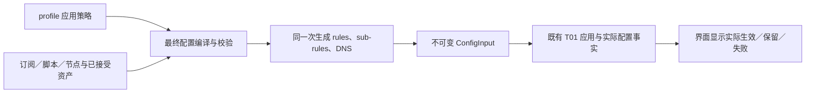

# L2-T02：应用统一生成域名／IP 分流与 DNS 配置

本文由 M1（Codex，M）亲自重写。用户已授权 D-02 细化任务并推进首项，由 M1／D-02 在既定方向内明确需求细节，无需逐项等待用户技术决定。当前**首项已完成本地交付，后续子任务尚未启动**，局部自验范围及未接入能力见[首项结果](l2_t02_01_result.md)，不表示整项受管上网已实现。设计基线为父仓库 `02cb5546d6cf708587bc28ec655a863e3cb947a6`、mihomo `6c6e3e472bb246cc55f2e8577d9eddccc2623afc`。

**本项保持当前 mihomo 源码与 gitlink 不变。** 应用维护一份策略，利用核心已有规则、子规则和 DNS 配置生成最终输入。旧版设计 `33f27ca` 中新增核心解析／路由机制的方案已被本次方向替代，其通过结论不适用于本文；不重置此前任务已有的核心修复。

任务状态见[任务清单](loop2_tasks.md#l2-t02-dns-接收方出口与失败回退)，共同判据见[安全目标](../security_requirements.md)，上游同步和完整任务完成后的推送规则见[贡献指南](../../../../CONTRIBUTING.md)。首项经 M1 设计评审后由 D-02 连续实施、自验并交实现评审，本地收尾按任务约定进行；**整个 L2-T02 完成前不推送**，设计通过或子任务完成均不单独触发远端交付。

## 1. 需求、价值与不做的风险

| 需求 | 采用本方案的收益 | 不处理或处理错误的风险 |
| --- | --- | --- |
| 域名策略同时决定业务与 DNS | 先确定用途与出口，再按该策略解析、访问 | 业务走代理，DNS 却发给直连接收方；两份人工规则逐渐不一致 |
| 域名与纯地址分流分开表达 | 域名不再依赖 GEOIP 选择出口；地址目标使用 IP 规则 | 把 IP 规则放后面仍可能触发域名查询，误以为顺序已经消除先后依赖 |
| 保留正常 DIRECT、局域网和订阅刷新 | 用户接受的功能可以持续使用 | 全部禁网损害用途；更新覆盖生成规则又会恢复未接受行为 |
| 限定受支持的配置 | 能给出可核对的最终配置和验证条件 | 为兼容任意订阅，静默删除混合规则、拒绝规则或放宽失败行为 |
| 不改 mihomo | 避免新增路由／解析核心补丁，降低官方同步冲突 | 把配置组织能力误当作核心生命周期保障，产生错误安全结论 |

本项提供**受管配置下的分流一致性设计**。它不等于所有应用 DNS 均被接管，也不等于取消后零外发、全设备断网保护或代理端解析可审计。第 10 节列出保留风险，不能用配置预览或编译成功将其记为已修复。

## 2. 已核实的实现依据

| 位置 | 当前源码事实 | 本设计使用方式 |
| --- | --- | --- |
| [配置合成](../../../../lib/common/task.dart)、[setup](../../../../lib/providers/actions/setup.dart) | 订阅／脚本／覆写先后合成；规则为空可沿用订阅；DNS 会 merge，且可追加 system 服务 | 在最后编码前统一编译受管字段，不能只往旧配置追加规则 |
| [子规则](../../../../core/Clash.Meta/rules/logic/logic.go)、[正则条件](../../../../core/Clash.Meta/rules/common/domain_regex.go) | 支持 SUB-RULE、NOT、DOMAIN-REGEX；条件读取有效 RuleHost | 用互斥入口选择域名表或地址表，复用原匹配器 |
| [业务 matcher](../../../../core/Clash.Meta/tunnel/tunnel.go) | 顺序匹配；候选不支持业务 UDP 时继续顶层下一条；未命中可落 DIRECT | 分支必须互斥，主表以 REJECT 终止 |
| [DNS 配置解析](../../../../core/Clash.Meta/config/config.go)、[policy 构造](../../../../core/Clash.Meta/dns/resolver.go) | 普通连续域名键可合并成 trie；rule-set policy 则作为有序 matcher | 用相同纯域名 provider 表达两端条件，避免两个不同优先级体系 |
| [RuleSet.MatchDomain](../../../../core/Clash.Meta/rules/provider/rule_set.go)、[inline provider](../../../../core/Clash.Meta/rules/provider/provider.go) | DNS 匹配只构造 Host metadata；支持 inline classical provider | 只生成白名单域名条件，不直接复用外部混合 classical 内容 |
| [DNSDialer](../../../../core/Clash.Meta/tunnel/dns_dialer.go) | respect-rules 按解析服务连接选路；不存在的指定代理名可能成为接口名 | 明确生成服务出口并校验名称；不依赖 respect-rules 推导业务域名策略 |
| [本地 RCODE](../../../../core/Clash.Meta/dns/rcode.go)、[DNS 中间件](../../../../core/Clash.Meta/dns/middleware.go) | 支持 rcode://refused；fake-ip 的部分 A/AAAA 可先本地回答 | 拒绝真实查询可用本地响应，但不能承诺 fake-ip 一定返回同一错误码 |
| [ConfigInput](../../../../lib/common/config_input.dart)、[T01 应用](../../../../core/config_apply.go) | 最终 YAML 可形成不可变输入；应用失败有保留／关闭契约 | 复用最终输入、来源撤销和实际配置事实，不新增运行权威 |

这些是静态源码事实，不是实测成功记录。官方配置参考：[路由规则](https://wiki.metacubex.one/config/rules/)、[子规则](https://wiki.metacubex.one/config/sub-rule/)、[DNS](https://wiki.metacubex.one/config/dns/)。实际采用能力以本地基线为准。

## 3. 路由语义

### 3.1 分类依据与不可识别情况

分类是“核心当前有可用逻辑域名”与“只有真实地址”，不等同于识别用户在浏览器输入了 URL 还是 IP。

- HTTP／SOCKS 可提供域名；TUN 常只有 IP，fake-ip／已知映射可能恢复域名。恢复后的域名路径仍走域名表，不能把合成地址交给 GEOIP 当作真实目的地址。
- 首版受管模式关闭改变 RuleHost 的嗅探，拒绝 hosts 域名别名重写；允许显式静态地址 hosts。仅关闭 override-destination 不足以保证嗅探不改变规则域名。
- 无法恢复域名时按地址表处理，不通过 PTR 猜域名，也不声称所有浏览器域名访问均已进入域名分支。需要原始域名的强保证时，此输入不满足条件。
- 应用自带加密 DNS 后连接真实 IP，可能只有地址信息。其内层查询不是本项可见内容，见第 10 节。

### 3.2 域名与地址表

| 分支 | 条件与终止 | DNS 含义 |
| --- | --- | --- |
| 域名表 | 按顺序匹配受支持的域名条件；命中 DIRECT、代理组或 REJECT；末尾有本配置显式默认策略 | DNS 使用同一条件对应的接收方／出口；解析得到 IP 后不再用 GEOIP 改换业务出口 |
| 地址表 | 按顺序匹配 IP-CIDR／GEOIP／IP-ASN 等目的地址条件；末尾有显式默认策略 | 使用已经提供的真实 IP；目的 IP 规则带 no-resolve，不为分类新增目标域名查询 |
| 主表兜底 | 未正常完成分支时 REJECT | 不借核心缺省 DIRECT 恢复可用性 |

默认策略由用户明确设置，不能从第一节点、GLOBAL 或源订阅的末条 MATCH 猜出。推荐未命中域名使用指定代理组，也可明确选择拒绝；显式默认 DIRECT 需要展示它会覆盖未命中域名及其 DNS，不能作为隐含缺省值。

这里没有固定的“GEOIP 前置解析阶段”。旧混合规则在缺 IP 且执行到 GEOIP 时可能先查 DNS；本方案把域名留在域名表，消除**为了 GEOIP 选出口而先解析域名**的需求。DIRECT／L3 协议为连接目标所需的正常解析仍然存在，此时 DNS 策略已经由应用配置确定。

### 3.3 原有 IP 拒绝与公共限制

分表会改变旧混合规则含义，尤其是原本作用于域名解析结果的 IP REJECT。迁移器不能把它自动当成“只针对字面 IP”继续启用。

首版建议：纯地址表保留其 IP 拒绝；域名中的目的 IP 禁止需求单独展示，不能证明保留时拒绝自动迁移。用户如仍需要该保护，应先评审如何用现有子规则表达局部检查以及它对远端解析的限制，再决定支持范围。**本稿不以 no-resolve 检查已知地址冒充覆盖域名全部实际目的 IP。**

进程、来源、端口、入站等条件不会自动进入域名 DNS 投影。可由现有平台独立执行的访问限制保留原职责；会改变本项出口、又无法与 DNS 等价表达的条件，首版拒绝受管候选。Android 排除应用和全设备接管范围仍由 L2-T03 审查。

## 4. 一份应用策略与职责

每个 profile 保存一份有版本的应用策略。以下为概念字段，不是已存在的 API 或 Schema：

| 内容 | 所属责任 |
| --- | --- |
| 有序域名条目：稳定条目 ID、条件、DIRECT／代理组／REJECT | 用户唯一编辑源；顺序决定优先级 |
| 有序地址条目及两个显式默认策略 | 不继承源 YAML 的隐含规则；空条目也有确定行为 |
| DNS 接收方配置及到 DIRECT／各代理组的映射 | 同时生成真实查询、默认服务与直连解析配置 |
| 节点／DNS 服务启动解析配置 | 明确必要接收方、出口及递归依赖，区别业务查询 |
| 已接受节点／组／域名集合和 Geo 资产引用 | 输入材料；记录版本、来源和所用内容，不能由订阅自报用户同意 |
| 策略版本与迁移状态 | 与 profile 一起保存／备份；旧格式不自动变成已确认的新策略 |

不新增逐域名待办、DNS 前置代理许可、B/G/K 同意指纹或查询级审批库。用户在策略页正常选择、预览并应用配置；缺必要设置时显示“未配置／待迁移”，不先联网等待其补选。



编译器只解释本项封闭策略模型，不实现另一套运行时 matcher。运行意图仍由 ServiceState 管理，实际接受状态仍由 T01／ConfigState 管理。

本项分表针对普通被接管业务。订阅、脚本、WebDAV 等维护请求继续沿 L1-T03 的 Auto／代理／直连选择及内部受控入口；不能为限制外部入站覆盖而移除这些内部入口。共享 DNS 配置是否影响维护请求须在 V3 回归核对，不能仅凭普通业务配置推导其出口正确。

## 5. 业务与 DNS 的同源生成

### 5.1 业务分支的最小结构

以下是静态核对过能力的结构示例，未运行解析或联网；ProxyA／ProxyDefault、Geo 类别及接收方须由真实策略提供。

```yaml
mode: rule
rule-providers:
  fc-domain-1:
    type: inline
    behavior: classical
    payload:
      - DOMAIN-SUFFIX,example.test
rules:
  - 'SUB-RULE,(DOMAIN-REGEX,^.+$),fc-domain'
  - 'SUB-RULE,(NOT,((DOMAIN-REGEX,^.+$))),fc-ip'
  - MATCH,REJECT
sub-rules:
  fc-domain:
    - RULE-SET,fc-domain-1,ProxyA
    - MATCH,ProxyDefault
  fc-ip:
    - GEOIP,CN,DIRECT,no-resolve
    - MATCH,ProxyDefault
```

域名子表里的 MATCH 只覆盖域名分支，不会吃掉纯地址。两个顶层条件互斥：域名候选不支持 UDP 时，核心可能继续顶层匹配；NOT 门使其不能进入地址分支，最终 REJECT。编译校验同时拒绝 PASS、REMATCH 等可能打破终止含义的目标。

### 5.2 DNS 的有序投影

不能把业务有序条目直接抄成普通域名键。首版为每条域名策略生成独立、纯域名的 inline classical provider；业务 RULE-SET 和 DNS 的 rule-set:ID 引用相同 provider，并保持相同顺序。生成命名空间由应用保留，源材料同名冲突视为错误。

首版条件白名单为 DOMAIN、DOMAIN-SUFFIX、DOMAIN-KEYWORD、DOMAIN-REGEX、GEOSITE。外部集合先在应用受控路径取得、严格验证并冻结；不能直接把 mixed classical 或 NOT／进程／IP 条件交给只有 Host 的 DNS matcher。无效条目必须由应用严格拒绝，不能依赖核心“警告后跳过”的容错。

| 应用条目 | 业务输出 | DNS 输出 |
| --- | --- | --- |
| 条目 1 → ProxyA | RULE-SET,fc-domain-1,ProxyA | rule-set:fc-domain-1 → 接受服务，明确经 ProxyA |
| 条目 2 → DIRECT | 同条目 provider → DIRECT | 同序 provider → 接受的直连／本地服务 |
| 条目 3 → REJECT | 同条目 provider → REJECT | 同序 provider → rcode://refused，本地处理真实查询 |
| 域名未命中 | 域名子表显式默认出口 | 默认 nameserver 使用对应接收方和出口；默认拒绝使用本地 RCODE |

DNS 映射必须使用保序序列化，不能按名称排序或合并掉重叠条目。不会改变路由结果的展示排序与策略顺序分开。

### 5.3 必须一起生成的 DNS 字段

- enable、主 nameserver、nameserver-policy、direct-nameserver／follow-policy、proxy-server-nameserver／policy、default-nameserver、fake-ip 相关字段均有明确应用所有权；不是只生成 policy 后保留任意旧 fallback。
- 每个联网解析服务显式指定存在的代理策略或 DIRECT。检查组闭包、协议能力及启动依赖；不使用 #RULES 重新递归求业务出口，不允许拼错组名被当成接口。运行时动态失配的剩余边界见第 10 节。
- DIRECT 解析器必须与生成 policy 协调：非空时启用 direct-nameserver-follow-policy，且默认服务是接受的 DIRECT 服务；不会因为另一个 DirectResolver 不继承 policy 而使用隐藏服务。
- 不保留源订阅的 fallback／fallback-filter、appendSystemDns、ECS 或 TLS 放宽选项。多服务、明文局域网 DNS 等仅在应用策略显式表达且未来验收覆盖时生成，不把原字段无声拼入。
- 首版公共解析仅接受 DoT 且校验服务身份；局域网允许显式指定 UDP／TCP 服务。DoH（含 bootstrap）当前拒绝：核心 HTTP client 可跟随到其它接收方及 HTTPS→HTTP，固定初始 IP／证书或指定代理不足以封闭该行为。后续支持须先证明可约束接收方与协议的实际机制，再交评审；不引入 sidecar，不以拒绝输入宣称核心问题已修复。其它协议在明确支持和验证前拒绝候选，不静默转换协议。解析服务收到域名、代理可见其转发目标，这是接受服务的正常可见范围。
- 首版不采用 system／DHCP 自动发现服务或接口名指定。用户可设置明确的本地 DNS 地址；私网地址不自动表示本机服务，经企业代理访问的私网 DNS 保留其指定代理出口。

### 5.4 fake-ip、hosts、启动与特殊协议

fake-ip 可让部分 A/AAAA 先在本地返回合成地址，业务随后恢复域名进入域名表；真实查询可能发生在后续 DIRECT／L3 消费者。过滤域名、非地址记录和 redir-host 不能据此视为“无真实 DNS”。REJECT 的 fake-ip 本地回答也不代表已放行业务，真实查询应由生成的本地 RCODE 处理。

静态地址 hosts 不新增目标查询，仍按有效域名规则决定出口；不允许通过别名重写更换分类域名。CNAME、缓存答案、A/AAAA 和非地址记录的实际消费者列入未来验证；未验证前不承诺所有别名路径都与初始 qname 完全同义。

节点和解析服务域名可能需要独立启动查询。用户接受明确的启动 DNS 与出口，default-nameserver 使用明确 IP 服务而非隐含公网默认；proxy-server-nameserver 与业务政策分开，防止代理为解析自身而递归。不得宣称“业务目标是 IP，所以全程无 DNS”。

WG remote-dns-resolve／节点自带 dns、按运行时目标生成额外解析的适配器、特殊 resolver 及无法核对的递归出站首版不进入受支持集合。不能把旧方案的 WG 最终 IP 重验当成现成功能；普通代理端解析同样无法由应用证明其内部 DNS 服务或实际远端地址。

## 6. 应用接入、编辑与持久化

| 位置 | 拟承担的职责 | 保留的现有权威 |
| --- | --- | --- |
| profile 策略页／模型 | 一份策略的增删、排序、默认出口和接收方选择；显示迁移差异 | profile 数据及正常用户操作 |
| SetupState／MakeRealProfileState | 在来源读边界捕获策略、节点、集合与必要材料的同次快照 | Request.mutate、来源版本和已有合成链 |
| _makeRealProfileTask 最终阶段 | 脚本／普通覆写之后、YAML 编码之前，一次生成并严格校验受管字段 | 既有配置编码与平台安全限制 |
| ConfigInput／T01 | 提交完整候选、判定过期、应用成功／保留／关闭 | 现有输入身份和 ServiceState |
| ConfigState／配置详情 | 显示用户草稿与实际接受配置的差别；展示生成预览和失败项 | Core 当前配置事实，不增设 DNS 运行状态机 |

受管字段必须整体替换或明确清除冲突值：rules、sub-rules、生成 provider、DNS、相关模式／入站覆盖及解析旁路。空策略也生成默认／拒绝终止，不能触发旧 data.rules.isEmpty 的订阅回退。仍保留安全模式的监听／NTP 等平台限制，最终校验禁止后续步骤重加被清除字段。

标准、脚本和自定义覆写提供允许的输入材料，不能在最终编译之后改规则／DNS。全局规则、原始 DNS 编辑器等入口在受管 profile 中改为策略编辑／生成预览，不能出现“保存成功但被编译器永远盖掉”的界面。未支持字段给出具体迁移问题，不直接丢弃。

策略持久化随 profile 的正常 DB／备份迁移实现，保存、删除、导入、排序须纳入现有 profile 来源失效比较；不能只让 UI 重建而不撤销过期候选。策略页显示的是草稿，只有 T01 成功接受才显示生效。保存失败、合成失败或缺依赖沿既有失败入口处理，不安装缺省直连配置。

## 7. 节点选择、自动更新与模式边界

### 7.1 DIRECT 的用户意图

普通明确 DIRECT 策略继续可用。代理组闭包首版仅容纳经验证的真实代理，不能含 DIRECT／COMPATIBLE／PASS／REMATCH 等控制回退；生成后非空，禁止核心自行拉取新成员破坏这个条件。无法证明空组或失败组不退 DIRECT 的组类型，不进入首版白名单。

“手动选择 DIRECT”在应用策略层表达为用户明确把该条目设为 DIRECT，并连同 DNS 生成新候选；不复用“核心 selector 中出现 DIRECT 就算人工操作”的假设。自动选择只在已接受代理成员范围内发生。组内普通代理节点切换可复用既有选择入口，同组 DNS／业务不保证同一物理节点。

Global／全局 Direct、SpecialProxy／SpecialRules、原始控制接口和热更新路由／DNS 都可能绕过生成主表。受管模式要求 Rule，并收敛相应 UI／应用配置写入口；不开放能任意改变这些字段的外部控制入口。不能约束的输入／设置拒绝启用本模式，而非继续显示已受管。监听安全本身仍由 Loop 3 处理。

### 7.2 订阅与资产更新

订阅自动刷新继续使用已接受的来源和 L1-T03 出口策略。刷新取得的是候选材料，应用重建完整规则／DNS／节点候选，校验后沿 T01 应用；普通节点变化不要求逐次人工确认，也不能改变用户自己的 DNS／分流策略。更广的来源委托和高影响变化接受由 L2-T05 接续。

远程规则／代理 provider 不由核心在后台独立更新受管内容。应用按既有刷新流程取得快照，验证后生成 inline 规则及固定节点／组成员，再一起应用；不能安全材料化的 provider 首版明确不支持。源订阅自己的定时字段不能绕过该边界。

GEOSITE／GEOIP 数据不声称可在运行中与两个消费者原子热换。首版使用已接受数据，更新需在停止状态用已有加载／更新能力核对并重载；不能证明一致时保留旧资产并提示待应用。自动下载与生效分开，是否接受必要的重连／手动应用作为第 12 节的产品取舍；不新增核心数据发布 hook。

## 8. 候选、失败与恢复

1. 捕获 profile 策略及材料；生成业务和 DNS；严格校验已拥有字段、引用、终止、TLS 和依赖。未知 action／非法 DNS 不能容错恢复默认。
2. 全部输出成为同一个最终 YAML，通过既有 ConfigInput／T01 提交。来源、策略或组结构变化使旧候选过期，重新捕获；不能给旧材料贴新版本继续使用。
3. 新候选失败时保留仍适用的旧配置，界面说明当前实际输入及未生效修改；无适用旧配置则按 T01 关闭相关入口。旧配置是旧受管方案还是迁移前原配置必须区分，不虚报新版保护。
4. 显式 DIRECT／代理／DNS 策略变化一同重生成；确认操作不成为启动意图，不能重启用户已停止的服务。并发停止和配置切换沿现有 latest-intent／ExpectedRun 处理。
5. 冷恢复使用已接受输入和现有来源资格；导入旧配置只产生迁移候选，不从缺失策略或缓存猜出 DIRECT。策略无法恢复时显示未配置，不能暗装默认规则。

上述流程复用应用已有契约，**不附加逐 DNS 事务撤销保证**。已发出的查询不可撤回，旧解析器背景任务和旧缓存的具体行为仍受第 10 节限制。

## 9. 用户场景与预期行为

下表均为待实现、待验证的行为。DNS 接收方由用户接受的策略提供；“无目标 DNS”不排除节点／解析服务的必要启动查询。

| 输入／操作 | 业务与 DNS | 失败／例外 | 拟验收 |
| --- | --- | --- | --- |
| 域名先命中 DIRECT／GEOSITE | DIRECT；同条目直连 DNS | 解析失败不新增服务；非“国内 IP 自动直连” | V1、V2 |
| 域名命中组 A／B | 对应组；DNS 经同组到接受服务 | 可用不同叶节点；不因失败转另一组／DIRECT | V1、V3 |
| 域名所有条件未命中 | 使用显式域名默认策略及其 DNS | 未配置默认策略不能启用；不进入 GEOIP 表 | V1 |
| 真实 IP 命中 GEOIP／IP-CIDR | 按地址表直连、代理或拒绝 | 不新增目标查询；纯地址无法推断原 URL | V1、V4 |
| REJECT 域名 | 业务拒绝；真实 DNS 本地 RCODE | fake-ip 可先本地答，不能据此说业务放行 | V2 |
| 地址／静态 hosts 已知 | 按有效目标分支匹配，无须无用途查询 | hosts 别名不受支持；不跳过拒绝 | V2、V4 |
| fake-ip 连接、真实记录类型 | 恢复域名后按域名表；真实问题按 policy | 初次合成回答不证明真实上游出口 | V2 |
| LAN／企业私网 DNS | 对应本地直连或指定企业代理服务 | 私网不自动等于 DIRECT；缺配置不借公网备用 | V3 |
| 候选不支持 UDP／缺组／空组 | 失败／拒绝 | 域名分支不能掉入地址直连；缺名称不能当接口 | V4 |
| 组内自动选点／用户选择 DIRECT | 自动限代理成员；DIRECT 为显式应用策略变化 | 不从 selector 默认或恢复值推断人工许可 | V3、V5 |
| 节点或 DNS 服务使用域名 | 使用独立接受的启动服务 | 循环、未接受服务或特殊解析协议拒绝候选 | V3 |
| 重叠域名、regex／GEOSITE | 两端同顺序 provider 首条命中 | 不把普通 DNS trie 优先级当作路由顺序 | V1、V2 |
| 修改策略／脚本覆写／空条目 | 最终编译统一输出；空条目有明确终止 | 不回退原始订阅、不残留旧 fallback | V5 |
| 自动刷新节点／规则 | 冻结材料、重编译后应用 | 不能由核心独立热更新破坏静态闭包 | V5、V6 |
| 坏候选／并发停止／冷恢复 | 保留适用旧输入或关闭，显示实际状态 | 不安装默认直连、不恢复旧启动意图 | V6 |
| 旧 IP 拒绝／进程或混合规则 | 展示迁移问题，不能证明等价则拒绝自动迁移 | 不静默删条件，也不冒称已保留目标保护 | V5 |
| 应用自带 DoH／DoT／DoQ | 加密服务作为普通业务目标分流 | 内层域名不可见，不能宣称本项强制控制 | V7 |
| 配置替换后旧查询／缓存 | 不扩大配置级承诺，保留实际核心行为说明 | 不能保证旧任务立即停止或按用途隔离缓存 | V6、V7及风险结论 |

## 10. 残留风险与不再承诺的能力

| 风险／边界 | 不修改核心时的结论 | 本项如何处理 |
| --- | --- | --- |
| 旧解析器 Background、共享查询、迟到结果及缓存 | YAML 不能增加 Owner／用途／activation 约束；切换或停止后旧查询仍可能继续，跨版本行为尚未验证 | 如实列为未解决／未验证，不把配置一致性写成“撤销后零外发” |
| 动态代理名称失配可成为接口选项 | 应用可防止生成时失配，不能更改核心缺名称时的解释 | 固定依赖、禁止独立动态替换、收敛控制入口；运行变化仍需真实消费者反例 |
| DoH 重定向扩大接收方／降级协议 | [当前 DoH client](../../../../core/Clash.Meta/dns/doh.go) 的 GET 查询及默认 HTTP 重定向不能由现有受管 YAML 封闭；初始服务可改换目标 | 首版及 bootstrap 均拒绝 DoH；核心风险仍存在，后续扩展必须先交实际约束与消费者证据 |
| DNS FD 与 Android 物理网络来源 | 配置文本和 protect 不证明绑定了所选网络 | 不新增 FD hook；设备验证及相关服务边界由 L2-T03 接续 |
| 代理端内部解析和 WG 二次解析 | 应用无法检查所有远端实际 IP；旧方案的最终 B 校验并不存在 | WG 特殊解析首版不支持；其它远端解析限制明确显示 |
| 域名分支不再受原有全部 IP 规则约束 | 不能同时宣称完全保留混合规则语义 | 迁移必须揭示差异；关键 IP 拒绝无法保留时不自动迁移 |
| 订阅节点及 DNS 服务自身可信性 | 同源生成不证明服务不会收集数据或来源未被攻陷 | 延续来源／身份审查；L1-T04、L2-T05、Loop 6 各按原范围处理 |

旧版提出的 DNS 子 lease、输入／writer 代际绑定、用途隔离缓存、事务预算、物理网络 FD 证明和 WG 最终 IP 校验从本设计删除。这些风险并未因此消失；需要这些强保证时，本方案单独不满足，不能在任务结果中记为已解决。

## 11. 未来验证与完成判据

L2-T02-01 的 design_v2／implementation_v2 已经 M1 评审通过，D-02 按[首项授权与范围](l2_t02_tasks.md)完成局部实现、必要本地自验与本地交付。下表仍为整项验证方向，未执行项不能记为通过；实际结果按子任务记录。使用真实消费者与本地合成 DNS／代理／业务服务，不连接真实订阅、账号或外部测试网站。

| 编号 | 真实消费者与观察 | 通过条件 |
| --- | --- | --- |
| V1 | 应用策略编译、最终 YAML、核心实际 matcher | 域名／地址分支互斥；重叠、默认和 GEOIP/no-resolve 正例一致，无意外缺省 DIRECT |
| V2 | 生成 provider、实际 DNS listener、fake-ip／hosts／rcode | 同名条件业务与 DNS 同首条；所有上游收件可区分；拒绝无目标外发，记录类型和别名行为如实覆盖 |
| V3 | DIRECT／代理组、真实 DNS client、节点／DNS 启动及 L1-T03 维护入口 | DIRECT、A/B、LAN和企业服务实际收件正确；维护请求的 Auto／代理／直连不被共享 DNS 破坏；枚举所有尝试 |
| V4 | TCP／UDP、空组／缺组、控制适配器和 no-resolve | 域名分支失败不落 IP／接口／DIRECT；纯地址和合法已有地址不被无用途解析阻断 |
| V5 | 最终合成、UI／DB 来源、脚本／覆写与导入 | 空集合不回退；冲突字段无残留；不支持规则明确拒绝；策略编辑和备份迁移不破坏单一来源 |
| V6 | ConfigInput／T01、订阅更新、恢复和并发停止 | 草稿与实际状态相符，失败不装默认配置；动态更新只能经受管候选；明确观察旧任务和缓存剩余行为 |
| V7 | Android 设备上的 TUN／网络变化、应用内置加密 DNS | 区分可见／不可见和接管／未接管；记录物理网络、旧查询实际边界，不能用替身证明设备行为 |

配置生成、静态引用和 YAML 解析通过只证明配置结构。业务与 DNS 出口结论必须有真实消费者的独立收件记录。产品验收中若发现重大剩余风险，需继续处理或由用户明确收敛可接受范围；不能仅因本项不改核心就宣布安全任务完成。

## 12. 实施时的决定与停止边界

用户已将本节普通工程取舍交由 M1／D-02 随实现收敛，不再逐项请求人类选择。先按以下边界拆分和推进首项；具体支持清单、验收和变更由子任务设计维护：

1. **语义。** 按本文的域名／纯地址分流方向实施；默认策略显式配置，不保留“域名解析到国内 IP 就自动改直连”，也不暗装 DIRECT。
2. **兼容。** 无法等价表达的旧条件不静默删除；先拒绝受管候选并保护适用的旧配置，按真实需要逐步扩展。内部实现选择由 D-02 提出、M1 把关，不因普通细节停工等用户。
3. **拒绝与数据更新。** 关键 IP REJECT 不能丢失；无法保留时不自动迁移。Geo 数据先采用可核对的重载边界，不承诺原子热换；保留订阅自动刷新用途。超出当前首项的能力独立落入后续子任务。
4. **安全边界。** 第 10 节的未解决／未验证事项继续保留，不因用户授权推进而改记为已接受风险或已修复。若出现必须修改 mihomo、删除关键保护、对外传输或新增设备／系统网络操作才能继续的真实冲突，先交 M1 判断受影响范围，保留其它可推进工作。

当前授权为任务分解及首项实施闭环，包含计划中的必要本地合成验证；实际设备、真实凭据／外部测试流量和宿主网络变化不包含在内。M1 的设计与实现评审继续进行，不增设人类逐步批准门。局部完成不等于整个 L2-T02 或全部 DNS 安全问题完成；整个任务实现、必要验证、评审和合入完成后，才按贡献指南普通推送一次。

## 13. 上游同步与维护

业务策略与生成逻辑放在应用侧最小边界，不修改或重生 mihomo 补丁／carrier。模型、UI 和最终合成各保留清晰职责，沿现有生成代码和 DB 迁移规则工作；不把自动生成 YAML 当作新的人工编辑源。

官方同步时重点复核子规则控制流、域名 provider／DNS matcher 顺序、配置字段默认、DNS 出站名称处理及最终合成入口。固定核心版本和受支持功能矩阵，能力变化后先复核相应用例；不能用保留旧模板代替兼容性判断。其它平台待定。
