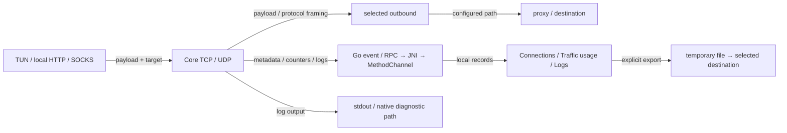

# L2-T04 业务数据处理与额外传输审查 Plan

任务及归属见 [Loop 2 Tasks](loop2_tasks.md#l2-t04-业务数据处理与额外传输审查)，判据见[共同安全目标](../security_requirements.md)。
本项回答：正常上网的正文和连接信息在客户端内经过谁，哪些信息被保留或交给其它接收方。
先核实共用生产链路，再以本地合成流量检验 DIRECT／SOCKS5 和实际应用消费者；不预设存在隐藏上传，也不预设全包安全。
design_v1 已由 M1 评审通过，文档基线和本地合成验证已实施；
[实际结果](l2_t04_result.md)及 implementation_v1 已由 M1 实现评审通过；用户已决定 Android 禁用 ZeroTier。
design_android_v3 已由 M1 评审通过（含 R1／Q2／R2）；文档基线后的实施、验证与 ARM64 制品已完成，
进入本地合入与 M 交付收尾，远端尚未交付。

## 问题与目标

用户点击 **Start** 后，出口符合配置仍不足以证明业务数据只用于该次通信。
Core 可读取正文进行协议处理、sniffing 和转发，也会生成 metadata、统计与日志，应用再经 bridge 展示、导出或保存部分信息。
缺口是这些用途之间尚无完整的、绑定实际版本的审查结论；它不是已经证实的泄漏根因。

输入基线为父仓库 `75d31f8e4c7e09be89dd8607304990e7fe79afb5`，Core 为
`6c6e3e472bb246cc55f2e8577d9eddccc2623afc`，源、gitlink、carrier 均保持不变。
设计提交时只读源码及既有证据，尚未执行本项流量、测试、构建或设备验证；实施后的结果单列于 Result。

初步走读确认下列提供方与消费者，仍须在实施阶段追完其依赖与旁路：

| 数据／路径 | 已读到的行为 | 本项需要继续证明什么 |
| --- | --- | --- |
| TUN／本机代理→Core | [Android TUN](../../../../core/tun/tun.go)交 fd 给 sing-tun；[DNS 分支](../../../../core/Clash.Meta/listener/sing_tun/dns.go)与普通连接分流；HTTP 代理会解析请求 | 从实际入口至 TCP／UDP 的交接、瞬时缓冲、DNS 和其它旁路，不能将 host 测试冒充 Android TUN 实测 |
| TCP／UDP 正文 | [tunnel](../../../../core/Clash.Meta/tunnel/tunnel.go)执行 sniffing、选路、dial、tracker；[TCP Relay](../../../../core/Clash.Meta/common/net/sing.go)和[UDP sender](../../../../core/Clash.Meta/tunnel/connection.go)转发字节 | 各包装层是否另存／另发、失败及取消时的去向；不由 Relay 的实现推导全链路无复制 |
| 协议与解析信息 | [SOCKS5](../../../../core/Clash.Meta/adapter/outbound/socks5.go)有认证、目标地址及 UDP relay；[sniffer](../../../../core/Clash.Meta/component/sniffer/dispatcher.go)读取初始数据提取域名 | 正常握手、封装及缓存的必要性；Host、SNI、IP、业务 Cookie／Authorization 与节点认证分别判断 |
| 连接与流量统计 | [tracker／manager](../../../../core/Clash.Meta/tunnel/statistic)保留 metadata、时间、规则、chains、字节计数；[wrapper](../../../../core/hub.go)提供 snapshot／request event | 实际 JSON、计数层次、连接关闭及队列生命周期；没有 body 字段不构成正文全链路证明 |
| 本地 bridge→Flutter | [ServiceController](../../../../android/app/src/main/kotlin/com/follow/clash/ServiceController.kt)、[ServicePlugin](../../../../android/app/src/main/kotlin/com/follow/clash/plugins/ServicePlugin.kt)、[Service](../../../../lib/plugins/service.dart)、[CoreManager](../../../../lib/manager/core_manager.dart)传递并消费事件 | 对照 Go 原始 envelope、Android 转交与 Dart 实际解析，核实有无额外消费者、错误输出和持久化 |
| 日志与保存 | Core 日志独立写 stdout；Flutter [Logs](../../../../lib/providers/app.dart)有内存缓冲和显式 Export logs；[backup](../../../../lib/common/backup.dart)写选定配置／DB／文件 | 日志订阅、入口隐藏、stdout、临时导出、DB／preferences／Core cache／私有 crash evidence 分别追踪，不能因入口关闭便声称不采集 |

## 方案与理由

沿数据实际流向审查每个分支的读取、复制、保留和发送调用，并记录其输入类别、触发、接收方、正常用途及证据深度。
source search 只用于定位，结论来自调用者、实现和消费者；没有观察到外发不能证明不存在，存在 dial／write 能力也不能证明当前已执行。
优先把共用链路查完整，比只枚举 URL 或穷举所有节点组合更能覆盖业务数据处理；动态验证用于检验关键判断和失败分支，不代替源码审查。

图只说明拟审查的通道，不宣称旁路已穷尽。DNS、协议控制／发现、缓存和错误处理须逐项补齐；
bridge 处理 metadata 与日志，不成为第二套路由或运行资格权威。
ConfigInput／T01、ServiceState 和 Request 的现有所有权保持不变，不新增全量报文记录、产品审计服务或持续采集机制。
Go 的 [Metadata](../../../../core/Clash.Meta/constant/metadata.go)
包含 `inboundUser`／`sniffHost` 等字段，
多于 [Dart 模型](../../../../lib/models/common.dart)当前接收的子集；核查原始 bridge 数据，不能只看页面字段。
`ServiceController.setEventListener(null)` 仍安装用于消费 configState 的 native 回调，
因此还须区分 Flutter detach、native 接收与最终丢弃，不能只根据 Go 的 `hasEventListener` 推断无事件生成。

### 覆盖边界与分层结论

1. 共用层：走读 Android fd／sing-tun 交接、本机 HTTP／SOCKS 入站、TCP／UDP、sniffer、requestscope、
   outbound 公共包装、统计、日志和应用消费者。DNS 只解释本项数据类别和接收关系，不重做 L2-T02 身份修复。
2. 深入并实测：DIRECT 与 SOCKS5 的 TCP／UDP；本机 HTTP 明文及 CONNECT、SOCKS 入站；
   sniffer 关闭和 HTTP／TLS 提取的代表分支。
   同时覆盖普通配置与受管配置可达部分，受管编译器／最终应用边界沿用既有实现，不修改白名单。
3. 普通模式其它能力：从 [ParseProxy](../../../../core/Clash.Meta/adapter/parser.go)、
   Android 实际 build tags 与配置消费者生成逐项覆盖表。
   逐个查看 adapter 的构造、Dial／ListenPacket、传输包装、日志／文件和附带联网入口，明确实际追到的依赖边界。
   SS／SSR、HTTP、VMess／VLESS、Snell、Trojan、Hysteria／Hysteria2、WireGuard、TUIC、ShadowQUIC、
   GOST relay、SSH、Mieru、AnyTLS、Sudoku、MASQUE、TrustTunnel、OpenVPN，
   以及 DNS／REJECT／REMATCH 均不得静默省略；
   smux、SS plugins、TLS／REALITY、WS／HTTP／H2／gRPC／其它配置可达传输独立注明深度。
4. Overlay：Tailscale、ZeroTier、EasyTier 单列配置→实例化→启动／DNS／peer／控制流的触发，
   区分选定 peer 与控制、发现、STUN／relay 接收方。只读已有运行时和缓存源码，不启动它们或联系公网服务；
   仍未追完的底层协议／依赖明确为未审，不由 `with_gvisor`、managed 限制或 UI 未选中推导不可达。

上述 3／4 层不承诺本轮建立每种协议服务器或完成全部依赖安全审计。
交付必须让读者区分源码覆盖、真实 Core host 实测、Dart 消费者测试与未验证 Android／协议范围，不能用共同层通过升级整包安全结论。
若发现实际超出用途的业务复制／发送，先保存最小合成反例，再做获准应用／wrapper 范围内的窄修正。
涉及 Core 禁改边界、关键路径无法判定或新重大风险时，向 M 给出影响和选项，暂停该部分；
不能套用 R1 的“记录跟踪”决定将新问题自动结案。

## 实施与验证

### 文档先行及交付顺序

设计通过后先形成当前文档基线，再写验证代码或必要修正：

- 新增 `docs/features/security/business_data_design.md`：业务数据处理的长期维护位置，说明 payload／metadata、
  处理方、保留／接收方、触发与生命周期、逐协议覆盖和未审边界；未证实部分先标 draft／待验证。
  独立用途是让用户无需被清理的任务 Result 也能理解处理范围，索引只链接此处，不另造风险台账。
- 修改 `docs/features/security/android_network_inventory.md`：业务与诊断部分链接该长期说明，只同步真实受影响的接收／保存边界；
  本项发现如影响现有契约，修订对应契约的权威章节，不复制其正文。
- 持续维护本 Plan 和 `loop2_tasks.md` 的本项状态；实测后新增 `loop2/l2_t04_result.md`，只写实际结果、偏差、复现及版本绑定。
  不回写已结束任务，不预写安全通过。现有 deferred 记录保留；新未解决重大风险的归属由 M 结合实际事实决定。
- 长期说明中的使用章节给出 English 入口：**Start → Dashboard → Live connections / Traffic usage**，
  导航 **Live connections / Logs**，
  **Tools → General → Logs and diagnostics → Logcat**，以及 **Export logs** 的实际保存范围。
  本轮不预设需要修改 UI；如确需改文案，按 localization skill 同步真实消费者。

### 本地合成验证与独立预期

优先复用现有 ConfigInput、managed Core、本地代理、captureFrames 及 Flutter scoped provider 测试设施；
必要的新测试限于父仓库 `core/` 和 `test/`，最小合成夹具随源，原始输出位于忽略的 `build/verification/l2-t04/`。
不另建通用测试平台。以下均为待执行条件：

1. TCP DIRECT／SOCKS5：实际接受／激活合成配置，使用 loopback HTTP POST 与 TLS origin；
   请求／响应正文、URL、header、目标和节点认证各用不同 marker。
   origin 与代理分别记录实际字节／目标／握手，正文须完整到达预期接收方，协议必要字段可解释。
   端到端 TLS 明文只在测试端点解密，不要求合法代理看不到地址／SNI。
2. HTTP／SOCKS 入站：absolute-form HTTP、CONNECT、SOCKS connect，覆盖正常与认证／目标失败。
   对照预期的 hop header 处理、target 和字节，失败不向无关目标发送业务 marker；
   不把所有输入“逐字节不变”当作 HTTP 代理正确标准。
3. UDP DIRECT／SOCKS5：原始 datagram 与 SOCKS UDP association／relay，请求和响应用不同 marker。
   独立 echo／proxy 接收及封装／解封装结果须匹配，metadata 与计数按该层定义核实，不能套用 TCP 或只计算 body。
4. sniffing 与失败／取消／恢复：HTTP Host／TLS SNI 可识别与截断输入、dial／handshake 失败，
   以及 owner 失效后新连接、受控在途取消和重新接受配置。对照 source 和实际收件，提取值与正文分别判断。
   取消后不新发获撤销业务，不将已发送字节声称为可撤回；恢复仅到新配置接收方，不复用旧 marker。
5. Go→应用消费者：记录真实 getConnections／traffic reply、request／log event，
   交 Dart 实际 parser／CoreManager／provider／页面消费者，对账 envelope 与结果，保留正常 metadata／计数。
   业务正文／业务认证 marker 不无故进入事件、统计或页面；Android JNI／Kotlin 转交先源码核对，
   host 替身不称设备证明。
6. 输出与保存：对照 stdout、事件、内存缓冲、导出临时文件、全新 preferences／DB／Core cache，
   覆盖正常、错误和停止，分类核对业务 marker 是否出现、是否属于明确用途。SQLite 按内容读取，
   配置中的合成节点认证／DNS 缓存与业务秘密分开；显式日志导出是否带 metadata 如实记录，
   不预称全量脱敏或无持久化。

固定由测试拥有的 loopback 接收方与独立 canary sink 区分目标、代理和错误接收方。
记录 Core socket hook 的拨号尝试，并拒绝非 loopback；此 hook 只能约束实际经过它的路径，
其它 client／native 调用须由源码追踪补足，不能据未命中 canary 或一次空目录宣称系统级无外发／无保存。
本项测试只用临时数据根，所有 server／socket／timer／子进程由测试持有、关闭并 wait；
全局 hooks 如需隔离采用自有短生命周期进程，不覆盖旧冻结证据或用户数据。

### ZeroTier 局部补证：M1 已批准的内存实验

实施走读发现 controller trace／TEE 的条件性 payload 副本，事实权威见
[当前说明](../business_data_design.md#zerotier-的额外-payload-接收能力与-android-禁用)。
M1 批准在原 pin 上补纯内存消费者实验；未批准禁用协议、改变 tags／工厂或扩大 controller 信任。
实验前先维护本节和该长期 draft，不修改 Core／依赖源码，不启动真实 wireTransport、overlay、设备或 OS 网络。

使用公开 Node、内存 StateStore／WireSender、合成 identity 与合法 Frame；
controller 输入必须经过真实签名／身份／network-config 接受路径，不能私有字段注入或绕过校验。
全局 trace、仅 controller trace、本地 trace 关闭的 TEE／WATCH 分开，配置无副本作负对照，
并观察损坏／非授权输入的实际拒绝。原定 peer 与额外 target 用不同身份，
独立接收／解码并核对原 frame、长度与方向，不将 frame 中的 TLS ciphertext 称为 HTTPS 明文。
队列、时钟及自有节点有界并关闭／wait；如公开 API 无法形成闭环，保留已到层级和具体缺口，
不以内部测试状态替代。此证据只证明 pinned 依赖和给定输入的行为，
与 adapter 可达性作静态对应，不冒充完整 Core／Android 业务外发或已发生的用户泄漏。
结果就绪先交 M 决定处置，其他独立审查继续；不以 R1 的记录许可替此问题结案。

### 检查、限制与完成判据

按实际变更运行锁定依赖解析、analyze 和受影响 Flutter／Go 检查；已有有效协议／JNI 证据按源码与制品绑定复用。
仅文档和测试变更时核实既有 ARM64 APK 输入等价性，不重复全量构建／安装；生产或 native 变更才补相应生成、编译和 ARM64 产物验证。
本方案不需要启动宿主应用、TUN、system proxy 或 AVD；若关键 Android 结论确需设备补证，
先修订具体用途及全新 English AVD／私有 ADB 资源安排交 M 评审。
真实订阅、凭据、ouo、用户 DB／备份、用户设备、宿主系统网络、外部测试／遥测及原始材料上传均不使用。

交付出口是可追溯的当前数据处理说明、逐路径覆盖及未审清单、相互印证的本地正反证据和必要窄修正；
设计与实现分别交 M 评审。审查深度不足或重大风险不能仅靠“未观察到”放行；
局部证据不代表普通模式所有协议或 Android TUN 已全面安全。
[R1](../deferred_security_items.md#l2-t02-r1-共享-ip-与域名身份)继续未解决，
L1-T04 身份／跳转与 L1-T05 全面日志脱敏仍暂缓，
Loop 3／4／5／6 及 L2-T05 不自动接做。

## Android 禁用 ZeroTier：design_android_v3，已通过

用户已明确选择不需要并禁用 Android 内的 ZeroTier 支持。原纯内存副本证据仍有效；
新保护的对象是随后构建的 Android Core，不操作其它软件／设备，不改 Core、依赖、gitlink 或 carrier。
父包装层增量已实施并完成本机验证与 ARM64 构建，实现评审已通过，进入交付收尾；旧 APK 不能据本设计标为已禁用。

### 构建和缓存

在 `plugins/setup/setup_hooks/lib/src/options.dart` 给 BuildConfig 提供按 Target 计算的唯一 effective tags：
Android 保留配置基础 tags，按 Go 支持的逗号／空白分隔去重并追加 `no_zerotier`；其它平台继续使用原 tags 字符串。
`go_builder.dart` 的 build 与 list 必须使用同一方法；fingerprint 已绑定实际 arguments、完整配置、环境、目标、
源码／carrier 和 harness inputs，新规则及 effective tags 使旧 Android cache 失效，不修改全局 build_config.yaml 的基础 tags。

同时将现有 build_config.yaml 内容纳入实际 inputs；CoreBuilder 始终为该文件声明精确的外层 hook dependency，
包括缺失状态，以发现创建／删除及内容变化。实际二次 Gradle 构建表明仓库根目录依赖会把无关任务输出归入 Flutter 输入，
触发 implicit dependency 错误，因此改用文件依赖；当前 hooks_runner 支持不存在文件的 hash，不扩大 Gradle 输入目录。改变 hook package 源码会使旧外层缓存失效；
内层再次核对实际 arguments／fingerprint／产物 Hash。`setup.dart`、直接 Flutter build 和 CI 都经同一 Native Assets 入口；
关闭 build_assets 的打包仍由现有入口拒绝，不把手工预置旧库当支持路径。

### 接受、provider 与失败关闭

实际能力边界是既有 `zerotier_stub.go` 的 NewZeroTier 拒绝，覆盖 ParseProxy、普通节点／组、inline provider、
file／HTTP provider 的材料 parser 和动态更新。不会删除节点、只屏蔽 trace 字段、加入浅层 YAML 黑名单或新增启用开关。
provider 的显式 exclude-type／filter 先于工厂解析：被原过滤条件排除的条目不构成能力实例，
不能承诺源文件只要出现 ZeroTier 字符串就拒绝。实际进入 parser 的不支持节点令该次集合解析失败，不提交部分集合。
旧 checkpoint／provider cache 恢复仍须经过新 Core 的真实 parser／factory，不沿用旧运行时对象。

源码确认 `executor.loadProvider` 启动 goroutine 后没有 Wait；有小并发上限的平台还可能在 Apply 内等待前批 Initial。
当前 ARM64／amd64 的 concurrentCount 为 MaxInt，ARM32 为 5，不能假定本轮 ARM64 有固定的小并发上限。
因此 Apply 返回和 provider 完成是两个独立条件。v1 的“Apply 返回后读一次错误”有提前安装窗口，现废弃该判断。
空组默认 COMPATIBLE 实际为 DIRECT，只加 tag 不能封闭此失败出口。

#### staged 初始化的真实完成边界

父仓库 `core/` 增加仅 no_zerotier 构建采用的 provider 初始化协调模块，临时资源对象绑定唯一 preparedConfig／receipt／scope。
它只管理本次工作完成和退出，运行资格仍由 ConfigInput／appRequests／ServiceState 决定，不新增可激活状态权威。
共享 installConfig 的解析、应用与安装收尾分段复用，不复制另一套配置安装实现。

1. 在 configMu 内核对 receipt、owner、来源与候选，创建单次 install 工作记录；同 receipt 的重复 install 加入同一结果，
   不能再次 Apply，也不能凭 `p.cfg != nil` 返回 installed。快照持有 cfg，供后台只访问自己所有的对象。
   进入本次全局应用许可的等待也在 configMu 外，并先于 ParseRawConfig；取得许可后重新核对候选，
   才在原锁范围内解析／构造 cfg，保持 CurrentOwner 的构造绑定与现有 bootstrapRequired 返回链。
   新 prepare 可以撤销旧资格并保留关闭的候选入口，但不能在旧工作未退出时解析出站、进入 Apply 或激活。
2. 在调用 Apply 前，为本 cfg 所有 file／HTTP proxy provider 和 rule provider 注册 Initial 完成槽，
   不能靠“已开始回调数量”推测总数。具体 ProxySetProvider／RuleSetProvider 采用嵌入原对象的包装；
   组、规则和 parser 仍引用同一个原集合，Owner／Proxy／JSON／更新等公开行为继续委托，动态 Update／SideUpdate 不重建集合。
   inline／compatible 的材料已在构造中解析；其非阻塞 Initial 仅启动自有 healthcheck，不作为待下载材料。
   `core/common.go` 的 toExternalProvider／sideUpdateExternalProvider 目前按具体类型分支，
   需仅对本包装显式取回原 provider 后复用原分支；不能以方法提升误称具体类型断言仍然成立。
   appRequests 的路由 lease 也以 provider 引用判定当前性，须以同一原 provider 比较，保留原集合与版本语义。
   路由快照在必要 rule Initial 尚未完成时把其 Strategy 视为未就绪（nil），避免并发读取原对象正在替换的指针；Initial 返回后直接委托原方法，不维护第二份 strategy。
3. install 释放 configMu 后，受本次工作记录持有的 worker 调用真实 ApplyConfigStaged。
   每个包装的第一次 Initial 调用真实原实现并记录完整返回结果；并发／重试调用共享该结果，不重跑原 Initial。
   worker 分别记录 Apply 退出和预注册 Initial 的完成；**全部成功且 Apply 已退出**才有成功候选。
   回调不能写 installed／ready、监听入口或 checkpoint，也不能关闭全局 activeBusiness。
4. RPC 在 configMu 外等待完成、首个错误、scope 取消、appRequests.changed 或整体 deadline。
   registerConfigOperation 成功替换 latestConfig 时只唤醒已有 changed 通知，不提前撤销仍已接受的旧运行；
   等待者依已有 receipt／owner／source／run 条件判定本候选是否失效。来源／dataset 失效在原 revision 变更时同样唤醒 changed，避免等待者只能等下载或 deadline 才发现失效。Stop 仍持原锁关闭 scope，等待不占用该锁。
5. 只有成功等待者重新取得 configMu，并再次通过 pendingForReceipt、scope、deadline、结果封存及来源／运行资格检查后，
   才走原 DNS／监听安装收尾，发布 installed；activate 再核对相同工作成功和原 phase。
   多个等待者只由第一个完成安装，后续返回既有结果；未完成时的提前 activate 返回拒绝，
   不设置 BusinessActive、不发布可重放 checkpoint。

本次 install 的整体等待预算拟为 30 秒，包含上一工作退出等待、Apply 调度和所有 Initial；
依据是现有单次 HTTP 默认 20 秒及 Dart RPC 默认 3 分钟，为启动工作提供有界预算并先于 RPC 兜底退出。
它不保证任意数量／大小的材料必然在时限内成功，不新增用户 timeout 配置；测试仅用受控短预算。
这约束本协调模块的等待，不承诺强制中断既有同步构造器或平台调用；不把用户在阶段间的权限对话计作后台工作超时。
接受成功时撤除初始化 deadline；provider lifetime context 独立保留到本配置退休，不能在 30 秒后自动取消已接受配置。
成功 cache 可在离线场景通过；缓存过期引发的正常后台刷新不是本次接受的必要条件，失败仍保留已合法集合。
缺失／坏 cache 可按原 provider 语义尝试配置的 bundle／远端材料，但最终须有真实成功的 Initial；
网络、格式、不支持能力或资格失败均关闭本候选，不能先用空集合进入 ready。
必要初始化请求仍沿既有 inner／provider-initial 资格和所声明路由，不等 ready、不自行直连或新增 bootstrap 许可。
既有解析阶段确实产生 bootstrapRequired 时保留原显式引导／重新提交路径；无法取得必要资格则失败，
不把 barrier 超时解释为自动获准引导，也不承诺所有 provider 都能走该恢复路径。

#### 取消、迟到和 Close 的所有权

失败、超时、Stop、替换、来源／运行失效都同步使本候选 scope 失效并唤醒等待；
当前候选由现有 blockConfigLocked 关闭，旧候选仅返回 superseded，不改新 owner 的事实或监听。
取消路径还须在原 appRequests 权威内匹配本 owner，立即撤销其 lease 资格并取消请求 context，禁止新 dial／迟到 commit；
不能只取消业务 scope 后等待 provider 自己结束。按既有 prepared／flush 清理模式，把可能阻塞的 socket／provider 关闭移出锁，
不在 configMu 或内部记录锁中等待这些 I/O；不为旧 owner 取消新 owner 的请求。
包装 RequestContext 保留原 context 的值与取消，
并关联本次退出信号，使 executor 的 WaitReady 重试在候选失败后退出，不能用 ready 重试满足接受先决条件。
普通动态 Update／SideUpdate 仍按原 parser 返回错误、保留仍合资格的旧集合，不因本次变化清空或改出口。

不能在原 Initial 仍运行时调用原 Close：Fetcher 的 watcher 建立与 Close 没有本项可依赖的并发保证。
包装 Close 只封闭新 Initial 进入、请求本次取消并幂等登记清理；未开始槽记为取消，迟到调用不进入原对象。
原 Close／cfg provider 清理由本工作持有的退出协调者在 **Apply 已退出、所有已进入的原 Initial 已返回** 后执行，
位于 configMu 外、每原对象只执行一次；包括 rule provider，避免 cfg.CloseProviders 引入同类并发关闭。
成功安装后的包装仍保留这一 Close 契约；新 prepare 先退休原工作，不能遗失 pending cfg 的清理责任。

同一时刻只允许一个全局 staged Apply／初始化／退休工作持有进入许可；新 install 在 configMu 外等旧工作清理完成，
等待同样受本候选整体 deadline 和资格约束，未获许可不启动新 Apply／worker，不形成后台重试队列。
这是对不可重入全局 Core 应用和旧 provider 副作用的资源串行化：旧 Initial 末尾会按 provider 名关闭连接，
所以不能只靠“旧集合 commit 被拒绝”就让新配置先运行。
旧对象、watcher 或原 Initial 若不响应取消，RPC 和 Stop 不等待其原 Initial／Close 无界退出，剩余资源进入隔离，
许可保留到实际退出；后续候选在其时限内不能安全取得许可便明确失败，不假装清理完成，也不强杀 goroutine。
保留量限于这一 cfg 已注册的 provider 工作，不因重复 install、取消重试或后续候选继续叠加 Apply；
这不是 ARM64 Initial 固定小并发上限的承诺，不能把仍存活的 goroutine 计为已释放。
恢复要求旧工作实际退出，或沿已有进程所有权路径重新启动 Core 所在进程；本项不擅自新增杀进程／设备操作。

#### 全局 Shutdown／Init 与进程退出

R2 的来源是 `core/hub.go` 的 handleShutdown／handleInitClash 和 prepareConfig 的直接 initializeCore 调用。
它们原来靠 configMu 与 Apply 互斥；`executor.Shutdown` 自身不取得 Apply 的 mux，锁外 Apply 后必须扩大同一资源进入契约，
不能只等待“下一 install”。这里沿用 v2 的工作所有权，不另设 ServiceState 或 UI 运行状态。

| 实际入口／调用方 | 完成语义及本增量的约束 |
| --- | --- |
| stopListenerReceived；Android service 的 Stop／revoke | 同步关闭业务 scope／lease，isRunning=false；不是全局 Shutdown 完成或 isInit=false 的证明 |
| Go initClash RPC ← CoreController.init／CoreAction.initCore | 取得同一进入许可后才可初始化；不能先走 isInit 同目录捷径绕过关闭中的工作 |
| prepareConfig 携 InitParams → initializeCore | 同样受关闭 fence 与进入许可约束；关闭期间不能先分配新 owner 再隐式 Init |
| Go shutdown RPC → handleShutdown | 退休本资源工作并确认退出，再执行原全局清理；成功后才可报告真正 Shutdown 完成 |
| CoreLib.stop／close → Service.shutdown → ServicePlugin → ServiceController.unbind | 实际仅解绑，不等于调用 Go shutdown；不把原返回 true 升级为整个 Go 地址空间清理证明，不改该解绑语义 |
| 非 Android cgo 的 releaseOnExit／exitOnTermination／IPC EOF | 原退出清理预算 3 秒只是尽力清理；真实进程退出才终结地址空间。Android cgo 不编入 exit.go，本项不新增退出／强杀动作 |

Shutdown 在入口登记当前资源工作的关闭请求，立即封闭本轮 prepare（分配 owner 前）、install、activate、Init 的进入，
并按 v2 取消本 owner 的业务／维护资格。重复 Shutdown 共享同一次工作；仅已登记的取消和短记录变更在锁内执行。
等待旧 Apply／Initial／provider 清理实际退出在 configMu 外，受同一 30 秒协调等待预算约束。
取得独占资源许可后，原 closePrivate、日志／route watch、监听、Geo updater、NTP、executor.Shutdown、force GC 收尾
由该关闭工作执行；不与旧 Apply、Init 或另一全局清理并发，也不在 configMu 内等待其可能阻塞的 I/O。
逻辑 Stop 在此期间仍可撤销资格和关闭自己所有的绑定，不与关闭 worker 重复执行全局 listener／resolver 清理。

只有物理清理返回成功后，持 configMu 及本次进入记录重核所有权，才完成 currentConfig 的关闭收尾、设置 isInit=false 并完成 Shutdown。
逻辑失效可能已经撤下 currentConfig；这不代表资源已释放，原 cfg 仍由退出工作持有到真实清理完成。
原 worker 已退出且新进入仍被封闭，因而不存在 Shutdown 成功后旧 Apply 再设置代理／DNS／NTP／inner 的窗口。
失败、超时或原清理未返回时，handleShutdown 返回 false／RPC 返回现有 MethodError 通道的失败，业务已关闭，
但 isInit 保留其实际初始化值、关闭 fence 保留，不能因 currentConfig 已为 nil 就伪称已清理或允许重新 initializeCore。
只有该关闭工作实际成功后，后续新请求才可 Init；迟到完成只作用于所捕获资源记录，不能清新 owner。
未响应取消的原关闭同样隔离；同一次工作不会因调用者重试继续派生关闭 worker，不新增自动杀进程。

利用已有 MethodCall.seq 在 dispatch 的同步部分登记 Shutdown／Init 的到达资格，不在该路径等待或执行 I/O。
关闭 fence 一经登记就不能被排队 Init 解除；记录关闭完成时的 arrival watermark，
在关闭前／期间到达但迟执行的 Init、带旧 registration token 的 prepare 不得在完成后自动重建。
旧 Shutdown 回调按原工作记录返回已知结果，不得对已新建的资源再清理；新 Init 必须是关闭完成后的新调用。
同目录 warm Init 在无冲突且已初始化时保持原幂等行为，no_zerotier 以外构建保留现有路径。

getIsInit 不把关闭中／隔离中的对象伪装成“干净的未初始化”：内部 isInit 仅反映真实初始化／清理结果；
关闭期间该 RPC 和拒绝的 initClash 使用结构化生命周期不可用错误，而非让调用方把 bool false／同目录 true 当可重建许可。
这样 CoreAction.initCore 的 isInit 捷径及 init 结果日志不会吞掉这一失败；沿既有 CoreMethodException 传播并由启动路径处理。
成功清理后的 getIsInit=false、正常 Init=true 语义不变，无新 JSON schema 或业务运行状态权威。

直接节点的 parse 错误、provider 初始化及动态错误均通过现有返回链显示。
只对 pinned stub 的确定错误叶子归一为 `ZeroTier is not supported on Android.`，不向 UI 增加 build-tag 细节或节点秘密；
其它初始化失败使用不含 URL／认证的失败说明。保持既有配置坏候选保护／失败关闭语义；无旧资格时入口关闭。
若真实消费者揭示此边界不可在 wrapper 安全落地，先向 M 报具体缺口，不改核心。

### 验证及文档增量

- `plugins/setup/setup_hooks/test/` 用现有 package:test 设施验证三种 Android target、基础 tags／去重、其它平台不变、
  build/list arguments 一致、配置内容与增删的依赖、旧 cache miss／新 cache hit；不启动桌面应用。
- 父仓库 Go 的显式 no_zerotier 选集走真实工厂／parser／inline／file／HTTP provider、动态坏材料和旧 checkpoint；
  覆盖显式过滤与真实遇到不支持节点的区别、合法离线 cache、坏／缺 cache 失败、原引导许可和旧合法动态集合保留。
  用可控阻塞的真实 provider 制造 Apply 已返回而 Initial 未返回，核对真实 ConfigApplyResult／receipt／owner：
  此时 install 不成功、重复 install 不旁路、提前 activate 被拒绝、预置业务目标／DIRECT 收件为零；分别释放成功和错误。
  加入多个 provider 中一个迟到、Apply 本身仍未返回、Stop／替换／来源失效、整体超时、迟到回调和退出隔离，
  检查等待未占 configMu、未完成原 Initial 时不并发原 Close、旧工作未退出时新 Apply 不进入，退出后恢复正常候选。
  小并发名额的平台分支按实际目标源码／构建核对，ARM64 不虚构超过 MaxInt 的运行用例，不为测试改 Core 常量。
  实际读取 external provider metadata／JSON、执行 Update／SideUpdate 并核对原集合身份，防止包装破坏具体类型消费者。
  不只测聚合计数：实际走 wrapper／ConfigInput、监听与独立收件；故意不响应取消的测试夹具最终由测试释放并 join。
  正常 DIRECT／SOCKS5 实际业务对照继续有效，原正文审查证据按输入复用；新增能力边界需实际运行，默认 SKIP 不计通过。
- R2 增量调用真实 handleShutdown／handleInitClash、prepare 携 InitParams 及 RPC：分别在 Apply 未返回和 Apply 已返／Initial 未完成时关闭，
  核实业务收件为零、原物理清理未先执行、isInit 未被提前清零、并发 Init／prepare 未产生 HomeDir／ownership endpoint 等初始化副作用。
  释放后验证原清理成功才 isInit=false，之后新 Init／新配置可恢复；重复关闭、关闭超时、迟执行旧 Init／Shutdown 及旧 registration
  均不能清理或重建新 owner。读真实监听、初始化文件／目录与 Go 状态的先后，不以协调器内部假 Shutdown 代替。
  结构化不可用错误经实际 Dart RPC parser／CoreAction 启动消费者传播，正常 warm Init／解绑语义和原默认构建对照保留。
  Core 进程退出仍按既有契约分层，不通过停止用户进程来做本项验证；测试所有阻塞和自有进程最终释放／wait。
- 构建 harness、Go、Flutter 受影响消费者和静态检查后，按现有 Android guide 关闭上传、锁定依赖，
  经生产入口重建 ARM64 APK；核 source／tags／指纹、内嵌 libclash 的 Go buildinfo／依赖、未剥离／打包库 Build ID 和制品摘要。
  另用同 effective tags 的真实可执行工厂／配置路径验证拒绝，区分编译中保留源码／错误文本与运行能力。
  不单凭符号字符串或配置文本判定封闭，不把旧研究诊断依赖计作 APK 启用能力。设备仍不在本增量范围。
- 先维护本文、`business_data_design.md`、`android_network_inventory.md` 和 `docs/development/android_build_guide.md`
  的 draft／兼容说明，再实现、回填 Result 与 Tasks。Core 平台架构的构建说明若解释受影响规则，也同步该权威段落。
  该设计仅重审新增构建／provider 失败出口和制品范围，不重启 v1 整体设计；通过后连续实施至实现交评。
