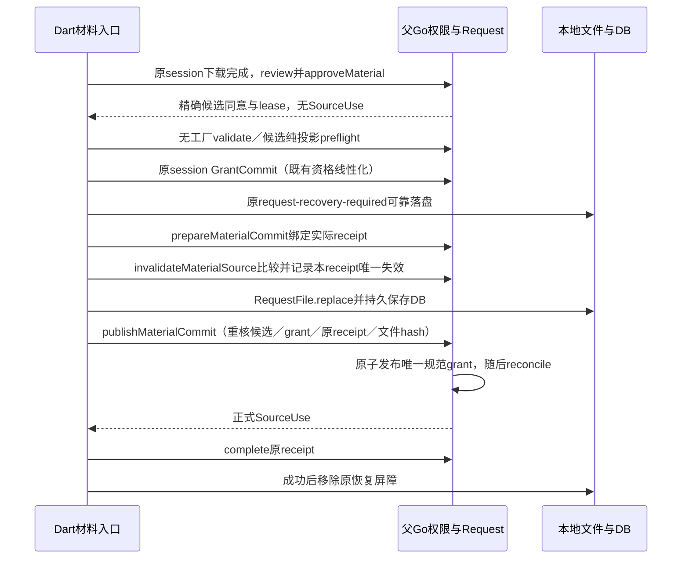
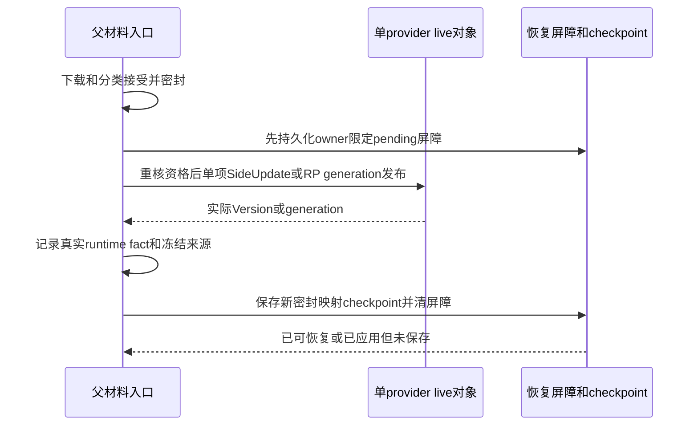

# L2-T05 来源接受与轻量连接追溯 Plan

任务入口：[Loop 2 Tasks](loop2_tasks.md#l2-t05-来源信任与配置内容接受)。M1 负责评审，D-02 负责设计、实施与本地交付。
实际验证、失败及设备限制见[Result](l2_t05_result.md)。
**M1已通过Android整项实现评审，I1／I2闭合；待本地交付及M收尾。**
来源接受、provider局部热采用、材料保存／恢复屏障及轻量规则来源追溯已完成生产接入。
原恢复／Start身份和原触发排序跨异步入口及队列保留；过期调用在取得Setup所有权前退出。
受影响host选集、正常生成／分析、最终ARM64制品及指定AVD正对照已完成；实际覆盖、失败和版本绑定由[Result](l2_t05_result.md)维护。

既有v1／I1／R5／I2及最终准入修订包保持冻结，不能将其中历史待审状态解释为当前未通过。
已知Core完整安装的日志并发仍未解决，且无原基线复现，见[长期风险](../deferred_security_items.md#core-完整安装的日志级别并发)。
指定设备的guest loopback和host bridge结果不构成物理网络、真实TUN入站或DNS R1保证；非Android来源保护仍未交付。
本Plan保留本次获审方案，当前有效契约由[长期设计](../source_acceptance_design.md)维护。
工作基线为父仓库 `310b61675f1efec8e9fb4f24659da425db4137af`、Core `6c6e3e472bb246cc55f2e8577d9eddccc2623afc`。
父仓库较生产调查起点 `1f1698494fc0a54d038d89b57ec98f448427004c` 仅有 M 的后置需求文档提交；已读生产源未变。

## 问题与目标

实施前，同一订阅 URL 的新内容经下载、语法检查、文件替换后即可进入合成；来源票据只证明这次请求仍有资格，
不证明来源获准改变 DNS、默认路由或增加协议能力。脚本刷新会替换文件并触发合成，`getProfile` 在最终配置编码前执行脚本。
Core provider 还会独立读取 cache、HTTP 和本地文件，并自动／手动更新集合，不能只检查 Flutter 最终 YAML。

本项按[共同安全目标](../security_requirements.md)落实首次明确委托、范围内自动维护和超范围候选的接受／拒绝，
覆盖普通及受管 Profile、远端／本地脚本、Override、本地编辑／导入、proxy／rule provider 与恢复。
运行期交付范围为Android；共享入口按真实平台选择路径。非Android保留既有来源、脚本、provider运行及ConfigInput v1契约，
不进入Android来源候选／热采用，也不显示已支持状态；其它平台安全能力仍待定。
Android必须使用完整SourceUse／ConfigInput v2，缺权限／registry／owner／lease时明确拒绝，不能退回legacy。
host可用真实registry／权限／owner夹具检查组件，不能据此声称Android平台装配或active gate通过。
不强迫普通配置转为当前有限受管策略，不改 Core、依赖源码、gitlink 或 carrier。
轻量追溯只补现有 **Live connections／Recent requests** 详情，说明实际 Rule、可证明来源及匹配时版本；
不包括后置的 App 分流、按 App 聚合、快捷创建规则或 HTTPS 路径采集。

### 已核实的生产约束

| 入口 | 源码事实与设计影响 |
| --- | --- |
| [Profile 刷新](../../../../lib/providers/actions/profile_refresh.dart) | 普通材料目前只作 YAML 检查；受管材料另有 preflight，随后才 invalidate／replace。新接受检查应在原提交点之前 |
| [合成](../../../../lib/providers/actions/setup.dart)与[规则组合](../../../../lib/common/task.dart) | Script 在 makeRealProfileTask 前执行；本地 addedRules 在源规则前，自定义 rules 替代源规则。来源记录应随真实组合产生 |
| [Fetcher](../../../../core/Clash.Meta/component/resource/fetcher.go) | parser 在 GrantCommit 前运行；GrantCommit 的 Spec 没有候选正文。自动轮询／file watcher 调用原 Fetcher.Update，不经过外层 provider.Update |
| [HTTPVehicle](../../../../core/Clash.Meta/component/resource/vehicle.go) | 有公开 Vehicle getter；SetInRead 在 scope 路径只收到提交时的无正文 metadata。没有可复用的“解析前候选字节”hook |
| [tracker](../../../../core/Clash.Meta/tunnel/statistic/tracker.go)与[通知](../../../../core/hub.go) | tracker 在规则匹配、拨号之后创建；记录 Rule／RulePayload，不带 ConfigInput 版本。到达通知时读当前配置会误归属迟到连接 |
| [真实匹配](../../../../core/Clash.Meta/tunnel/tunnel.go) | 匹配在 configMux 读锁内执行 C.Rule.Match，随后可能跳过 PASS／不支持 UDP 或 REMATCH。追溯必须对应最终采用结果 |

以上是源码调查，未作为新运行验收。L2-T04 的已交付禁用、初始化与生命周期契约继续有效，不重开其冻结任务记录。

## 方案与理由

### R5 恢复后缺材料的明确引导（实现评审通过，待本地交付／M收尾）

实际红例：带marker先Start会正确结束为failed／setupFailed；随后明确离线核对虽清marker且不提升候选，
附带重建仍被原Auto维护规则拒绝。fresh initializedIdle先恢复可以成功，不能替代这个顺序。
离线材料没有另一个可直接使用的正式索引：恢复已使checkpoint失效，权限中的semantic digest不能推出原始正文Hash；
不扫描旧manifest／accepted列表或新增恢复库。采用现有一次bootstrap对缺失材料做明确引导，正式来源接受保持原路径。

- 保留R4有效checkpoint优先复用。仅识别原producer写出的规范“checkpoint已失效”空引用为无材料，
  不把它当作材料权威；须先通过新root正式SourceUse／声明及unknown／marker检查。其它损坏、撤权仍报错，不能转普通网络miss。
  正常自动／后台分支不因空引用获得网络资格。
- 明确离线恢复成功后的前台重建可以请求引导；用户再次点击Start（实际ui intent、可见且允许review）也可重试。
  仅当未started且原普通维护条件不成立时，缺材料的Auto／Direct provider沿现有Direct request recovery对话框，
  展示provider名称及去除凭据／query的目标origin。每个实际URL单独确认，取消无permit／HTTP／新输入，保当前许可并可再次Start重试。
  声明Proxy的provider不进入该分支，不降级DIRECT；缺合法代理仍明确失败。
- 复用Request.begin现有allowBootstrap及真实permit；withSession只补参数传递，completeProviders在密封复用miss后调用。
  Go现有permit绑定client／key／完整URL／dataset／source revision／native epoch与revision，begin一次消费并继续核owner／operation；
  bootstrap lease仍走实际Android SocketGate的当前network选择、protect／bind与后续state核对，不改普通failed／preparing资格。
  源码已核：Go bootstrap分支不要求started；native gate不接受starting／retiring protect、旧network或外部VPN。仍须真实端到端验证，不据源码先记通过。
- UI恢复两个实际caller向applyProfile传局部allowBootstrap；普通自动应用／刷新默认false。
  Start重试只由setRunning新建的实际ui请求传递局部选项（非initialize、无preparedRequestId、非paused），
  不凭native source历史值推导；实际native已started时一律不引导，即使Go未ready或paused使Dart的running判断为false。
  Stop／新intent／token、source／dataset或网络revision胜过未完成对话框、permit和旧cleanup；未知写者或marker未核对时仍拒绝。
  恢复helper在确认前捕获既有native processEpoch／intentRevision／configToken，离线核对成功后只在该身份仍相同时允许caller重建；
  新命令胜出时只结束本次离线处理，不把其完成当作重建新intent的请求。比较沿现有captureNativeRunState，不发布或维护另一份运行状态。
- 本地file不出现直连对话框，也不伪造网络session：复用fetchProvider现有本地分支，路径仍仅由正式root计划解析并核C.Path安全范围。
  读取沿既有beginRequestDataRead／endDataRead排除未知写者、marker与在途写，前后重核当前client／来源ticket及正式root／完整声明。
  仅返回有界候选字节，仍需原origin／provider review、密封lease及bindProviders／ConfigInput，不授予任意本地路径或网络能力。

文档先修本Plan、`../source_acceptance_design.md`与`../source_acceptance_guide.md`的引导／取消重试语义；
再修改原checkpoint失效引用读取、Request参数及Setup／恢复caller，补窄测；Result只回填实际结果。
验收覆盖两个恢复顺序、取消后再次Start、Proxy不降级、材料缺失／损坏／撤权、旧确认与新Stop／intent／network竞争，
真实Go permit一次消费与Android实际下载收件；原unknown／R4未变证据复用，重建ARM64仅复跑受影响设备路径。

#### I2：原恢复／Start身份跨队列保持（含入口准入修订，实现评审通过，待本地交付／M收尾）

M对implementation_r5指出：恢复helper返回bool后丢弃原native身份，排队后重取快照可把新tile／alwaysOn命令当成旧动作授权。
本轮沿已审latest-intent约束补齐：恢复成功返回确认前的原processEpoch／intentRevision／configToken，两个caller原样传入applyProfile；
新UI Start以既有RunRequestScope实际requestId核初始native身份后，在进入setup队列前固定该身份。
排队前后与_setupConfig开始均核同；来源／Script／provider候选、permit、安装与错误清理延续原身份检查。
本次正常登记的新token只依据本次Core receipt接续；不把后来观察到的新token或intent当自己的资格。
旧动作被新命令／Stop／token替代时返回superseded，不能弹框、下载、发布许可、安装或清理新命令。
先同步本Plan、Design／Guide／Result，再窄修和补受控排队窗口反例及同身份正对照；未变设备证据复用，原冻结包不改。

I2复审残留：拒绝旧身份之前递增setup generation，仍可使合法较新Dart任务失去current；原8组仅替换native状态，不能证明两个Dart任务同时在途。
补齐既有SetupAction的调用排序与准入：调用票号只排序，不失效当前拥有者；原身份和caller current通过所有await后，
同步比较票号并取得setup generation，旧票号不得覆盖已准入的新票号。Stop沿同一票号序列即时失效旧任务。
取消过期需求与setup busy变化均在准入后，队列真正执行前再次核同；未获资格的晚到恢复不产生共享副作用。恢复和fresh UI Start在各自触发时预留同一Setup排序票号，跨恢复helper／prepareRunIntent等待原样传入；不能仅在晚到applyProfile处给旧动作分配新票号，native身份未变时也须保护已准入的较新任务。
新增较新B真实Setup已阻塞后晚到旧A、旧UI身份读取待返回而较新B进入、以及合法新任务仍能替换旧任务的最小对照。
先文档、反例及窄修；原I2冻结包与已成立证据不改，按新增影响补制品和正对照。

### R4 实际Android启动的provider材料复用（已审，待实施验收）

获审I1 APK在指定隔离AVD实际Start失败：原生进入preparing、Go旧配置ready但businessActive=false；
`completeProviders`无条件创建新网络session，Request.begin在尚未started时拒绝auto出口。
原失败日志和同一实际PID的两次状态保存在`android_device/app-start-failure-01.log`及
`observation-start-requested.json`、`observation-resumed-start.json`，不计启动通过。

M1已通过本增量设计。离线复用入口仅从可验证checkpoint取得已采用manifest中的已接受provider材料，
逐项核新接受config的计划、原始Profile用途、provider声明、SourceUse／origin及密封正文摘要。
仅返回仍有规范许可且声明相符的已采用材料，不扫描候选／live cache、不从存在或Hash推断许可，
不创建新grant或放宽preparing的网络规则；返回正文沿既有review／bindProviders／ConfigInput重新校验。
材料在跨语言消费期使用既有material lease，来源票据／数据集／unknown writer和恢复屏障仍受原检查。
普通运行期刷新及停止态材料保存后的前台重建继续原流程；实际preparing／starting的启动构建先复用合资格材料，缺失时保留现有显式下载／
bootstrap或失败行为，不暗中DIRECT。checkpoint有pending／recovery marker时不作为复用来源；
同一限制适用于当前已采用材料，不从live后未保存的状态恢复启动。损坏、撤权及缺原始Origin按错误拒绝，
不能当作普通miss后自动下载；只有无checkpoint或新计划没有同声明材料才为miss。

同一失败后原生仍preparing；源码显示未提交配置的清理可能拿上次ready receipt调用abortConfig而被
superseded提前返回，须以真实状态机回归确认。拟由现有failRunIntent区分本次尚未注册的构建失败，
只结束相同intentRevision＋configToken的启动，不abort旧ready配置；晚到清理仍不能停止新intent。

文档顺序：先修本Plan及`../source_acceptance_design.md`的启动材料／失败语义，再修改
父Go材料读取、Dart completeProviders和必要的既有native清理参数及相关窄测；
实际红绿结果回填本Result与`../source_acceptance_guide.md`，原v1／I1包保持冻结。
验收含started=false的同声明材料离线复用（HTTP收件为零）、缺材料／改声明／撤权／损坏／屏障拒绝、
真正运行刷新仍下载，以及未注册失败对当前／新intent的清理；再重建ARM64并复跑实际Start及后续设备矩阵。

### R3 新来源身份的同意与材料提交（已审，待实施验收）

真实manual successor bridge发现：Profile更换URL后，下载尚未提交时的`accept`即替换规范grant的incarnation；
随后`reconcileSourceScopesLocked`关闭旧配置scope，也取消本次下载的旧owner会话，导致最新候选无法保存。
不能放宽`sourceCurrent`、owner或Stop检查，也不能重抓ticket或改走DIRECT。
本修订仅分离材料阶段的精确同意与正式权限发布；config／provider运行采用仍只接受规范SourceUse。
普通同Identity且现有委托允许的revision维护沿原热更新路径，不因本修订关闭整个scope。

#### 接口与所有权

- 父Go沿现有`pendingSourceReviews`保存已同意材料候选。候选绑定随机ID、精确原始正文hash、identity、
  kind、settings、routing／automatic选择、原grant revision及incarnation、来源ticket、实际RequestSession ID和operation。
  首次实体以“原grant不存在”绑定。沿现有候选数量／总字节预算及材料lease限额，不建立第二份grant文件。
- 材料入口中凡需本次人类选择的候选均先延迟发布，包含首次／新Identity／fresh，以及同Identity的Routing改变；
  不仅按identity判断。精确正式许可复用、既有委托下不改变use epoch的自动revision追加仍走原路径。
  Source permissions页面的即时withdraw／用途变更是当前使用权限操作，继续立即生效，不伪装为材料候选。
- 材料入口的`approveMaterial`返回`approved`、候选ID及材料lease，**没有SourceUse**；不会替换规范grant、
  触发旧scope撤销、允许自动维护或冷恢复。其它操作、另一session／client或新owner不能消费该同意。
  精确旧revision已正式接受时可继续返回真实SourceUse；初次／新identity／fresh实体替换先走候选同意。
- Dart使用独立`SourceMaterialApproval`承载待提交材料，不用空map或伪造SourceUse冒充正式接受。
  正常运行审查仍返回`AcceptedSourceRevision`。前台拒绝、来源／设置变化、session结束或候选替换使同意失效并释放lease。
- 现有Android `validateConfig`仍只进行无工厂的结构／代理格式检查。受管preflight使用新增的候选投影入口，
  父Go核精确候选、正文、source ticket和原session后，执行既有纯投影及策略编译；该投影不产生SourceUse、
  不调用节点构造器、不下载嵌套材料、不允许config安装。Script代码仍须独立正式许可；本修订不授予待提交代码执行。
  Profile和Script材料保存共用提交语义；Script实际执行发生在材料正式提交后的配置合成阶段。
- 网络材料候选在review时绑定实际下载session／原Spec及operation；`prepareMaterialCommit`只接受该真实
  `appRequestLease.GrantCommit`生成的receipt。Profile／Script网络刷新沿原session，不新登记请求。
- 显式本地Profile import（含fresh）／Script save在review时建立`local-material`候选，绑定本地操作ID、
  精确正文、设置和来源ticket，没有网络session。`grantLocalMaterialCommit`只能消费相同已同意的local候选，
  在原`dataMutations`串行范围内核当前client、dataset、来源revision／operation及native观察，再生成带该同意ID的
  有界本地receipt。它不要求服务运行，也不授予网络能力；普通`lock`receipt不能消费任何材料同意。
  网络候选不能转为local候选或由普通lock升级；显式重新导入相同字节须建立另一local操作并重新获得该次同意。
- 两类入口复用原`appRequestReceipt`，增加原Spec或local操作ID、同意ID和材料hash，重核规范grant与候选，
  不创建平行事务／权限权威。一个receipt仅能绑定一次、同意不能重放。本地import／save先同意与纯validate，
  后取得专用本地receipt并保存；`_ManagedMaterialFrame`明确接收本次approval作纯投影，不再二次正式review／accept。
- `invalidateMaterialSource`在父Go的既有config／registry锁序内比较当前来源revision和候选原ticket，
  原子递增并把前后revision记录到实际已绑定receipt；同时沿原入口使checkpoint失效及取消旧网络lease。
  每个receipt只允许一次。Dart同步自己的cancel generation，不再另外调用普通invalidate；不能将外部恰好+1
  视为自己的失效。publish只认可该receipt实际记录的失效、当前revision精确相等及未改变的dataset／grant。
- `publishMaterialCommit`仅在相同receipt尚未完成、候选仍为同一已绑定对象、原grant未改变、dataset／实体
  未被其它操作撤销或替换时发布；核对本receipt唯一一次来源失效所产生的预期source revision和已保存文件的精确hash。
  保存目标由父层按kind／key计算：Profile为私有`profiles/<id>.yaml`，Script为`scripts/<id>.js`；
  不接收调用者任意路径。新owner／新client不得完成旧提交。权限原子写成功后才reconcile旧scope；
  不再对已结束网络读取重复请求资格检查。
- `complete`对已绑定但未发布的提交返回partial commit，先撤销候选发布能力、释放该receipt的内存占用，
  删除`r.commits`对应项并`changedLocked`唤醒等待者；保留耐久恢复屏障，绝不靠无限占用receipt阻塞恢复。
  receipt终止后所有晚到publish均拒绝。detach先禁止该client发布，已取得有限本地写资格者在原action结束后终止；
  旧client重新attach时，旧receipt只能失败终止，不能借新client发布。进程退出自动清除内存能力，屏障不删除。

#### 实际提交时序

`GrantCommit`之前保持原session的全部检查；材料receipt是既有有限本地写资格，不恢复网络访问。
本地入口用`grantLocalMaterialCommit`替代图中的网络GrantCommit，其余耐久提交及失败出口相同。
正式grant发布在file及DB耐久保存之后；它与Dart事务不能跨语言原子化，故整个窗口由既有恢复屏障覆盖。
`materialSaved`只描述file＋DB实际已保存：发布权限失败时仍如实报告材料已保存和partial commit，不伪称文件回滚。
正式SourceUse只在发布成功后供后续合成使用；旧root的撤权只在此时发生，不能由“候选同意”提前触发。

沿用同一个`request-recovery-required`，将其pending内容改为含receipt／client随机身份的所有权标记，
该文件仍只作恢复屏障，不作来源许可或候选恢复日志。材料绑定前须核本receipt的pending标记已可靠落盘；
成功complete只删除匹配的本次标记，失败终止保留它。Dart原`_runReceipt`及其partial-commit写入／清理同样按
实际receipt身份比较，旧finally／ack丢失不能删除或覆盖新receipt的标记。标记写入失败时不进入材料写阶段。
失败响应丢失后只允许幂等终止及释放本次资源；不得重做publish、重放file／DB或借新receipt续原候选。
原receipt已经移除时，前台data read可结束等待并明确收到recovery-required；attach／ready可建立新client，
在实际核对file／DB／grant、使旧dataset失效并前台重建后才显式清理相符的恢复屏障。

#### 失败、并发与恢复出口

| 位置／事件 | 材料与权限事实 | 结果／恢复 |
| --- | --- | --- |
| 拒绝、validate或preflight失败 | 原file／DB／grant未变 | 丢弃本次同意，保适用旧输入 |
| GrantCommit前Stop、切换、删除、新URL／successor、撤回 | 原session／ticket或grant不再合资格 | 拒绝绑定，不保存、不续网络 |
| GrantCommit后普通Stop／新intent | 仅允许已授予的有限本地提交完成；不启服务／新请求 | 正式材料可保存，应用结果superseded；不恢复运行intent |
| 绑定后删除、另一次来源失效、grant revision／incarnation改变、新owner／detach | 本候选不得发布正式许可 | 若尚未写则保旧；若已写按partial commit阻止重放 |
| file或DB失败 | RequestFile沿原实现恢复旧文件；grant尚未发布 | 保恢复屏障并失败终止receipt、唤醒等待者；不假设跨文件回滚成功 |
| file＋DB成功、权限写失败／结果不确定 | 新材料真实已保存，grant可能旧或新 | markPartialCommit及invalidateDataset；保屏障、拒绝重放和新采用 |
| grant成功、reconcile／complete失败或ack丢失 | 已发布权限不假回滚，真实材料保留 | 保屏障、幂等终止内存receipt；前台核实际权限／材料后重建 |
| 绑定后任意进程退出／冷启动 | 同意及未完成receipt不恢复，屏障留存 | 不自动提升候选为许可；实际规范grant若未发布，新材料须重新审查 |
| 旧cleanup／晚到候选 | ID／session／operation／receipt不匹配 | 只能释放自己的lease，不能清新屏障、覆盖新grant或材料 |

前台恢复复用既有`request-recovery-required`和dataset失效流程，读取实际file／DB与唯一grant再审查／重建；
不从候选缓存推断正式许可。权限原子写即使rename后报告fsync失败，也按未知提交结果保屏障处理。
真正withdraw、删除及外部恢复继续立即撤权，不被材料同意或旧receipt延后。

#### 实现评审I1：排队clearRecovery与detach

implementation_v1未通过：M1通过真实control入口让clearRecovery排队于configMu，期间退休同一receipt，观察到unknown=1时旧调用仍清除恢复标记。
修订不改变已审恢复语义：clearRecovery取得configMu后才核unknown；同一临界区中核当前receipt／registry、client ready、begun、未failed／retired及dataset失效，再比较并删除相符marker。
核对至删除期间保留registry锁，避免实际receipt完成或归属变化跨越。补真实排队反例、资格拒绝、foreign marker、重复complete和合法restore正对照；按影响复核其它恢复／发布入口的锁内校验。
原v1冻结包及M红例不修改；增量Go验证、真实备份bridge与ARM64制品另作绑定，设备限制保持不变。
M1已通过implementation_i1增量复审（snapshot `33816b8ff9450812e8413559210b1b68b0a4e6588bcfd32f56224c882029d326`），I1闭合；整项仍待真实Android验收，不提交／合入。

#### 修订验证

##### R3.4 detach与未知写者（增量设计，M已通过，实施中）

`ServicePlugin.onDetachedFromEngine`只发送`engineDetach`并撤掉回调，不join Dart文件／SQLite写。
`RequestFile.replace`的copy／rename和`NativeDatabase.createInBackground`所在Dart isolate可能尚未结束；
不能把detach、新client、超时或原生state的新epoch当作写者已退出。
实际app／service／core Manifest没有独立`android:process`声明，`Core.kt`通过同进程JNI加载`libcore`，
Drift后台数据库也是isolate而非外部进程。因此完整应用进程退出能终结这些写者；Service重启或Go Init不能提供该证明。
`ServiceStateMachine`的`processEpoch`由对象构造时生成UUID，不作为OS进程死亡证明。

沿既有`r.commits`为前台receipt增加`retired-unknown`状态，不建第二份事务或grant清单。
另有一个仅作拒绝条件的进程级unknown-writer计数；它不随registry／Core Init／ServiceState重建清零，
只在该实际receipt收到写结束的`complete`时逐项解除，或随整个OS应用进程消亡自然重建。
registry被重建而旧receipt已不可确认时，计数仍阻止使用，必须真正重启应用进程。
不提供按新epoch、超时或外部trusted标志清除的接口，不自动kill用户进程。

所有前台receipt沿同一集合限制并行数量为16（独立的保守前台写限额；现有Dart串行提交远低于此，来源候选槽位上限仍为32），满时按已有commit-busy拒绝／等待；
有unknown writer时不再准入新的本地提交或网络请求，不允许集合继续增长。
Core内部无frontend client的已审维护receipt不计为本地file／DB写，但不得借它消费前台材料同意。

| 事件／消费者 | 实际处理 |
| --- | --- |
| 无本地写receipt的普通detach | 沿原客户端取消，后台provider热采用继续按原运行资格；不设置unknown |
| 已grant但`beginCommit`尚未确认durable marker | 尚不允许进入Dart本地action；detach后拒绝beginCommit，可直接终止本次空receipt |
| marker已确认且未complete时detach／engineDetach | 先保耐久屏障、撤销候选publish能力、退休receipt并计入进程unknown；沿已有失效路径阻止不一致运行资格 |
| 新client ready | 可ready以显示恢复界面；不因此恢复写入、网络或配置运行 |
| beginDataRead／waitFrontendCommits | 不等待退休条目；因unknown／屏障及时拒绝，不卡十秒或无限等 |
| 新grant／lock／material local grant／正向review/accept/publish／ConfigInput应用 | unknown非零即明确拒绝；withdraw／reset等即时撤权仍可执行 |
| 恢复inspect／commit | unknown非零返回restart-required，不清标记、不核对后抢先采用；普通读不成为恢复绕过 |
| 旧client complete到达 | 只幂等终止相同receipt并减去它的unknown占用、唤醒等待者；永不删／覆盖屏障或执行publish |
| 旧client永不complete | 标记和进程拒绝条件保留；界面说明必须完整重启应用，不能只重启代理／Service |
| 真正退出后重新启动 | 新进程没有存活旧写者；仍须用户明确进入已审离线file／DB／grant核对，不能因计数初值为零自动清标记或恢复候选许可 |

detach按既有`configMu → checkpointMu／registry`顺序处理，不能在持checkpoint锁后反向等待configMu。
`complete`与detach在同一串行点归属receipt；标记所有权仍由原receipt／client绑定，
旧complete或晚到Dart finally不能删除新client／新receipt的标记或改变其dataset。
已退休条目只作写者结束凭据；不再作为active commit拖住ready／data read。

English UI落点沿Profile／Script的`Source permissions`恢复入口：遇到restart-required时明确显示
“Open App info → Force stop, then open FlClash again. Restarting the proxy service or closing the screen is not enough”。
不自动停止用户进程，也不让“Restart proxy”按钮假装解除；用户真正重启后仍显示已审的本地核对／重建确认。
进程退出条件以这些写者共享的真实OS进程生命周期为依据，Go／registry／native epoch变化均不能单独放行。

新增验证只覆盖该分支：无写detach仍能热更新；有写detach时read及时返回、ready可达但新写／运行拒绝；
晚到complete只结束自己、foreign marker不变；registry／Init／Service epoch不清unknown；
独立子进程退出后保留原marker、由新的真实进程离线核对恢复。该新增量由M1按小节摘要`99e3c598615a98a52ff607c4406752cfbbf9d80e461f2dc113e68b1a739cd410`通过；实现与host反例已验证，Android实际平台验证仍未完成。
Android实际MethodChannel还须显式允许`beginCommit`／`markRecovery`／`clearRecovery`，不开放native内部动作；补真实插件分发的允许及拒绝反例。

两条现有真实Dart→Go manual successor bridge为已稳定失败入口；修订后核最新URL材料保存及旧waiter退出。
补拒绝／validate失败不撤旧权，确认后Stop／新owner／删除／更晚URL／withdraw，候选跨operation／client复用拒绝，
权限写失败、file／DB失败、complete丢失、冷恢复及旧cleanup反例。普通provider与inline热更新保连接证据按影响复用。
同Identity Routing改变、本地fresh import／Script save失败保旧、外部恰好一次invalidate不能冒充本receipt、
失败终止后data read及时返回且新client可前台合法恢复，纳入本修订增量验证。
当前源码入口：`core/source_acceptance.go`、`source_grants.go`、`source_scope.go`、`app_requests.go`，
`lib/common/request.dart`、`request_file.dart`、`lib/providers/actions/profile_refresh.dart`及`policy_material.dart`。
M1已通过本增量设计并授权连续实施，尚未形成运行验收结论；原冻结design_v5不修改。
获审章节hash为`48802eca1578e6bc434efe6e74c8dd484c9ad5088660bc39be997786ac69fa11`，
获审文档与实施前源码基线在忽略目录`build/verification/l2-t05/design_r3_reviewed/`，只作设计及接续依据。

### 1. 委托与候选接受

来源委托是持久的用户决定，运行资格仍由 Request／ConfigInput／ServiceState 判定。
SourceGrant 由父 Go 包装层的单用途私有权限文件持久保存：来源实体 ID 与 incarnation、委托 revision、用途／可维护部分、
节点协议及附加能力范围、固定保护边界、已接受执行的脚本 digest。Dart 通过既有请求资格下的权限操作查询／修改，
Drift 只保留 Profile／Script／本地路由数据，不再另存一份可与无前台运行分歧的 grant。
不以 URL、文件 Hash 或“已有缓存”自动生成委托；URL／来源身份或引用拓扑变化须重新核对。
Go 父包装层提供统一的候选影响分类，Dart 负责编辑、合成和交互，避免两份分类规则。
ConfigInput manifest 携带同次来源票据、权限文件 revision、设置快照与材料绑定；权限从父层规范记录重核，不能由源 YAML 或 manifest 的自称标志授予。
已接受输入的精确内容使用同意与未来自动维护委托分开，见保存与撤回部分；两者均不创建第二个运行状态机。

主动输入 URL 的 Import 动作只表示请求下载该来源，不表示接受下载到的任意内容；新增嵌套 provider 接收方须先获准下载。
首次 Import／Use 时显示 **Review source**：来源名称／脱敏服务 origin、节点与规则用途、允许协议能力、
DNS／默认出口等当前有效行为；用户可 **Accept this revision** 或明确委托其范围内维护。
后续 **Review changes** 按实际有效差异解释“解析服务变化”“默认出口变化”“扩大 DIRECT”“增加控制／发现服务或协议能力”，
不把逐行 YAML diff 当唯一说明。默认不显示 URL token、密码和完整请求正文。

| 变化 | 拟接受行为 |
| --- | --- |
| 已委托节点的地址、凭据、数量／名称维护，且协议／能力范围与引用闭包仍合法 | 自动候选处理，不逐次询问；仍信任该来源选择的节点，不宣称识别恶意节点 |
| 明确可变块／集合内的 proxy 规则维护 | 仅满足下述有序变化准则时自动处理；普通字段相同不构成证明 |
| DNS／默认 mode／MATCH 出口、固定 DIRECT 或 REJECT 保护条件、来源／资源 URL、插件／控制服务能力变化 | 留作待确认；复杂表达式或二进制 rule set 无法证明未扩大 DIRECT 时，按可能扩大处理 |
| 未分类的有效字段、未知能力、无法对账的组合／来源 | 进入确认；已禁止的 routing／能力不能被通用 Accept 解除，须去除该内容或明确修改相应委托 |
| 用户主动改某个本地设置／规则 | 本次明确编辑动作可作为该精确差异的意图；不能顺带批准远端的其它变化 |

#### R1：不用 matcher 的保守有序准则

自动规则维护只承诺下列可机械核对的形状，不声称任意两份规则等价。首次接受时明确标记并展示
`P（固定前缀）→ V（来源可变块／集合槽）→ Z（固定尾部）`；顺序本身是同意的一部分，不在更新时自动搬动旧规则。
P 包含全部本地固定决策（不只 DIRECT／REJECT），各条及其引用内容保持不变；V 只能在已接受位置内变化，
每槽目标、来源、条件范围 U 固定；Z 只能是一条固定的终末 MATCH，不能夹入其它决策。只有真实存在这种边界的配置才取得自动规则维护资格。
既有任意复杂规则仍可使用和明确接受新版本，不会被强制重排或转成受管子集；不满足自动准则时规则变更待确认，纯节点维护仍独立判断。

U 可明确委托“任意域名／IP 条件”，或列出域名后缀／IP 前缀范围。
自动内容仅接受可解码的正向 DOMAIN／DOMAIN-SUFFIX／IP-CIDR 原子或等价 domain／ipcidr 集合；
用 Core 的字段拆分规则和确定的后缀／前缀包含关系核 U，不对流量运行另一套 matcher。
跨槽改目标、移动边界、逻辑否定／组合、SUB-RULE／PASS／REMATCH、Geo、未知字段或二进制集合变化，
以及不能证明所有引用仍属于本槽的情况，均进入确认；未知内容不能通过不改默认行来冒充安全。

- **Z 为固定 MATCH,Proxy（已接受代理默认）**：V 可增删其获委托条件，不能跨过 P、改变目标或引用。
  目标闭包必须可静态核清：仅已接受代理节点／组，过滤后非空，不含 DIRECT、PASS、REMATCH 或空组默认直连；
  同时保持已接受的TCP／UDP支持等最低能力，不能因不支持UDP而跳过旧proxy规则落入DIRECT。节点／组更新也须核此闭包；不能核清则不自动。
  匹配／不匹配 V 分别落入已委托槽目标或已接受代理默认，两者关系在首次委托中展示。
- **Z 为固定 MATCH,DIRECT 或 MATCH,REJECT**：V 只许单调增加正向 proxy 条件。
  旧条目须逐条作为新块中相同目标／参数的有序子序列保留，集合须证明旧规范化原子集包含于新集，槽与前后边界不动。
  减少终末默认 DIRECT／REJECT 的覆盖是此 V 委托的明确用途，不改变 P 内固定保护；不会因删除 proxy 条件扩大默认 DIRECT。不能证明单调时确认。固定 P 中的 DIRECT／REJECT 永远优先，不能抢先插入。
- 任一固定决定位于 V 之后且可能被其新条件抢先（不仅是终末默认）、或固定约束引用的集合／listener 绑定可变：
  不进入自动形状。不能仅比较该固定规则文本；须先明确接受新的结构，或继续逐次确认其路由变化。

因此 A=`DOMAIN-SUFFIX,example.test,Proxy; MATCH,DIRECT` 到 B=`MATCH,DIRECT` 必须确认，
理由是删除 proxy 条件可能扩大默认 DIRECT。`blocked.test,REJECT` 文本虽相同，若新 Proxy 条件被插到它前面，也必须确认；
若实际固定 REJECT 在 P，来源只能在其后维护获委托槽。真实 Core 独立收件验证这些结论，不用模拟匹配证明一般语义。
比较作用于本次设置和已接受脚本下的最终投影；只有被投影实际排除、不会被 parser／运行入口消费的原字段不制造提示。
当前 Global／Direct mode、未命中或暂时未选中不等于字段已被排除；仍可在未来选择中恢复的能力必须保留授权检查。
首次既有配置迁移须明确委托，不把旧无 grant 的 checkpoint 当任意未来更新许可。

### 仅用订阅节点，不采用订阅分流

现有 Standard 是前置 addedRules，仍保留源 rules；Custom 只有本地 customRules 非空才替换主 rules，
清空后会恢复源 rules，且不能据此证明源 sub-rules／rule-providers 被排除。受管选择直接走 managedFinalProfile，
不能向用户承诺 Override 总在其上生效。这些现状不是严格的来源权限。

在 **Review source → Routing rules** 中可明确选择 **Do not use source routing rules**，
使该来源没有提供或恢复分流的权限；这是节点、节点组、DNS 等独立用途中的一项，不由该选择顺带批准或禁止其它类别。
节点可继续在已委托范围内更新；节点组须单独决定是否采用，DNS／NTP／其它能力各按其有效委托和 Override 处理。
不把这一用例命名成“只取节点，所以其它所有内容都禁止”的隐式组合开关。

本地路由采用显式 selection，区分“使用源路由”和“使用自有路由”；不再以本地数组是否为空决定权限。
自有规则复用现有 DB 规则／本地材料入口，保留 Core 的普通规则表达能力，不要求转为有限受管子集。
选择自有路由后，在任何可能构造出站／启动控制能力的 Core parser 前，先对通用解码数据按用途投影并分类／确认。
原 parser 只在该前置决定后用于真实语法、工厂及安装验证；接受未知选项也不能放行被禁止的 routing 能力或绕过工厂拒绝。
被排除的源主 rules／sub-rules 不进入脚本，最终编码再次以自有路由为准，Script 不能把它们恢复。
若另行选 Script 作路由权威，须明确接受其代码和用途，源路由不作隐式输入，输出仍受同一入口检查。

边界覆盖实际可达入口：`listeners` 的 `rule`／`proxy` 会写 SpecialRules／SpecialProxy，`tunnels.proxy` 也可直达出站；
listener 的名称／端口还可能影响 IN-NAME／IN-PORT 决策。仅删主 rules 不够。
“不采用源分流”时不自动采用这些源入站／隧道声明；需要的入站由用户明确建立本地声明，固定入口身份与路由，不能用通用未知能力接受绕开。
应用自己的 mixed／TUN 入口继续由现有权威建立，global mode 也不能被源声明覆盖。
节点组、DNS／sniffer 仍是独立用途；但 REMATCH 等会改选规则入口的节点能力不能伪装成普通节点自动维护。

rule-provider 按**消费者用途和来源实体**绑定，不能只按同名查找。只供被禁用业务路由的集合不实例化、不调度。
若已单独接受的 DNS／sniffer 确实需要同一来源的集合，可保留其数据用途，但须用受控内部名称重写所有已识别引用，
禁止自有业务规则意外解析到这个集合；未识别引用形式不能自动接受。这样既不恢复源分流，也不把业务规则开关等同于关闭 DNS。

空自有规则也保持显式选择，不恢复源 rules。必须明确 **Unmatched traffic** 为已接受代理组、DIRECT 或 REJECT；
未选择时返回需完成本地规则设置，保留仍合资格旧输入，不把空集合的 Core 默认直连当作用户决定。
最终默认分支与自有 MATCH 必须一致；缺失／冲突或节点组引用不可用时拒绝候选，不自动补回订阅规则。
自有 RuleSet 只能绑定明确归属且已接受的 provider；不能因同名引用落到被禁用的源集合。
源 routing provider 未被采用时也不创建后台刷新任务或保留一个可绕过权限的旧 live 集合。

重启、清空本地规则、切换 Override、导入／恢复和来源刷新均重核这一 selection／grant；
重新使用源路由须明确选择并接受有效差异。对照验收包含源 MATCH／DIRECT、嵌套 sub-rules／RuleSet、
Script 尝试写回路由、空本地规则与显式默认出口，以及更新节点仍正常通过预期代理。
受管选择继续由原 policy selection 决定最终路由；此权限只约束其材料来源，不在受管编译器之上另叠一份普通路由。

### 2. 下载、脚本与采用的顺序

下载进入自有候选文件，不先替换当前材料。复用 RequestFile／session.commit、Profile refresh queue 和受管材料 frame，
把普通候选合成也放到 source invalidate／replace 之前；相同候选只留一个待处理入口，自动任务不反复弹窗。
已有材料保存、采用和 Core fact 分开显示；接受材料不等于已经生效。

新脚本必须在执行前获得对精确来源／代码 digest 的明确接受，包括本地粘贴或远端刷新。
**Review script** 先展示代码及其可读配置／console 能力，不运行未获准代码生成预览。
代码接受后才用既有 QuickJS 执行，再作最终行为比较；行为被拒绝时，旧脚本／材料与旧输入仍保留。
QuickJS 当前限制为 10 秒、256 MiB，宿主安装 console；这不等于任意网络／文件能力，也不能证明 console 不会打印配置秘密。
不在本任务恢复全面日志脱敏；脚本代码执行授权与其输出的配置接受是两件不同的决定。

确认绑定候选字节、来源 incarnation／grant revision、所有依赖票据、设置及脚本版本。
等待确认期间换 Profile、改设置、撤销来源或收到新候选，都要重核；旧确认不能覆盖新候选。
拒绝／过期在提交前结束，保护仍合资格的旧输入；进入 ConfigInput 后仍沿 T01 的失败关闭与恢复契约，不能承诺任意构造失败都无损回滚。
撤回未来维护与停止当前使用分别执行明确的用户意图，不能把“缩减权限”默认为其中之一，见下述保存与撤回契约。
外部导入／备份恢复创建新来源 incarnation，不复制另一份材料的信任决定；本机重启只重用仍有效且完整绑定的已接受输入。

### 3. Core provider 的前置边界与兼容代价

**父仓库拥有候选材料刷新，Core 只消费已接受材料的私有live cache／generation。**
现有公开 hook 无法在 HTTP parser 构造出站前看候选正文；单靠 GrantCommit 拒绝既太迟，也无法比较内容。
仅拦 UI Update／SideUpdate 则漏过轮询和 file watcher。这两种较小修改均不能达标，不作为可接受替代。

保留用户源配置中的 HTTP／file、格式、过滤、override、周期与路由声明；ConfigInput绑定按digest命名的密封正文和原声明；原Core file provider／parser使用另一个私有live cache，
其内容只由接受入口经受控SideUpdate更新，密封正文不原地覆写。Core原watcher至多重读已接受cache，不能读取源候选或新远端正文。
所有 UI／RPC／REST provider Update 请求转到同一个父包装层材料入口；SideUpdate 也先进入候选接受，不能直接调用原 SideUpdate 写 live 集合。
不改 Core，也不借浅层 YAML 黑名单代替工厂能力边界。加密／订阅转换、过滤和格式仍须对应现有 Core 行为；
分类不能证明能力范围时进入明确确认，真实语法／工厂拒绝不能被“用户已接受”绕过。

父 Go 包装层按规范 grant 与已接受材料声明调度普通 provider，使用既有 requestscope lease 和声明的 DIRECT／代理出口。
受管材料仍沿原 Dart 编译器／选择／绑定流程，不新增 Go 受管编译器。
缺初始材料或声明路由无法引导时走原显式 bootstrap／失败，不自动获准 DIRECT。

#### R2／Q1：单 provider 热采用（设计已通过，待实施验收）

普通 provider 内容维护不再 register 全量 ConfigInput、prepare／revoke business scope 或改变 native configToken／service identity。
现有 parent 的实际 scope、owner、ServiceState、来源／grant/use epoch 和设置资格仍为前提；正常 frontend detached 时沿已有
provider requestscope 维护，不伪造 starting／started，不新增后台完整应用 JNI 入口。未决前台 commit 已使 registry retired、
Stop／SSID pause／Shutdown、重新 attach 改 dataset 或新前台操作均拒绝尚未提交的旧候选；后台不能自行 Start。

**材料与 cache 分工。** 父材料入口仍先下载、通用解码／能力分类、接受，再进入真实 parser。
被接受正文保存在不可变密封材料；Core file provider 指向另一个本任务私有 **live cache**，它不是恢复权威。
cache 只由同 owner 的接受入口写入；普通 Update／REST／SideUpdate转父入口，旧源 file watcher只由父入口读取候选，
Core watcher至多重读已接受cache。cache写入统一经受控SideUpdate，不能先把候选直接覆写到cache。
恢复按manifest密封映射校验／重新生成cache，绝不因cache较新、存在或Fetcher hash而批准材料。

**Proxy provider。** 保留已安装的原provider对象，接受后调用一次原SideUpdate，以真实parser处理原格式、过滤、override和协议工厂，
保持原健康检查、Version及GroupBase缓存机制。该parser失败发生在onUpdate前；成功后setProxies仅替换该provider的列表。
不调用Initial作预检，不创建同名临时proxy provider触发closeAllConnections；不因A刷新关闭DIRECT、B或整个旧scope。
改变／删除的A节点仅从新选择移除，已经建立的socket仍留在原连接上，不“迁移”至新节点。
为避免旧adapter被提前finalize，采用前捕获并持有旧proxies；只在能证明其真实使用退出时释放，否则保守留到所属scope退出。
这些退休引用及正文纳入有界预算，拟每parent最多32份退休generation且共用128MiB密封正文上限；
无法安全释放且预算已满时延后新采用并显示原因，不能回收活对象或断网腾位。初期保守pin到scope退出可能限制长时间连续自动轮换，
此限制必须可见；后续仅在真实socket／in-flight退出可证时提前回收，不用tracker不存在或任意超时猜测退出。
这不是任意协议既有连接无中断的普遍保证；实际TCP／UDP持有和协议资源生命周期须按拟验收证明，未知情况如实保留限制。

**Rule provider。** 热更新不写全局ruleProviders map，也不原地修改可见strategy。
在初次安装、对外运行前即在map放入父层窄P.RuleProvider wrapper；公开Name／行为固定，内部atomic pointer指向不可变generation，
每次Match／Strategy／Count持有同一个局部generation引用并委托真实Core方法，Strategy仍返回原类型。
DNS／sniffer的RuleSet经全局map取得这个固定wrapper，亦不依赖其拥有tunnel.configMux读锁。
候选用不会与任何活跃／用户声明重名的私有身份、独立私有cache构造RP，先覆盖SetAfterUpdate为仅记录本地完成，再SideUpdate；
该身份只作私有工厂实例名，原来源／用途资格仍绑定公开source entity，不能因改名绕过Begin／grant。
不Initial、不启动watcher／轮询；私有身份和禁止公共Emit是双重边界。
原parser在私有RP中建立新strategy；候选未发布或失败绝不能Emit公共RuleUpdateCallback。
发布时仅换该wrapper的generation指针，绑定真实strategy、密封digest、source use和匹配ledger；旧调用持有旧generation直至返回。
发布后在所有父层锁外对稳定公共wrapper发送一次原RuleUpdateCallback，不能把私有名字当公共名字发出。
wrapper的JSON／underlyingProvider、RequestContext及stage清理同步接入，旧generation的Close仅在其解析／工作退出后执行。
这解决getter无读锁及共享消费者的strategy竞态，不把UpdateRules的写锁误当成所有DNS读者的同步。

DNS／sniffer新调用用新的已接受generation，已开始调用可完成旧generation；进行中的DNS响应和既有DNS缓存不强制清空，
不声称整个请求或多次子查询跨调用是一个原子快照。TUN route-address-set／route-exclude-address-set是另一个实际消费者：
其缓存由原callback更新，不与普通规则匹配同瞬切换；影响这些入站／系统接管声明的集合变化归结构变化，须明确接受／前台处理，
不能冒充“仅新连接规则维护”。未发布候选必须用真实callback消费者反例验证没有提前改变该缓存。

**单 provider 提交顺序与锁。** 同一active parent只串行采用一个provider，每来源保最新候选；后继重新分类，
不承诺跨provider一揽子原子批次，不保留500ms整包合并和60秒限频。有效内容相同／合法304直接结束，不SideUpdate、不动checkpoint。
下载、通用分类和待确认在配置锁外，密封材料／新manifest先写到私有不可变对象并pin。
到提交点复用configMu核appliedConfig、fact、latest op、scope、run／dataset／来源／grant及真实provider身份；
运行相关grant变更也进入此配置提交边界，再取sourceAuthorityMu，不从权限锁反向等待configMu。
Source use撤回／Stop等在到达时按捕获owner fence取消候选并撤实际使用资格，不能等旧解析完成后再让其恢复业务。
已进入提交的操作与未来维护撤回有明确先后，撤回成功答复前等其真实commit退出；未提交者取消。

不在SideUpdate外持selectMu、checkpointMu或registry.mu：Fetcher内部顺序为loadBufMutex→资源提交锁→GrantCommit的
selectMu／registry检查；onUpdate的ProxyUpdateHook会再次取selectMu并刷新应用维护路由资格。
只由原hook持有其短锁；这不撤普通business scope。metadata／checkpoint发布在SideUpdate退出后按既有
configMu→selectMu→checkpointMu→registry核对顺序进行，回调／通知在释放这些锁后发出。
新前台registration可能在configMu外抢先登记，提交前检查latest；已经提交到旧owner的真实变化如实记录到仍对应的旧fact，
不得覆写已切换的新owner，随后新操作仍沿原权威胜出。

**恢复屏障与失败事实。** 单provider采用前先fsync一份窄pending-material记录，绑定旧owner／input／来源revision与已接受目标digest，
冷恢复先检查它；只有pending记录可靠落盘才允许改变live。它是恢复屏障，不是“采用成功”标记，不授予候选权限。
SideUpdate的文件写／原子列表切换及新manifest／checkpoint无法假称一个磁盘事务：

- parser／cache写在live切换前失败：保持旧live事实；仅在确认旧cache／旧映射一致且能可靠清除屏障后恢复旧checkpoint资格。
- live已经采用、随后checkpoint／metadata写失败：报告“已应用，恢复未保存”，runtime fact记录实际新材料版本、replayEligible=false，
  保持DIRECT／B及既有socket；屏障保留，禁止冷启动误用旧checkpoint，也不靠Receipt.Fail或重放旧字节假装回滚。
  后续只重试这份已应用事实的持久化，不重跑SideUpdate；重试前重核owner、来源、use epoch和目标generation。
- 成功：写出含实际新密封映射／ledger的manifest和checkpoint，可靠清除屏障，才宣布可恢复。
  崩溃在任意中间点都先阻断自动重放，前台以仍获准精确材料重建；绝不把pending候选自动升级为已采用。
  冷恢复以持久checkpoint／输入ID及pending目标识别未完成事务，不能只比较重启后的新runtime owner而忽略旧屏障；
  新owner成功采用后的清理也须条件核对这组持久身份，旧事务不能倒写新checkpoint。
- 迟到／撤销／新owner：清理只操作捕获的旧事务记录；旧屏障不覆盖新owner成功的checkpoint，collector保留仍被该事务引用的对象。

Proxy真实Version／Rule generation用于核实是否已改变，不能只以SideUpdate返回值或事件到达判定。
过渡期间不能同时取得准确Rule与材料generation时，追溯显示Unknown／待提交，不读取当前配置强补；已有tracker标签始终冻结。
RP wrapper在实际Match时记录其局部generation，最终tracker核对沿未变追溯设计。
V为源主规则列表时，若要沿稳定RuleSet槽热维护，可在首次委托投影中明确映射为固定位置的原生RuleSet及正向条件材料，
保持P／Z顺序和各槽目标；真实匹配仍是Core RuleSet，不新增matcher。该投影改变外层Rule类型，须展示且验收，不能当作无差异隐改；
不满足此形状的源主规则不因此获得自动维护许可。

普通订阅刷新也按有效差异分类，不能因入口是Profile而直接全量应用。已绑定provider正文走上述热路径。
inline节点／受影响组采用另一个窄的代理图发布：以已接受声明中的显式节点、proxies／use／empty-fallback、
include-all*及嵌套组依赖求出受影响闭包；保留DIRECT、B及无关组／provider原对象。
用公开adapter.ParseProxy及outboundgroup.ParseProxyGroup建立闭包，排序的AllProxies／AllProviders、原默认GLOBAL／兼容provider
及仍有效selector选择按原Core语义处理；有新解析／组对象时同样隔离未发布健康检查任务，不能触及活跃provider注册表。
准备只在本地map内进行，现有provider引用经窄的准备代理转发只读Proxies／Version，暂存RegisterHealthCheckTask并禁止Touch／HealthCheck／Update；
新建的compatible provider不Initial，不能提前开始探测。发布后才启用／提交这些已获准健康检查注册，失败只Close自有新对象，不能Close借用的live provider。
准备成功后以copy-on-write代理map调用公开UpdateProxies，原监听／rules／scope／service identity不变；
旧图持有引用的in-flight／socket可继续，退休和checkpoint遵守上述屏障／预算，不假称多个独立provider原子变化。
这不是重写编译器／matcher，实际代理／组构造仍由原Core完成；未知依赖／无法隔离准备副作用就不自动采用并说明具体原因。
入站、VPN、DNS服务声明、协议附加能力或路由结构差异先呈现真实变化，明确前台采用，不作为普通热维护默认处理。
受管源展开继续用原Dart编译器，实际编译差异同样分类。拟验收分别证明provider内容、inline／组闭包和结构输入，
不能用一个provider用例代替全部订阅维护。

#### H1：inline图自动资格与DNS在途读者

UpdateProxies的configMux写锁不保护无锁getter，COW也不能证明读取全局map指针无数据竞争。
自动资格以**实际构建的客户端种类和自本进程开始的创建履历**判断，不以DNS开关、目前未查询、暂未选中或仅一个YAML键判断。
推荐保守首版继续支持常见无命名代理的UDP／TCP／DoT和禁用H3的DoH；不改变DNS服务、出口或现有协议选择来争取资格。

| 真实读者 | 源码边界与拟处理 |
| --- | --- |
| DNSDialer.DialContext | ProxyAdapter=nil且ProxyName非空、非RULES时直接Proxies()[name]，包括接口名miss；不具自动inline资格。RULES虽走原resolveMetadata，首版仍按非空ProxyName保守排除，不把它误说成同一无锁分支 |
| DNSDialer.ListenPacket | ProxyAdapter=nil且ProxyName!=RULES时直接Proxies()[name]，**包括空名字**；所有可能建此类packet transport的客户端均排除，不能只禁DNS命名代理 |
| 普通UDP／TCP DNS与DoT | client.ExchangeContext使用DialContext（UDP截断后TCP仍是DialContext），DoT仅TCP DialContext；仅在实际NameServer的ProxyName为空且ProxyAdapter=nil时，均不读全局proxy map |
| DoH H1/H2与DoH3／DoQ | DoH仅在httpVersions不含H3时使用TCP DialContext；须核PreferH3=false、Params[h3]!=true及当前DefaultHTTPVersions无H3。DoH3的probe／dialQuic、DoQ的openConnection会用ListenPacket，空ProxyName也排除 |
| DNS来源全体 | 遍历真实config.DNS的NameServer、Fallback、DefaultNameserver、NameServerPolicy、ProxyServerNameserver／Policy、DirectNameServer，递归计入bootstrap和transport复用；不能只检查main。显式system及全局SystemResolver的固定构造均为无ProxyName的普通UDP client，Android UpdateSystemDNS亦不从地址构造ProxyName；DHCP把接口名放入ProxyName，首版排除。rcode无出网且可单列；overlay／未知构造排除 |
| 协议私有／延迟DNS | WireGuard／MASQUE及OpenVPN等可创建私有Resolver并填ProxyAdapter；虽然非nil adapter会跳过DNSDialer的直接map读取，内部adapter和迟建调用仍需完整图证明，首版保守标记不具inline自动资格。ZeroTier仍由原Android禁用；未知／未来DNS创建者不默认安全 |
| proxydialer.byName | outbound／provider override及NTP的dialer-proxy均可在无configMux下读图；创建过此类对象即排除自动inline资格。父层appRequestDialer.ListenPacket同样命中此路径，须改用已有AllProxies受锁快照＋lease的SelectProxy／路由资格核对取得对象，再用New(selected)拨号，不在未来按名字重读图；不更换出口或绕过严格代理限制 |
| REST与其它map读者 | proxies／groups／provider handlers的getter无锁；任何controller传输曾开放就保守排除。RuleSet与TUN route set读ruleProviders，普通RP热更新保持map固定及稳定wrapper，不写此map；GroupBase读provider对象列表／Version，不等于无锁读取全局map。父层其余读者沿AllProxies／ProvidersSnapshot／RuleProvidersSnapshot；真正resolveMetadata的SpecialProxy／Direct／Global及matchScoped在configMux读锁内 |

**资格与履历。** 父层维护一个仅用于自动资格的内存unsafe-reason latch，初次受控初始化起审计所有真实DNS／adapter／NTP／controller构造入口，
包括初始安装、provider解析、代理验证和失败／未发布准备；只有即将构造已接受材料时才按其真实能力记录，未获准的下载正文不能使latch改变。
record与inline提交共用configMu顺序：任何可能启动无锁读者的工厂／服务入口在构造前先登记；inline在同锁内重核无unsafe／unknown履历才可换图，
不能出现“先放行inline、另一线程同时在锁外造旧DNS client”。下载和通用解码不因而移入配置锁；原解析／验证入口按需补齐这项工厂admission。
该latch不是权限或运行状态权威，不授予source use，也不从manifest自称标志恢复。

只要本进程创建过未封闭读者、存在未登记的旧client或无法证明履历，就保持不具inline自动资格到**真实进程退出**；
普通Stop、设置改成安全DNS、Close／ResetConnection、Core重新init和任意超时都不能清它，不能用短暂无流量或缓存过期猜测在途调用已退。
即使当前全为无名DoH H1/H2，只要先前有DoQ／DoH3／命名DNS、DHCP、私有未知DNS或REST／byName对象，也不自动换inline图。
新实现从受控进程起完整登记的安全路径可并发使用原DNS client，不迁移或重建它们；一个已开始的安全client调用仍沿原resolver／连接完成。

**实际影响。** 应用默认Dns为无fragment的DoH且prefer-h3=false，bootstrap为无名普通UDP：仅就DNS条件可取得首版资格，
仍需同时满足其它读者、履历和源委托条件；不是声称所有订阅默认安全。用户使用DoQ、DoH3、命名DNS、respect-rules、DHCP、
协议私有DNS或本进程曾产生这些读者时，涉及inline节点／组map替换的自动采用保持旧输入，并显示具体限制及“需明确应用”的状态。
不强制改DNS／代理，不静默回退直连／完整reapply；用户明确前台采用与自动维护分开，前者沿原配置契约并显示其真实影响。
普通provider正文SideUpdate／稳定RP generation不换这些全局map，仍可继续热更新，不因H1限制被连带禁止。

#### H1 拟验收增量（均未执行）

- 用真实DNSDialer的TCP命名proxy，以及ListenPacket的UDP空ProxyName／命名proxy，交错inline更新请求：
  断言该请求未调用UpdateProxies，旧图及DNS／DIRECT／其它连接继续真实收件；覆盖名字miss按interface处理的分支，不以名字不在图中当安全。
- 用真实DoQ／DoH3构造和packet消费路径作资格反例；不得只在分类单测里改一个Net字符串。
  一次unsafe client已开始后改成safe配置，再让旧调用继续并请求inline更新，latch仍阻止换图；Stop／reinit不清，真实新进程才重新建立履历。
- 正对照在新受控进程使用真实普通UDP／TCP、DoT与禁H3的DoH，包括bootstrap／policy／fallback分支，
  让实际DNS请求与获准inline闭包发布交错；本地受控接收方证明原DNS出口不变、新代理内容生效、DIRECT／B连接持续，并跑相关race检查。
- 父层packet命名代理改用真实AllProxies快照／SelectProxy后，与inline发布交错，核严格proxy约束、取消／route revision和收件；
  不把它简单改成DIRECT或只断言NewByName没被调用。REST曾开放、NTP／outbound byName及私有DNS迟建路径各保留真实生产入口反例。

### 保存、撤回与回收（Q2）

| 对象 | 保存权威与最小边界 | 回收／恢复 |
| --- | --- | --- |
| grant | 父 Go 单用途权限文件，原子写入；每来源实体一份当前委托，独立 auto revision 与 content-use epoch，最多1,024实体、文件4 MiB；较大条件契约用有界不可变引用 | 只有明确用户权限操作可写；来源删除／外部恢复换incarnation。Dart DB不复制授权，损坏／版本不明不能从候选猜回 |
| 候选／已接受代码待行为审查 | 父材料入口私有文件，每来源最多一份待处理；最多32份、每份16 MiB、合计64 MiB，批次另有在途引用 | pending标记／代码接受不等于配置采用；失败／重启重核绑定，不自动提升状态。过期／替换且无工作引用才删除 |
| 密封材料／条件契约 | digest命名，不可变；采用权威仍是实际成功的ConfigInput／checkpoint，引用材料合计预算128 MiB，单个约束／manifest遵守4 MiB限制 | current、prepared、退休未退出stage、待确认候选、checkpoint和有效grant契约均须pin；超预算先拒绝新候选，不能删引用对象腾位 |
| provenance ledger／临时归属 | 随输入冻结，受manifest大小上限约束；pending 2,048项/60秒，tracker缓存4,096项 | 非权限；丢失／驱逐显示Unknown。旧连接只需最小冻结标签，不为trace保留旧正文和全配置历史 |

权限文件只维护本项语义，不预建通用存储／加密或审计框架；正文、URL token、节点凭据不进入 grant 描述或追溯标签。
确需的原配置／材料仍在私有正常配置存储，不声称它们不含秘密。
父 Go 的现有配置 collector 扩展引用图，利用原读／提交屏障捕获 pins；运行工作持有材料 lease 到真实退出，
磁盘删除前重核归属，只清自己目录中未被引用的 hash 文件。活跃、pending或checkpoint不得按年龄清理；非活跃缓存可回收，不承诺任意旧Profile永远离线可用。
权限／引用更新失败报告未完成并保留已接受事实；重启的候选只能再次走真实资格／确认／原生应用，不能靠文件存在或 accepted 标志成为配置。

两个撤回意图必须分开展示：

- **Stop automatic maintenance**：持久关闭该 auto grant并递增revision，取消其候选／offer；已明确接受的精确内容仍获use许可，当前业务与精确checkpoint可保留，重启也不能再自动维护。
- **Stop using this source/capability**：递增content-use epoch并同步撤销受影响输入scope／重放；native按捕获的旧fact/configToken条件清理。
  当前使用依赖它时会停止该配置，需选择不依赖它的替代输入；这是明确撤权，与普通节点删除／规则更新保留已有socket不同。不能只关未来下载而继续使用已撤销能力，也不能误停已切换的无关新输入。

既有接受凭据只证明精确输入在当时被允许，不是未来grant；精确重放同时检查规范权限文件当前use epoch。
备份不携带可静默复用的委托，外部恢复需新incarnation／接受；本机正常重启可重放仍具use许可的已接受快照。

### 4. 轻量规则来源追溯

Dart 合成时按真实规则列表／sub-rules 和 provider 绑定产生有界 provenance ledger，随 ConfigInput 冻结来源实体、
材料／脚本／Override 版本及局部位置；不存 URL／节点密码。任意 Script 变换无法证明单一原作者时，保留 Profile＋Script 等候选来源，
不凭文本相同断言“没有经脚本改变”。受管规则标识指向实际用户策略及其材料，避免与编译输出再建一个规则权威。

父 Go 层在解析后的规则上加只委托原 C.Rule.Match 的观察器，不自行匹配。
观察器绑定被安装的 ConfigInput／ledger，在真实 Match 返回时记录 metadata 身份、规则位置、返回目标与当时材料版本；
保留原 RuleWrapper 的 disabled／统计／Unwrap 和其它实际消费者契约。
在 DefaultRequestNotify 创建 tracker 时，按相同 metadata 身份取出观察，核对最终 Rule／RulePayload／出口，
排除被 PASS、UDP 能力或 REMATCH 淘汰的中间结果；不能确认时返回 Unknown／多个候选。
版本来自该次匹配绑定，不在迟到通知中读取“现在的配置”。

父包装层给 request event 和 getConnections 添加可选 provenance DTO，Dart 正常生成模型并让
Service→CoreLib／CoreService→CoreManager→现有列表／详情消费同一冻结记录。
只显示可证明的 **Matched rule、Source、Applied revision、Rule set**；providerChains 是节点来源链，不能作为规则来源。
RuleSet 只承诺外层集合名及已接受材料版本，不承诺集合内部子规则或完整匹配过程。
Direct／Global、无规则回退、遗留记录、观察缺失、超限或恢复后不能唯一对账时明确 Unknown，不以当前 Profile 补全历史。

匹配到 tracker 前的暂存按 metadata 身份有界并限时；拟最多 2,048 项、保留 60 秒，超限／迟到结果降为 Unknown。
tracker 归属缓存拟最多 4,096 项，覆盖现有 2,000 条 Recent requests 加一段 live 记录；超容量连接仍转发但不保证留存追溯。
过期／驱逐只降低追溯完整性，不影响转发，也不造另一份历史数据库。
事件队列原有丢失与 UI 清空语义保留；已有 Recent requests 的内存记录可携带最小冻结标签，不新增正文／完整 URL 持久日志或 telemetry。

## 实施与验证

### 文档影响与交付顺序

未变设计的长期draft基线已建立；本轮先修订热采用／恢复契约，获审后再接续代码与测试。影响范围：

先完成下列**未可用 draft** 文档基线，再改生产、生成与测试：

- 新增 `docs/features/security/source_acceptance_design.md`：委托、候选、前置边界、恢复及最小追溯的唯一长期契约。
- 新增 `docs/features/security/source_acceptance_guide.md`：English UI 的首次接受、正常更新、待确认／拒绝、脚本两阶段接受与 Unknown 含义。
- 修改 `.agents/architecture.md`：规范grant文件、ConfigInput／Request／ServiceState分工、单provider热提交／恢复屏障、父材料入口、tracker DTO与引用回收。
- 在 `ServiceStateHost.kt`、`ServiceStateMachine.kt`、`ServiceController.kt`、`plugins/ServicePlugin.kt` 及 Core JNI 声明／桥接处同步真实契约注释：
  既有运行token／service identity保持不变、旧owner条件清理，以及普通RPC仍不可调用的边界；不新增完整reapply JNI接续。
- 修改 `docs/features/security/managed_updates_design.md` 及 `managed_updates_guide.md`：新来源接受与既有受管保存／采用的接口和兼容边界，不复制新契约。
- 修改 `docs/features/security/business_data_design.md`、`android_network_inventory.md`：只同步新增本地元信息、来源／更新边界和导航，不改 L2-T04 历史结论。
- 实施后新增 `docs/features/security/loop2/l2_t05_result.md`，回填实际消费者、失败／跳过／限制与版本绑定；同步 `loop2_tasks.md`。
  总索引同步 Loop 3 暂缓、T05 后接 Loop 6；NA-T01范围不改。

按来源委托／候选与脚本前置、provider 密封快照／普通自动维护、匹配观察与实际详情消费的顺序实施，
保持每一阶段的未接入路径明确，不能以首段通过交付整项。
新增 grant／DTO和ARB走项目正常生成流程；routing selection复用规范grant，明确默认复用Profile.matchTarget，不新增DB授权副本／migration；现有请求／来源／配置对象复用，不平行重写编译器或 matcher。

### 拟验收出口

| 场景 | 方法与预期观察 |
| --- | --- |
| 首次／既有配置迁移、普通节点轮换、受管材料更新 | 真实 Import／刷新／合成与 Core 接受链；首次明确委托，范围内更新无重复确认，固定代理及合法 DIRECT 的独立接收方正确 |
| 仅取节点、清空自有规则、嵌套集合／Script／恢复 | 显式不采用源分流时不恢复源 rules/sub-rules/rule providers；自有默认出口正确，禁用来源无后台材料接受，节点更新与独立节点组／DNS 用途不被误连带 |
| 有序规则反例／前置routing入口 | 用真实Core和独立Proxy／DIRECT接收方核删除Proxy后扩大DIRECT、在固定REJECT前插Proxy、P保护与单调新增；listeners rule／proxy／名称／端口、tunnels、同名RuleSet和Script不能在parser前绕过不采用源分流 |
| DNS／默认出口／DIRECT 扩大、未知能力、来源／设置改变 | 候选实际有效差异与用户接受／拒绝；未确认、拒绝、过期不提交，旧合资格输入仍可收件，无自动直连引导 |
| 新脚本、旧代码／新输出、console 与预算 | 真实 QuickJS 消费；拒绝代码前入口执行数为零，接受代码不自动接受超范围输出，超时／异常保护旧材料或按 T01 关闭 |
| HTTP／file proxy 和 rule provider；自动／手动／SideUpdate／恢复 | 使用真实原 parser、原工厂与独立收件；新正文不能经旧 watcher／缓存／REST 绕过，坏材料／待确认保持原快照；正常周期、离线与无前台维护可观察 |
| Android started后前台detached的自动采用 | 实际原生applyConfig先成功started，再真实detach Flutter client；仅热采用材料，native configToken／serviceId／protect generation／options fingerprint不变，独立收件与checkpoint对应新材料；不得手工publish started代替 |
| 后台与前台／Stop／SSID pause／撤回／Shutdown竞态 | JVM真实ServiceStateMachine＋受控host验证锁序与旧token清理；Android验证真正active scope／原生运行资格。各材料阶段屏障后换设置／权限／owner，旧候选不生效，live后持久化失败保留真实运行事实并阻断旧checkpoint重放 |
| 保留连接、304／无变化、单provider串行 | 持续DIRECT＋provider A＋B的TCP／UDP；更新A后DIRECT／B持续收件，新A用新材料，旧连接和trace不被改写；304／有效无变化不SideUpdate，不register／prepare；后继按真实最新parent／材料重核 |
| live后失败、共享规则消费者、退休引用预算 | 分别注入cache写失败／live后checkpoint失败／屏障清理失败与崩溃重启；真实fact与可恢复状态准确。DNS／sniffer旧并发调用可完成，私有RP不提前改TUN缓存，超预算不删活引用或断开旧socket |
| pending、撤销、两次刷新、切换／Stop、重启／备份恢复 | 合成 DB／文件和受控时钟／屏障；迟到确认不作用于新 revision，撤销不能沿旧 checkpoint 自动采用，资源和任务有界退出 |
| 规则重名、Script／Override、RuleSet、延迟拨号后切换 | 真实 matcher→tracker→Go envelope→Dart 详情；来源／版本固定于实际匹配，候选／未知不冒充精确归属，providerChains 不作规则来源 |
| PASS／REMATCH／不支持 UDP、Direct／Global、丢事件／缓存驱逐 | 验证最终结果而非首个命中；缺证据显示 Unknown，Live／Recent 不靠当前配置重算旧连接，不影响正常转发 |

先作窄正反／竞态，再补受影响 Go／Dart／native 消费、迁移备份、正常生成／分析和 ARM64 构建绑定；复用未变证据，不机械重跑全量。
设计阶段未执行这些测试；获审实施按下列范围执行。实施仅用自有临时文件／DB、合成凭据与 loopback HTTP／TLS／DNS／代理；
无实际设备／用户 AVD、真实订阅／用户数据、宿主网络设置、外部测试流量或原始材料上传。

#### Android 验证安排（由用户创建并指定测试设备）

JVM真实ServiceStateMachine可验证原生顺序，但host Go的Android build tag为false，不能证明Android实际active scope／原生运行资格。
用户最新决定AVD必须由用户创建，覆盖先前M1允许D自建的安排。D不创建、克隆或注册AVD，
也不以新userdata／复制定义替代；只使用用户明确指定的测试实例。
用户已创建并启动Pixel_7a_API_34，当前emulator-5554，API34／arm64-v8a；D只读核名／版本／ABI及测试包缺席，persist.sys.locale为空，未读取用户DB／订阅或安装／启动应用。
现有QEMU由用户无sandbox启动，不能追溯加启动隔离；实际guest尚未在所需隔离内运行。用户现已明确授权D按需自行关闭／打开此指定AVD，无需再次询问；仅用同一定义与原userdata在获审隔离中启动，不新建／克隆／擦除，不重启全局ADB。
先前SDK版本命令及sandbox进程／本地端口窄probe仍不算设备验收。指定设备的最小测试范围为：

- Android14／API34、ARM64-v8a，AOSP或Google APIs镜像即可，不需要Google Play或账号；设备型号无特殊要求，
  常规Pixel尺寸足够。English、全新测试数据、无个人信息／真实订阅／其它应用；由用户建立定义及初始userdata。
- 仅对用户已确认的Pixel_7a_API_34按需有序关闭和隔离启动，重新核实际名称／serial／PID；之后只操作该测试设备、独立ADB server／端口及确认的PID。
  不访问用户其它设备、旧任务AVD或全局ADB；不另设userdata或ANDROID_AVD_HOME变相新建。
- 只装本任务dev APK／测试桥，来源／业务接收方与provider均为guest 127.0.0.1自有fixture；如需host端点才设限定ADB reverse，不放宽原sandbox。
  分别验证proxy service（protect none）和guest VPN service的实际身份／protect generation；不宣称物理机TUN全网络覆盖。
  UDP业务夹具可在guest自有loopback运行，host边界仅用明确TCP端口及ADB reverse；不为接收宿主UDP动态端口放宽sandbox。
- 此用户镜像为非root user build；验证桥使用同Debug证书的临时Android Instrumentation companion，保持获审release APK不变。
  通过该APK的R8 mapping读取target进程内真实JNI／ServiceStateMachine，以真实Activity生命周期触发detach；不注入运行状态、grant或空lease。
  诊断桥仅允许snapshot／私有合成夹具路径／真实Activity launch、finish及恢复read guard观察：Core JNI只读getConfigState、getConnections等，native state从该target的实际machine读取。
  Source／Script确认与Start／Stop仍由真实UI执行。Instrumentation本身会启动target进程，记录前后PID；普通finish与写等待中的finish分开，不能将runner退出当产品detach或Force stop。
  SQLite阻塞夹具是同UID独立app_process子进程，只持事务锁、不提交业务DML；真正等待保存的是生产Dart isolate。
  实际SQLite竞争已使写入先于detach失败，保留marker但不计unknown。M已确认同UID文件lease窄探测属于既有夹具范围：
  先在自有临时普通文件验证真实读者阻塞、明确释放后原字节返回及holder退出，再用于已加载合成Script的RequestFile.replace。
  只用公开Os.fcntlInt及配置NDK的Linux命令；不修改目标APK、镜像、SELinux、系统lease参数或运行／grant／receipt状态。
  记录holder／实际目标PID、租约break期限与触发／释放；kernel拒绝就保留失败，不通过压力或安全开关强行达标。
  持锁时只读marker／permissions／checkpoint，避免诊断读取被租约文件；实际marker＋保存等待、engineDetach、
  新前台restart-required及Force stop实际死亡分别观察，普通blocked、超时、holder退出不能替代unknown写者证据。
  Force stop后分别核target及锁子进程实际退出，再在新target进程核耐久marker和明确离线恢复；如锁子进程需额外清理则单列，不冒充生产writer退出。
  同cert／targetPackage、companion源码／构建安装摘要、实际mapping及target APK／DEX摘要均保留；诊断桥不进入生产APK。
- 首次通过真实应用入口started，再detach实际Flutter client而保留Go／native host；候选更新沿真实provider热采用和不变的原生运行资格，
  不用Go测试helper手工publish started／starting冒充。
- 镜像可能自行联网，必须在启动前用进程级sandbox（如本机sandbox-exec）限制emulator／QEMU及子进程仅访问明确的本地ADB／fixture端口，
  禁止公共网络；不修改宿主TUN、系统代理、防火墙或其它网络设置。此前窄probe只证明SDK版本进程及其QEMU／crashpad子进程的本地端口限制，未证明实际guest启动全路径；
  若无法落实则不启动AVD，向M报告实际缺口并改审本地安排，不绕过限制或声称设备验证已通过。

上述是用户指定设备后的拟验证范围，不沿用旧任务AVD许可；用户创建设备不自动授权其它设备或放宽网络隔离。
L1 身份／跳转及全面脱敏仍暂缓，DNS R1 未解决；本项来源委托不等于来源认证或全协议／整包安全保证。
