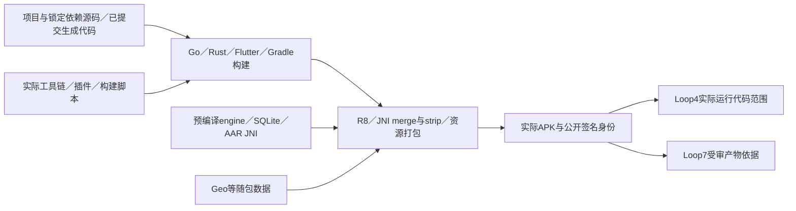

# Loop 5：源码对应、官方工件与 Android 构建信任

本轮建立实际源码、第三方组件、构建工具、缓存和最终 APK 的对应关系，处置来源未知或被替换的执行内容。依据[共同安全目标](../security_requirements.md)，对应[审计基线](../android_security_baseline.md) A-08、A-09、A-14。
阶段拆解及T01／T02设计和实现经M1通过，已交付并完成M普通fork推送及独立远端核实；用户2026-11-06授权连续完成后续任务，用户2026-11-07明确延期[原EasyTier源码／生成缺口](../deferred_security_items.md#loop5-t03-easytier-wasm-源码与生成对应)后，T03按调整范围已交付并完成M远端收尾，T04已通过完整实现评审并本地交付于`90593590095743dd2c3ba9aa528b999bed666082`，I1／I2均闭合，M已完成普通fork推送并独立核实`e947c0374b9f091e300c1d76c91ac1af9cf97cd0`；用户2026-11-08取消T05及本轮后续，T01–T04已交付，T05未交付，本轮不继续。单层任务、归属及交付定稿历史由[Tasks](loop5_tasks.md)维护，实际对象与证据边界见[来源基线](../android_build_sources.md)。

按用户取消及释放磁盘的要求，Loop5本地构建、下载材料、缓存、实验工作树和原始证据已清理。T01–T04已交付源码及任务定稿仍沿Git历史读取，旧本地证据路径不再可用；T05未交付。

## 中止记录

2026-11-08用户因本轮验证累计磁盘占用过大，决定中止Loop5的继续推进。
多次隔离准备分别保留了SDK／NDK／工具链、依赖缓存、源码工作树和编译中间产物，失败环境也持续留存；
清理中的一次扫描仅T05两套准备目录就约30.3GiB。该数是当时的目录统计，不是清理后的当前占用，
也不作为清理前全部占用的精确分账。

中止时T01–T04已交付，范围及历史提交见[Tasks](loop5_tasks.md)。T05完成过设计和部分局部实现／验证，
中止前本地报告24项针对性测试及固定SDK reader的两次新JVM检查通过；完整Android构建、
最终APK对账及整项实现评审未完成，没有新APK或T05交付提交。未交付代码及草案已撤回，
上述局部结果不属于当前交付版本的能力。

本轮状态为用户中止，不记为完成或验收通过；不再构建、追加验证或接续T05，也不自动启动其它Loop。
已交付成果保留，原EasyTier源码／生成缺口仍按既有备忘延期。

## 本轮路径与当前边界

先从实际Android ARM64 dev release APK逆向绑定装包内容和构建输入，再补来源接受依据、生成关系与构建约束，最后验证正常构建及错误输入的拒绝。
来源可信、源码可取得、由该源码生成、行为安全和漏洞可达是不同结论；本轮向Loop4提供实际代码范围，向Loop7提供可复核的制品绑定。

T01已交付来源说明及只读工具，复用现有APK和记录，未重新装配。T02已交付受管入口及相称验证，M已完成完整实现和I1复审；后续仍按真实依赖逐项设计、评审与交付，不抢跑未审方案，不推导升级、清用户缓存、设备或桌面操作。
Core／mihomo／依赖源码／gitlink／carrier不改；未来方案涉及这些范围时，交具体对象、缺口、影响及替代给M，不从本轮目标自动取得例外。
必要官方或项目配置来源的查询／下载仅发最少资源参数，材料留本地；不读取凭据、私钥、完整环境或真实用户材料，不上传源码、日志、APK、符号或截图。
本轮后续授权已由用户2026-11-08的取消决定覆盖，不接续T05或启动其它Loop。T01–T04已交付结论保留，T05未交付。

## 需求与正向价值

用户需要本机可持续构建、审查真实执行内容并同步官方修复。Flutter 引擎、Android SDK/NDK、JDK、Gradle/Maven 等提供必要平台能力，源码与预编译工件均应能说明来源和作用。

目标是回答“执行了什么、下载了什么、哪份源码生成了什么、最后装入什么”，并约束构建脚本和未经授权的传输。全面从源码重建所有官方组件不预设为完成条件，保留某个官方二进制仍需要实际核验和行为审查。

## 风险与不整改的后果

| 风险入口 | 当前事实与待核实边界 | 不处理时可能发生什么 |
| --- | --- | --- |
| 下载与版本引用 | T01发现的Wrapper、发布接受及tag缺口已由T02受管入口处理；直接旁路、完整CI与跨次派生缓存仍待T04 | 未覆盖的入口仍可能执行不同内容或污染 APK，不能把受管入口的局部保证扩大 |
| 实际工具与声明 | T02已固定正式Wrapper及同次工具选择；JNI选择NDK28.2，Native Assets hooks选择29.0 | 审核错误版本或不能复现；声明、现存缓存与本次执行须分别绑定，差异本身不证明篡改 |
| 随包可执行资产与信任数据 | 当前APK含EasyTier WASM的精确模块字节，生成源码关系未闭环；Android实际tag含no_zerotier，不能沿旧A-14声称装入ZeroTier根节点数据 | 未审执行代码可能进入产物；编入不证明已启用或联网，禁用项也不能由缓存／锁文件存在推导装包 |
| hooks、脚本与缓存 | 构建依赖脚本/缓存，本地禁上传流程仅覆盖部分任务 | 读取无关文件/密钥、上传符号/日志，或混入不对应当前源码的旧库 |
| 签名和最终包 | 既有本机构建为 Debug 签名 release APK，正式包条件仍需绑定 | 用户安装包与受审代码/配置不同，或错误签名与产物替换无法识别 |

## 已核来源事实与尚缺证据

实际装包关系、构建输入类别、工具选择及unknown已迁入[来源基线](../android_build_sources.md)，不在本阶段计划维护平行明细。
现有APK的10份native已有本地字节关系，401项／1DEX枚举和R8映射仍不等于完整输入或生成证明；已有12源路径绑定只覆盖局部改动。
T01建立只读对账与明确缺口入口，发布认证、WASM／预编译生成、缓存／CI约束继续分属后续任务，不以来源基线完成替代全Loop验收。

## 解决思路

- 维护实际 Android 构建/运行清单，区分项目源码、第三方源码、生成代码、官方工具二进制、运行二进制、数据及其它资产。记录版本/提交、发布者、渠道、摘要、用途、源码关系和进入 APK/构建进程的路径，覆盖传递依赖与动态下载。
- 补齐实际锁定版本源码和生成输入，确定 fork 相对上游的差异；重点可执行资产需要可审查的来源闭环。源码可取得、字节与模块相同、实际由该源码生成分别判断。
- 对 Flutter/Dart/引擎、Go/Rust、JDK、SDK/NDK、Gradle/插件及 Maven 工件核对官方发布身份、精确版本与完整性。包管理器重打包单独记录来源和补丁，不能冒称与官方原始工件完全一致。
- 固定关键引用，建立可信的摘要/签名和依赖验证基线。首次下载内容自行算出的摘要只记录身份，接受基线还需核实出处；哈希或签名也不证明行为安全。
  [Gradle文档](https://docs.gradle.org/current/userguide/dependency_verification.html)明确verification metadata的bootstrap信任当前取到的内容，必须另核接受依据；[Wrapper校验](https://docs.gradle.org/current/userguide/gradle_wrapper.html)也不能代替已缓存输入和bootstrap代码的核验。
- 对来源未知的可执行内容先核发布／生成关系，再决定是否确需重建、替换或约束；不预设全面重建。Android ZeroTier沿用已交付禁用，不重新引入；EasyTier仍在实际包内，若处置需要改Core／依赖源，必须另交决定，不能悄悄换为DIRECT或将关键unknown按清单完成结案。
- 核实实际编译器选择、缓存指纹与失效规则，检查最终库、资产、签名及调试符号的对应关系。可复现差异需要解释，不把时间戳/签名差异直接算作篡改。
- 收窄构建环境、凭据、文件和网络权限，区分必要只读下载与上传；工具遥测、CI 权限、发布/符号上传和签名密钥分别核验。禁用若干上传任务或清理环境变量不能代替完整边界审查。

## 收益与代价

收益是发现替换、来源缺口、缓存混入和隐蔽构建传输，让源码审查对应到安装包。代价是首次溯源、生成工具适配、版本固定维护及同步时的依赖复核。

逐组件说明保留/替换/重建及其信任条件；可核验官方预编译组件可进入候选清单，
采集行为接收[联网用途与覆盖结论](../android_network_inventory.md)、
缺陷由 [Loop 4](../loop4/loop4_plan.md)核验。
关键来源未知项需实际处置，不能靠列出清单变成已接受。

## 范围、依赖与完成方向

- 来源清单可先做，随着各轮代码/依赖修改更新实际输入。Geo 发布文件的具体比对与更新归 [Loop 6](../loop6/loop6_plan.md)，本轮记录其装包关系。
- T01独立交付实际来源基线与只读检查入口，不等待所有后续认证完成；T02／T03／T04按真实对象补获取、生成与构建约束，T05汇总正常及反例的最终产物绑定。具体依赖及出口只在[Tasks](loop5_tasks.md)维护。
- 向 Loop 4 提供实际运行组件和源码范围，向 [Loop 7](../loop7/loop7_plan.md)提供受审构建输入、最终工件及签名/符号绑定。
- 完成时关键执行内容有可信来源和可说明的源码关系，官方发布身份核验可复核，错误工件/版本/缓存受到约束，正常本机构建可用。
- 缺少源码、无公开签名或不能证明历史生成关系时如实记录证据强度及处置；不能用编译成功或“官方”两个字掩盖缺口。
- 已知关键执行内容来源缺口未处置时不宣称本轮整体通过；原EasyTier源码／生成关系仅按上述用户决定明确延期，不升级其来源或风险结论。超出no-Core范围的部分及时交M决定，其余独立工作不受牵连。About UI已有5项原基线失败不在本轮顺手清修；DNS R1／Core日志race、Loop6延期备忘及其它未授权Loop保持原结论。
- 按[官方同步约定](../../../../CONTRIBUTING.md)分开维护版本锁、生成输入和必要窄补丁；同步后比较依赖、构建标签、下载来源、上传路径和最终包变化。

依据入口：[构建指南](../../../development/android_build_guide.md)、[Gradle 配置](../../../../android/settings.gradle.kts)、[Wrapper](../../../../android/gradle/wrapper/gradle-wrapper.properties)、[Native Assets 参数](../../../../plugins/setup/setup_hooks/lib/src/options.dart)、[构建工作流](../../../../.github/workflows/build.yaml)、[EasyTier](../../../../core/Clash.Meta/adapter/outbound/easytier.go)、[ZeroTier Android拒绝分支](../../../../core/Clash.Meta/adapter/outbound/zerotier_stub.go)。
